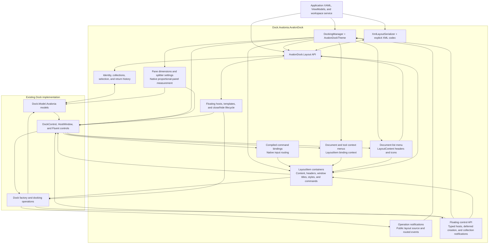

# AvalonDock compatibility

`Dock.Avalonia.AvalonDock` lets an Avalonia application use the
`AvalonDock` C# namespaces and layout names. The implementation wraps
`Dock.Model.Avalonia` models and renders them through Dock's controls. It is an
in-progress compatibility project; the
[acceptance checklist](https://github.com/wieslawsoltes/Dock/blob/feature/avalondock-compatibility/src/Dock.Avalonia.AvalonDock/COMPATIBILITY.md)
records implemented behavior and remaining API gaps. WPF controls, dependency
properties, and assemblies require their Avalonia counterparts.

The CLR namespaces are `AvalonDock.*`; update using directives and any explicit
CLR namespace declarations when porting source from the WPF library. The
assembly/package name remains `Dock.Avalonia.AvalonDock`.

## Reference the package and theme

The project builds NuGet packages for .NET 8 and .NET 10. To try the package from
this branch before publication, build it from the Dock repository:

```sh
dotnet pack src/Dock.Avalonia.AvalonDock -c Release -o artifacts/avalondock-nuget
```

Add that directory as a local NuGet source in your consuming application and
reference the generated `Dock.Avalonia.AvalonDock` package version. Keep your
normal package sources configured for its dependencies. The package references
Dock's Avalonia model and Fluent theme; use compatible Avalonia package versions.

In `App.axaml`, with the default `xmlns="https://github.com/avaloniaui"`, add:

```xml
<Application.Styles>
  <FluentTheme />
  <AvalonDockTheme />
</Application.Styles>
```

`AvalonDockTheme` includes Dock's Fluent resources and the manager/content
templates that connect the compatibility API to Dock's controls.

## Declare a layout in XAML

Place this layout inside an Avalonia view. Declare `x:DataType` on the view for
its ViewModel when using compiled bindings. This example uses literal content:

```xml
<DockingManager x:Name="DockManager">
  <LayoutRoot>
    <LayoutPanel Orientation="Horizontal">
      <LayoutAnchorablePane DockWidth="240">
        <LayoutAnchorable ContentId="properties" Title="Properties">
          <TextBlock Text="Workspace properties" Margin="12" />
        </LayoutAnchorable>
      </LayoutAnchorablePane>
      <LayoutDocumentPane>
        <LayoutDocument ContentId="readme" Title="Readme">
          <TextBox Text="Editable document" AcceptsReturn="True" />
        </LayoutDocument>
      </LayoutDocumentPane>
    </LayoutPanel>
  </LayoutRoot>
</DockingManager>
```

The assembly maps the manager, layout, and theme namespaces to Avalonia's
default XML namespace, so these elements require no AvalonDock prefix.
The Xceed XML namespace is also supported:

```xml
<Window xmlns="https://github.com/avaloniaui"
        xmlns:ad="http://schemas.xceed.com/wpf/xaml/avalondock">
  <ad:DockingManager>
    <ad:LayoutRoot>
      <ad:LayoutPanel>
        <ad:LayoutDocumentPane>
          <ad:LayoutDocument Title="Document">
            <TextBlock Text="Avalonia content" />
          </ad:LayoutDocument>
        </ad:LayoutDocumentPane>
      </ad:LayoutPanel>
    </ad:LayoutRoot>
  </ad:DockingManager>
</Window>
```

`ad` is an arbitrary alias. Using a prefix can make the library boundary
explicit in a mixed XAML file; it does not change the layout's behavior.

The original WPF library maps its types to the Xceed URI and suggests `xcad`
in its [assembly namespace declarations](https://github.com/xceedsoftware/wpftoolkit/blob/2c71faba5eecc1b6ae6cd3d269408e0df37715d8/ExtendedWPFToolkitSolution/Src/Xceed.Wpf.AvalonDock/Properties/AssemblyInfo.cs).
A prefix lets a WPF view keep the usual WPF presentation namespace as its
default. Unprefixed AvalonDock elements are also possible by making the Xceed
URI the default on that subtree; WPF controls inside it then need their own
prefix or a reset default namespace. This adapter additionally maps to
Avalonia's default namespace, so the first example can mix unprefixed
AvalonDock and Avalonia elements directly.

## Use the C# layout API

The following code belongs in a workspace service called by ViewModel commands.
`manager` is the `DockingManager` declared above, supplied by application startup.
The sample uses an `ILayoutWorkspace` interface so its ViewModel has no Avalonia
dependency and its view code-behind only initializes XAML.

```csharp
using System.Linq;
using AvalonDock.Layout;
using AvalonDock.Layout.Serialization;

LayoutDocument document = manager.Layout.Descendents()
    .OfType<LayoutDocument>().Single(item => item.ContentId == "readme");
LayoutAnchorable properties = manager.Layout.Descendents()
    .OfType<LayoutAnchorable>().Single(item => item.ContentId == "properties");

document.IsActive = true;
document.Float();
document.Dock();

properties.Hide();
properties.Show();
properties.ToggleAutoHide();

new XmlLayoutSerializer(manager).Serialize("layout.xml");
new XmlLayoutSerializer(manager).Deserialize("layout.xml");
```

Content methods operate through the native Dock factory. Closing and hiding
honor the corresponding capabilities and cancelable events. A tool's return
pane and tab position are retained when it floats, docks, hides, or is restored.
After deserialization, look up layout nodes again: the manager now owns a new
layout tree, while content can retain its application identity.

## Bind item containers and commands

`DockingManager.GetLayoutItemFromModel` returns a `LayoutDocumentItem` or
`LayoutAnchorableItem` from `AvalonDock.Controls`. Its `LayoutElement` is the
layout node and its `Model` is the application content. Title, identifier,
icon, selection, active state, and capabilities synchronize with the live model.

```csharp
using AvalonDock.Controls;

LayoutItem? item = manager.GetLayoutItemFromModel(document);
if (item?.FloatCommand is { } floatCommand && floatCommand.CanExecute(null))
    floatCommand.Execute(null);
```

A view whose data context is the returned container can bind its commands
using the default XML namespace:

```xml
<StackPanel x:DataType="LayoutItem">
  <TextBlock Text="{Binding Title}" />
  <Button Content="Activate" Command="{Binding ActivateCommand}" />
  <Button Content="Float" Command="{Binding FloatCommand}" />
  <Button Content="Close" Command="{Binding CloseCommand}" />
</StackPanel>
```

The default ReactiveUI commands cover closing, floating, activation, docking as
a document, closing document sets, splitting document panes, and moving between
adjacent document panes. Tool containers add hide, auto-hide, and dock commands.
Document-group commands honor `CanMove` and the manager's
`AllowMixedOrientation` setting. Closing document sets uses each container's
current `CloseCommand`, including application replacements, and honors close
capabilities and cancellation. Individual command properties can be replaced
or bound to application commands.

Containers retain identity during moves, floating, auto-hide, and tool hiding.
Removal detaches a container after the current layout mutation; replacing or
deserializing the manager's layout detaches the old containers immediately.
Resolve containers again after loading. Detachment disables and releases
default commands without disposing application commands. `IsVisible` hides or
shows tools and closes documents, honoring cancellation; Avalonia does not
provide WPF's separate `Hidden` and `Collapsed` states.

`View` is the compiled content presenter used by the native Dock controls. It
moves with its content between docked and floating hosts. Native document close
buttons, tool title-bar close/pin buttons, context menus, tab middle-clicks, and
tab double-clicks use the current container commands in docked and floating
hosts. Menus on auto-hide strips use the same tool container. Command parameters
are null, so parameterless `ReactiveCommand` properties work directly.

Tool title-bar close buttons use `CloseCommand` when `CanClose` is true and
`HideCommand` otherwise. A disabled command cannot fall through to the native
factory's default action. Floating-tool close commands run before the host's
window-close action, preserving application overrides and close/hide
cancellation. Native window decoration close requests still use the window
lifecycle and its cancellation events. Calling layout methods such as `Close`
or `Float` directly invokes model operations, independently of UI commands.

`DockAsDocumentCommand` returns a floating document to its previous document
pane. Without a previous document pane, docking chooses the last focused main
document pane or another main document pane, creating one when necessary.

## Bind ViewModel content

`DocumentsSource` and `AnchorablesSource` accept observable collections of
application objects. With a view's `x:DataType` set to a ViewModel exposing
`Documents` and `Tools`, bind the sources and provide typed templates:

```xml
<DockingManager DocumentsSource="{Binding Documents}"
                AnchorablesSource="{Binding Tools}">
  <DockingManager.DataTemplates>
    <DataTemplate DataType="{x:Type vm:EditorViewModel}"
                  x:DataType="vm:EditorViewModel">
      <TextBox Text="{Binding Text, Mode=TwoWay}" AcceptsReturn="True" />
    </DataTemplate>
    <DataTemplate DataType="{x:Type vm:PropertiesViewModel}"
                  x:DataType="vm:PropertiesViewModel">
      <TextBlock Text="{Binding Description}" Margin="12" />
    </DataTemplate>
  </DockingManager.DataTemplates>
</DockingManager>
```

Here `vm` refers to the application's ViewModel namespace. The ViewModels derive
from `ReactiveObject`; editing properties must notify changes. Keep UI logic in
commands and services. Container styles can bind each generated layout item's
title and stable `ContentId`. A `LayoutUpdateStrategy` can also set these values
and choose its destination pane. There is no implicit mapping from a
ViewModel's property names to these layout properties.

Source additions, removals, replacements, and resets update the live layout.
Moving a source entry preserves the user's tab order. Resetting a source clears
all layout items of that type, including manually inserted items. Floating
hosts resolve content templates from the manager's current scope, including
ancestor templates.

## Style item containers

`LayoutItemContainerStyle` accepts an Avalonia `ControlTheme`. Its target is a
`LayoutItem`, `LayoutDocumentItem`, or `LayoutAnchorableItem`, and the container
is its own data context. Compiled bindings access the application ViewModel
through `Model`. For a document collection whose `EditorViewModel` exposes
`Title`, `ContentId`, `CanClose`, and `CanFloat`:

```xml
<DockingManager DocumentsSource="{Binding Documents}">
  <DockingManager.LayoutItemContainerStyle>
    <ControlTheme TargetType="LayoutItem" x:DataType="LayoutItem">
      <Setter Property="Title" Value="{Binding ((vm:EditorViewModel)Model).Title}" />
      <Setter Property="ContentId" Value="{Binding ((vm:EditorViewModel)Model).ContentId}" />
      <Setter Property="CanClose" Value="{Binding ((vm:EditorViewModel)Model).CanClose, Mode=TwoWay}" />
      <Setter Property="CanFloat" Value="{Binding ((vm:EditorViewModel)Model).CanFloat}" />
    </ControlTheme>
  </DockingManager.LayoutItemContainerStyle>
</DockingManager>
```

Use one-way bindings unless the ViewModel must also receive changes made by
Dock. The two-way `CanClose` binding above demonstrates that option. Titles,
identifiers, and capabilities affect the same native models that Dock renders.
Containers belong to the manager's logical tree, so themes can use manager and
ancestor resources, including `DynamicResource`, while content is floating.
Shared setters can live in a base theme referenced through `BasedOn`.

For different document and tool types, set `LayoutItemContainerStyleSelector`
to an `AvalonDock.Controls.StyleSelector` subclass. This is the counterpart of
WPF's `StyleSelector`; its result is an Avalonia `ControlTheme`:

```csharp
using Avalonia;
using Avalonia.Styling;
using AvalonDock.Controls;

public sealed class WorkspaceStyleSelector : StyleSelector
{
    public ControlTheme? EditorStyle { get; set; }
    public ControlTheme? PropertiesStyle { get; set; }

    public override ControlTheme? SelectStyle(object? item, AvaloniaObject container)
        => item switch
        {
            EditorViewModel => EditorStyle,
            PropertiesViewModel => PropertiesStyle,
            _ => null
        };
}
```

Declare the themes and selector in XAML resources and assign the selector with
`StaticResource`. The selector receives the application object and its actual
item container. An explicit `LayoutItemContainerStyle` takes precedence.
Changing either manager property reapplies the style; replacing content
selects a theme for the new object and detaches the old typed bindings first.
A null selection removes the previously selected theme while preserving the
live layout state. Styles also apply to new source entries and hidden tools.

Command setters bind application `ReactiveCommand` properties through `Model`,
just like metadata. For example, add this setter to the document theme when
`EditorViewModel.CloseCommand` implements the application's close workflow:

```xml
<Setter Property="CloseCommand" Value="{Binding ((vm:EditorViewModel)Model).CloseCommand}" />
```

The tab close button, Close menu item, and middle-click then invoke that
command. Replacing the command or changing its `CanExecute` updates the UI.
Replacing a theme or restoring XML releases its bindings without disposing
application commands; available defaults return when the style stops supplying
a command.

## Customize document and tool context menus

`DocumentContextMenu` and `AnchorableContextMenu` accept Avalonia `ContextMenu`
instances. Each open menu receives the relevant `LayoutItem` as its data context,
so compiled bindings can use container commands and metadata directly:

```xml
<DockingManager>
  <DockingManager.DocumentContextMenu>
    <ContextMenu x:DataType="LayoutItem">
      <MenuItem Header="Close" Command="{Binding CloseCommand}" />
      <MenuItem Header="Float" Command="{Binding FloatCommand}" />
    </ContextMenu>
  </DockingManager.DocumentContextMenu>
  <DockingManager.AnchorableContextMenu>
    <ContextMenu x:DataType="LayoutAnchorableItem">
      <MenuItem Header="Hide" Command="{Binding HideCommand}" />
      <MenuItem Header="Auto Hide" Command="{Binding AutoHideCommand}" />
    </ContextMenu>
  </DockingManager.AnchorableContextMenu>
  <!-- Add a LayoutRoot or bind the content sources here. -->
</DockingManager>
```

The enclosing view declares the default Avalonia XML namespace and `x` namespace,
as in the layout example above. No `avalondock` prefix is required. Use `Model`
to reach application content or `LayoutElement` to reach the public layout node.
A tool docked in a document pane uses `DocumentContextMenu`, with its existing
`LayoutAnchorableItem` as the binding context.

Tool menus also apply to title bars, their menu buttons, and auto-hide strips.
Both properties work in floating windows. Keyboard context-menu requests from
pane content use the active item, while a child control's own context menu or
flyout takes precedence, including when its opening is canceled. Title-bar menus
track active-tool changes; tab menus keep the requested tab's item.

The adapter theme supplies separate default menus per manager. Assigning `null`
(or `{x:Null}` in XAML) disables the corresponding menu. Replacing a menu closes
the old invocation; clearing the local property value restores the theme default.
Application menu opening can be canceled using Avalonia's `Opening` event.
Closing, detaching, or replacing the layout clears the invocation's data context
and placement references. The application retains ownership of its menu items
and commands.

## Select content templates

`LayoutItemTemplate` applies an explicit Avalonia `IDataTemplate` to application
content in both docked and floating panes. For example, when every document
uses the same ViewModel type:

```xml
<DockingManager DocumentsSource="{Binding Documents}">
  <DockingManager.LayoutItemTemplate>
    <DataTemplate x:DataType="vm:EditorViewModel">
      <TextBox Text="{Binding Text, Mode=TwoWay}" AcceptsReturn="True" />
    </DataTemplate>
  </DockingManager.LayoutItemTemplate>
</DockingManager>
```

For different content types, use `LayoutItemTemplateSelector`. The WPF selector
counterpart is `AvalonDock.Controls.DataTemplateSelector`: override
`SelectTemplate(object?, AvaloniaObject)` and return an Avalonia `IDataTemplate`.
The arguments are the application content and its actual `ContentPresenter`.
The selector can refer to compiled templates declared in XAML resources:

```csharp
using Avalonia;
using Avalonia.Controls.Templates;
using AvalonDock.Controls;

public sealed class WorkspaceTemplateSelector : DataTemplateSelector
{
    public IDataTemplate? EditorTemplate { get; set; }
    public IDataTemplate? PropertiesTemplate { get; set; }

    public override IDataTemplate? SelectTemplate(object? item, AvaloniaObject container)
        => item switch
        {
            EditorViewModel => EditorTemplate,
            PropertiesViewModel => PropertiesTemplate,
            _ => null
        };
}
```

Set `LayoutItemTemplateSelector` to an instance of this selector. An explicit
`LayoutItemTemplate` takes precedence. When the selector returns null, normal
manager, ancestor, and application data-template lookup applies. Inline
controls and Dock template content retain Dock's native content handling.
Changing either manager property updates existing presenters; changing content
selects the appropriate template for the new object. Recycling is limited to
controls built by the same selected template. An explicit template can also
display null content.

## Customize the document list menu

Each native document tab strip has an **Open documents** button. Its menu lists
that pane's `ChildrenSorted`, including tools docked as documents. Collection
changes refresh an open menu without rearranging the tabs. Selecting an entry
uses its current `LayoutItem.ActivateCommand`; command enablement and the layout
node's `IsEnabled` apply to the entry.

The manager exposes separate templates for the entry header and icon. Both
receive the public `LayoutContent`, not the application object in `Content`.
For example, these properties go inside a `DockingManager` using Avalonia's
default XML namespace:

```xml
<DockingManager.DocumentPaneMenuItemHeaderTemplate>
  <DataTemplate x:DataType="LayoutContent">
    <TextBlock Text="{Binding Title}" FontWeight="SemiBold" />
  </DataTemplate>
</DockingManager.DocumentPaneMenuItemHeaderTemplate>
<DockingManager.IconContentTemplate>
  <DataTemplate x:DataType="LayoutContent">
    <Image Source="{Binding IconSource}" Width="16" Height="16" />
  </DataTemplate>
</DockingManager.IconContentTemplate>
```

`DocumentPaneMenuItemHeaderTemplateSelector` takes precedence over the explicit
menu header template. With no menu header template or selector, the menu uses
`DocumentHeaderTemplate`, then the default title text. Assigning a document
header selector also supplies the menu selector if the latter is unset.

`IconContentTemplateSelector` receives the public layout node and the owning
Avalonia `MenuItem`. It takes precedence while preserving the explicit
`IconContentTemplate` value, so clearing the selector restores that template.
Without a custom icon template or selector, the menu displays `IconSource`.
`LayoutContent.IconSource` and `LayoutItem.IconSource` use Avalonia `IImage`.
Changes to templates and model metadata update an open menu. The same menu
behavior applies in native floating document windows, and layout replacement
closes the old invocation and releases its generated presentation.

## Size panes and splitters

`DockWidth` and `DockHeight` accept Avalonia `GridLength` values, including pixel
sizes such as `240` and star sizes such as `*` or `2*`. The manager exposes the
split gap separately for each layout direction:

| Manager property | Applies to | Default |
| --- | --- | --- |
| `GridSplitterWidth` | Width between horizontally arranged panes | 6 device-independent pixels |
| `GridSplitterHeight` | Height between vertically arranged panes | 6 device-independent pixels |

These properties can be set, bound, or styled. For example, with the default
Avalonia XML namespace:

```xml
<DockingManager GridSplitterWidth="8" GridSplitterHeight="6">
  <LayoutRoot>
    <LayoutPanel>
      <LayoutAnchorablePane DockWidth="240">
        <LayoutAnchorable Title="Properties" />
      </LayoutAnchorablePane>
      <LayoutDocumentPane>
        <LayoutDocument Title="Editor" />
      </LayoutDocumentPane>
    </LayoutPanel>
  </LayoutRoot>
</DockingManager>
```

Each nested or floating panel calculates pane proportions using its own available
space and the configured splitter gap. Pixel panes keep their requested size
when the host or gap changes, subject to available space and native constraints;
star panes share the remainder. Collapsed return panes and adjacent hidden
splitters do not consume this space. Native splitter dragging updates public
pane dimensions, which survive subsequent window resizing. Changing the group
orientation selects the corresponding manager setting.

The settings belong to one manager and update its existing floating windows.
XML restoration and view reattachment retain them as manager configuration;
they are not serialized as layout metadata. Native Dock controls outside the
adapter retain their default splitter size.

## Customize tab headers and window titles

Header templates receive the public layout node. Content templates receive the
application object stored in that node's `Content` property.

| Manager property | Native presentation | Template data |
| --- | --- | --- |
| `DocumentHeaderTemplate` | Document tabs, docked or floating | `LayoutContent` (documents and tools docked as documents) |
| `AnchorableHeaderTemplate` | Tool tabs and auto-hide strips | `LayoutAnchorable` |
| `AnchorableTitleTemplate` | Selected tool's title bar, including floating panes and auto-hide previews | `LayoutAnchorable` |
| `DocumentTitleTemplate` | Floating document window caption | `LayoutDocument` |

For example, add these properties to a manager declared in the default Avalonia
XML namespace:

```xml
<DockingManager.DocumentHeaderTemplate>
  <DataTemplate x:DataType="LayoutContent">
    <TextBlock Text="{Binding Title}" FontWeight="SemiBold" />
  </DataTemplate>
</DockingManager.DocumentHeaderTemplate>
<DockingManager.AnchorableHeaderTemplate>
  <DataTemplate x:DataType="LayoutAnchorable">
    <TextBlock Text="{Binding Title}" FontStyle="Italic" />
  </DataTemplate>
</DockingManager.AnchorableHeaderTemplate>
<DockingManager.AnchorableTitleTemplate>
  <DataTemplate x:DataType="LayoutAnchorable">
    <TextBlock Text="{Binding Title}" FontWeight="SemiBold" TextTrimming="CharacterEllipsis" />
  </DataTemplate>
</DockingManager.AnchorableTitleTemplate>
```

`DocumentHeaderTemplateSelector`, `AnchorableHeaderTemplateSelector`, and
`AnchorableTitleTemplateSelector` accept
`AvalonDock.Controls.DataTemplateSelector`. `SelectTemplate` receives the
layout node and the actual presenter. A document-header selector should
also handle `LayoutAnchorable` when tools can be docked into document panes.

As in AvalonDock, header selectors take precedence: setting a selector clears
the explicit header template, and the template property is coerced to null
while a selector is present. A null selector result uses a title header.
Changing a manager header property updates existing docked, floating, and
auto-hide headers. Compiled bindings observe live title and metadata changes.
Native tab selection, activation, and auto-hide preview input continue to work.
XML restoration releases old header content and binds the replacement nodes.

Tool titles follow the selected tab independently of its tab header. The title
template and selector use the same precedence rules as header templates;
clearing both returns to the default title text. Runtime changes reach existing
tool title bars, including floating panes and open auto-hide previews. Native
context menus, title-bar buttons, and input handling remain available. Source
removal and XML replacement release the old title's model and manager references.

Floating document captions use `DocumentTitleTemplate` independently of tab
headers. For example:

```xml
<DockingManager.DocumentTitleTemplate>
  <DataTemplate x:DataType="LayoutDocument">
    <TextBlock Text="{Binding Title}" FontWeight="SemiBold" TextTrimming="CharacterEllipsis" />
  </DataTemplate>
</DockingManager.DocumentTitleTemplate>
```

`DocumentTitleTemplateSelector` receives the window's public `RootDocument`
and its actual presenter. Selector precedence and fallback follow the title
rules above. Replacing the root document, loading XML, or changing templates
updates the caption. The native window's text title also follows document
metadata, independently of the caption template.

Document hosts use a client caption with the manager's document context menu,
the current item close command, and maximize/restore controls. Caption dragging
uses Dock's native window drag helper and factory cancellation. Double-clicking
the caption maximizes or restores the window; buttons and other focusable
caption content retain their own input. Reattaching a manager recreates its
floating hosts while retaining layout models and application content. Keep a
stable data context for source bindings while the manager is detached.

## Observe docking and floating operations

`DockingManager` exposes four bubbling routed events: `PreviewFloat`, `Floated`,
`PreviewDock`, and `Docked`. Their `Source` is the public `LayoutContent`, while
the handler's sender is the manager or ancestor handling the event. Preview
notifications run before native movement; completion notifications run after
the operation. The protected `RaisePreviewFloatEvent`/`RaiseFloatedEvent` and
protected-internal `RaisePreviewDockEvent`/`RaiseDockedEvent` methods let derived
managers extend these notifications.

A workspace service can subscribe without putting handlers in view code-behind:

```csharp
using Avalonia.Interactivity;
using AvalonDock.Layout;

manager.Docked += OnDocked;

void OnDocked(object? sender, RoutedEventArgs args)
{
    if (args.Source is LayoutContent content)
        Console.WriteLine($"Docked: {content.ContentId}");
}

// Unsubscribe when the workspace service detaches.
manager.Docked -= OnDocked;
```

The events cover layout methods, float/dock commands, native menus, and native
drag execution. A group operation raises one pair: floating uses its selected
content, and docking uses its first content. Native validation does not raise
events or mutate the layout. Internal moves in a split or group operation do
not produce additional pairs. Reordering tabs and restoring a previous floating
pane without creating a new window are silent, matching the upstream paths.
Document tab-group commands are also silent. Floating an auto-hidden tool raises
its preview before Dock unpins it.

Despite the `Preview` names, these events bubble rather than tunnel. Setting
`Handled` affects event routing and does not cancel docking or floating. Native
capabilities still apply, and a rejected floating attempt does not raise
`Floated`. Exceptions release the operation scope, and changing the manager's
layout during a preview prevents stale completion notifications.

## Inspect native floating-window controls

`DockingManager.FloatingWindows` enumerates `LayoutFloatingWindowControl`
instances. These derive from Dock's `HostWindow` and are the actual Avalonia
windows displaying the floating layouts. Documents use
`LayoutDocumentFloatingWindowControl`; tool groups use
`LayoutAnchorableFloatingWindowControl`. Their `ILayoutControl.Model` is the
same public floating model found in `LayoutRoot.FloatingWindows`.

```csharp
using AvalonDock;
using AvalonDock.Controls;

foreach (LayoutFloatingWindowControl window in manager.FloatingWindows)
    Console.WriteLine($"{window.Model}: maximized={window.IsMaximized}");

manager.LayoutFloatingWindowControlCollectionChanged += OnFloatingWindowsChanged;

void OnFloatingWindowsChanged(object? sender,
    LayoutFloatingWindowControlCollectionChangedEventArgs args)
{
    Console.WriteLine(args.CollectionChangedEventArgs.Action);
}

// Unsubscribe when the workspace service detaches.
manager.LayoutFloatingWindowControlCollectionChanged -= OnFloatingWindowsChanged;
```

The event wraps the collection action, indices, and actual added or removed
controls. Canceling a close leaves the control registered. Removing a floating
model, closing its host, layout replacement, and detaching the manager remove
closed hosts. Reattachment
can create new control instances for the same persistent floating models, so
keep application state on the models. Native drag and window-state changes
update `IsDragging` and `IsMaximized`.

Hiding all tools hides their floating window while retaining the same control,
resources, geometry, item commands, and model. `LayoutAnchorable.Show()` restores
that host. A floating return pane retained after docking also keeps its hidden
host for reuse. These visibility changes do not add or remove manager controls
or duplicate native host registration. Hidden models loaded from XML or a
reattached view receive new unshown controls and become visible when restored.
Hidden windows are excluded from native docking hit tests and the optional
bring-windows-forward behavior during dragging.
An explicitly created window that has never been shown remains under the
caller's control until `Show()` is requested.

`RootDocumentLayoutItem` resolves a document host's current container.
`SingleContentLayoutItem` follows the selected content when a tool host has one
visible pane and becomes null when it has multiple panes. Its default binding
is compiled and uses `LayoutItemFromLayoutModelConverter`, also available under
`AvalonDock.Converters` and both supported XML namespaces. Application values
and bindings can override this default through Avalonia property precedence.
Use `CreateFloatingWindow` when you need to configure a window before displaying
it. The method moves a document or tool into a new native floating layout and
returns its **unshown** control. `PreviewFloat` and `Floated` describe the layout
move; native `WindowOpened` fires when the window is shown.

```csharp
LayoutFloatingWindowControl? window =
    manager.CreateFloatingWindow(document, isContentImmutable: true);
if (window is not null)
{
    window.Title = "Document workspace";
    window.Show();
}
```

The method returns null when floating is rejected. Documents must belong to a
pane; standalone panes and content from another manager can be transferred into
this manager. An unattached or auto-hidden tool is first placed in a temporary
pane. Unlike `LayoutContent.Float()`, creation always requests a new window.
It works before the manager is loaded, and nested creation requests keep their
own options. Set content floating bounds before calling it to choose the initial
position and size.

`isContentImmutable` prevents replacing the window's `Content` after it loads;
it does not make the hosted layout or document read-only. With false, custom
window content uses normal Avalonia content rendering. Derived floating controls
can also use the protected constructor's immutability option.

`LayoutAnchorableFloatingWindowControl.CloseWindowCommand` and
`HideWindowCommand` operate on all tools in that window. They check each model's
capability and its current container command, then forward the caller's parameter
to the current commands. Check `CanExecute` before calling `Execute` directly:

```csharp
// toolWindow is a LayoutAnchorableFloatingWindowControl.
if (toolWindow.HideWindowCommand.CanExecute(null))
    toolWindow.HideWindowCommand.Execute(null);
```

They can also be used in compiled bindings with the floating control as the
binding scope's data context:

```xml
<StackPanel x:DataType="LayoutAnchorableFloatingWindowControl">
  <Button Content="Close tools" Command="{Binding CloseWindowCommand}" />
  <Button Content="Hide tools" Command="{Binding HideWindowCommand}" />
</StackPanel>
```

Enablement follows membership, capabilities, command replacement, and application
`CanExecuteChanged` notifications. Execution snapshots the contents so a command
can remove its own tool; subsequent tools still use their current commands.
Content closing/hiding cancellation is preserved. Native window-close requests
check the factory veto first, then use the current close commands with a null
parameter, falling back to hide when the tool group cannot close. A command that
keeps content in place keeps the native window open. The protected `CanClose`,
`CanHide`, and `DoHide` hooks participate in this path. Closed hosts release their
command subscriptions without disposing application commands.

Derived floating controls can inspect the protected `CloseInitiatedByUser`
property. It starts true and becomes false when internal model cleanup, layout
replacement, or native window exit requests closure; cancellation does not reset
an internal request. Hiding and ordinary view unload preserve its value. As in
upstream, this records the internal-close request, not whether a human physically
clicked a button. Inspect it in Avalonia's `OnClosing(WindowClosingEventArgs)` or
`OnClosed(EventArgs)` overrides.

To enable arrow-key movement of floating windows, set the manager property:

```xml
<DockingManager AllowMovingFloatingWindowWithKeyboard="True">
  <!-- LayoutRoot and application content -->
</DockingManager>
```

It defaults to false and can also use a compiled ViewModel binding or a style
setter. The C# wrapper has a private setter, matching upstream; from a workspace
service use `manager.SetValue(DockingManager.AllowMovingFloatingWindowWithKeyboardProperty, true)`.
Unhandled arrow keys move the current floating document or tool window by 25
device-independent units, converted to desktop coordinates. Editors retain
their handled arrow keys, and window movement does not mark the key event
handled. Changes to the option take effect immediately for that manager's
existing hosts. Native position saving and XML persistence retain the moved
window's coordinates.

The floating-control surface is still being completed: resize-border customization,
exact close-event ordering, native cleanup cancellation and host registration,
and remaining protected/platform hooks are tracked in the compatibility checklist.

## Restore application content from XML

The XML describes layout structure and metadata; it does not serialize controls
or arbitrary ViewModels. A newly constructed `XmlLayoutSerializer` captures
existing content by `ContentId`. Construct it after the relevant content exists.
For a new application session, resolve IDs using a content registry:

```csharp
XmlLayoutSerializer serializer = new(manager);
serializer.LayoutSerializationCallback += (_, args) =>
{
    if (contentById.TryGetValue(args.Model.ContentId, out object? content))
        args.Content = content;
    else
        args.Cancel = true;
};
serializer.Deserialize("layout.xml");
```

`contentById` is an application-owned dictionary of stable identifiers to
ViewModels. Set `Cancel` to omit an unavailable item. Source collection
notifications are suspended while callbacks run, then resume even if loading
fails. Parsing and content resolution finish before replacing the manager's
layout. The runnable sample writes to a temporary file and replaces the saved
file after a successful save.

Docked, hidden, auto-hide, and supported floating layouts retain return
locations and floating geometry. Native grouped-document or mixed floating
shapes that the current AvalonDock hierarchy cannot represent are rejected
before an existing save file is overwritten.

Individual content, pane/group, root, and floating models also implement
`IXmlSerializable`. Their `WriteXml` methods write attributes and children inside
an element opened by the caller; `ReadXml` consumes that element. Content reads
preserve an existing `Content` object, group reads append children, and root
reads replace the hierarchy while retaining the native root and factory.
These methods do not resolve application content or return-container references;
use `XmlLayoutSerializer` for complete layout restoration and content callbacks.

## Implementation architecture



The facade wraps the same native objects that Dock renders and moves.
`LayoutModelContext` preserves wrapper identity, and `LayoutChildren` projects
native child lists as observable AvalonDock collections. Native changes flow
back into public ownership, selection, and active-content state. Compatibility
metadata, such as AvalonDock return-container references, remains in the adapter.

| AvalonDock API | Native Dock implementation |
| --- | --- |
| `LayoutRoot` | `RootDock` and its factory |
| `LayoutPanel`, document/tool pane groups | `ProportionalDock` |
| `LayoutDocumentPane` | `DocumentDock` |
| `LayoutAnchorablePane` | `ToolDock` |
| `LayoutDocument`, `LayoutAnchorable` | `Document`, `Tool` |
| `LayoutAnchorSide`, `LayoutAnchorGroup` | Projections over native pinned lists |
| Document/tool floating models | `DockWindow` and a floating `RootDock` |
| `LayoutDocumentFloatingWindowControl`, `LayoutAnchorableFloatingWindowControl` | Typed subclasses of the actual native `HostWindow` |
| `DockingManager` | A themed `DockControl` using the live root and factory |
| `LayoutDocumentItem`, `LayoutAnchorableItem` | Container state and commands over the same `Document`/`Tool` |

`LayoutFactory` extends the native Avalonia factory at the window-close and
batch-floating boundaries. It composes lifecycle helpers to honor AvalonDock
capabilities and return positions, then delegates actual movement to Dock.
`LayoutFloatingWindowPresenter`, the host factory, and scoped templates manage
floating presentation and preserve the manager's template lookup scope.
Window command adapters observe the current item containers and delegate to
their commands; native factory vetoes still precede content close/hide requests.
The optional `IDockWindowHostFactory` supplies the model at initialization and
when a host is recreated. `LayoutFactory` preserves the native ID-based and
application locators while making that model available to the manager's host
factory; nested requests and exceptions restore the previous request. A
separate registry observes native host identities and floating-model membership
to publish control additions and removals.
`LayoutFloatingWindowCreation` scopes per-content creation options around native
factory movement. The host prepares its native layout and geometry while
deferring presentation until the application shows it. Floating Dock controls
inherit the manager's host factory, including when a floating window is shown
before the main view.
The native content template obtains the corresponding `LayoutItem.View` from
the factory. That presenter selects manager content templates and delegates
inline controls and Dock template content to the native model's template path.
The item registry keeps containers in the manager's logical scope and applies
selected control themes. Compiled container bindings synchronize metadata and
capabilities with those same native models.
Header and tool-title template adapters translate native document/tool models
to their existing public wrappers before applying compiled templates. Their presenters
remain inside Dock's tab controls, auto-hide buttons, and tool chrome. Tool titles
observe the native pane's selected model. Closed containers release their
header bindings and native presentation parents.

Floating document captions bind to the public floating window's `RootDocument`
and compose native `HostWindow` state and drag handling. Pane content templates
pass public layout wrappers into their deferred presenters, then resolve the
same native-backed `LayoutItem.View`. This keeps native models out of competing
logical-parent relationships when tab and content hosts detach and reattach.

The native factory optionally implements `IDockOperationObserver`.
`DockManager.ValidateDockable` opens its scope only for validated execution,
before the first collection mutation. The adapter shares that scope with layout
methods and factory calls, suppressing duplicate notifications from internal
moves while allowing event handlers to operate other contents. Scopes release
their references on success or failure. Routed-event class handlers preserve
the public layout source through Avalonia's event routing without reflection.

The document list uses the native tab strip's right-content slot and Avalonia's
`MenuFlyout`. Its sorted entries bind to public layout contents, and their header
and icon presenters share the item container's template refresh and cleanup.
Selection invokes the current container activation command, which delegates
movement and active-content changes to the native factory.

`LayoutSizingPanel` extends Dock's proportional panel at the measurement boundary.
It translates public pane dimensions into native proportions using that panel's
available size, then delegates measurement, arrangement, and dragging to Dock.
Weak panel registrations invalidate both docked and floating views when an
explicit pane dimension changes. Floating hosts receive scalar splitter settings
through weak registrations, so discarded hosts do not stay alive through manager
property notifications.

`XmlLayoutSerializer` uses explicit codecs and content callbacks without
runtime type discovery. It restores the facade and its native models together.
The core docking algorithms, input handling, recycling, and control rendering
remain in Dock. See the [Dock architecture overview](dock-architecture.md) for
the native interaction pipeline.

## Sample and validation

From the repository root:

```sh
dotnet run --project samples/DockAvalonDockSample
dotnet test tests/Dock.Avalonia.AvalonDock.Tests -c Release
```

The [sample](https://github.com/wieslawsoltes/Dock/tree/feature/avalondock-compatibility/samples/DockAvalonDockSample)
demonstrates documents, tool panes, Agenda/Contacts auto-hide strips, floating,
and save/load commands. Its XAML adapts Xceed Live Explorer 3.7.0 and includes
the original Ms-PL license and attribution. The adapter implementation is new
MIT-licensed code.

The test project covers compiled default/Xceed namespaces, Headless input and
rendering, native model synchronization, XML, and lifecycle behavior. The
separate NuGet consumer builds against the packed assemblies. The
[compatibility checklist](https://github.com/wieslawsoltes/Dock/blob/feature/avalondock-compatibility/src/Dock.Avalonia.AvalonDock/COMPATIBILITY.md)
also describes the pinned API audit and the work still required before claiming
full compatibility.
