# AvalonDock compatibility

`Dock.Avalonia.AvalonDock` lets an Avalonia application use the
`AvalonDock` C# namespaces and layout names. The implementation wraps
`Dock.Model.Avalonia` models and renders them through Dock's controls. It is an
in-progress compatibility project; the
[acceptance checklist](https://github.com/wieslawsoltes/Dock/blob/feature/avalondock-compatibility/src/Dock.Avalonia.AvalonDock/COMPATIBILITY.md)
records implemented behavior and remaining API gaps. WPF controls, dependency
properties, and assemblies require their Avalonia counterparts.

The CLR namespaces are `AvalonDock.*`; update using directives and any explicit
CLR namespace declarations when porting source from the WPF library. The
assembly/package name remains `Dock.Avalonia.AvalonDock`.

Layout content starts with zero floating dimensions, letting Dock choose the
native window size unless an application supplies one. Document-list sorting
uses comparable application content when available and falls back to titles.
XML return destinations preserve explicit empty pane identifiers and are resolved
before content-recovery callbacks; an unset identifier is distinct from an empty
one. Return-container assignments notify before initializing an unset pane ID,
while identifier metadata itself does not raise property notifications.

## Reference the package and theme

The project builds NuGet packages for .NET 8 and .NET 10. To try the package from
this branch before publication, build it from the Dock repository:

```sh
dotnet pack src/Dock.Avalonia.AvalonDock -c Release -o artifacts/avalondock-nuget
```

Add that directory as a local NuGet source in your consuming application and
reference the generated `Dock.Avalonia.AvalonDock` package version. Keep your
normal package sources configured for its dependencies. The package references
Dock's Avalonia model and Fluent theme; use compatible Avalonia package versions.

In `App.axaml`, with the default `xmlns="https://github.com/avaloniaui"`, add:

```xml
<Application.Styles>
  <FluentTheme />
  <AvalonDockTheme />
</Application.Styles>
```

`AvalonDockTheme` includes Dock's Fluent resources and the manager/content
templates that connect the compatibility API to Dock's controls.

## Declare a layout in XAML

Place this layout inside an Avalonia view. Declare `x:DataType` on the view for
its ViewModel when using compiled bindings. This example uses literal content:

```xml
<DockingManager x:Name="DockManager">
  <LayoutRoot>
    <LayoutPanel Orientation="Horizontal">
      <LayoutAnchorablePane DockWidth="240">
        <LayoutAnchorable ContentId="properties" Title="Properties">
          <TextBlock Text="Workspace properties" Margin="12" />
        </LayoutAnchorable>
      </LayoutAnchorablePane>
      <LayoutDocumentPane>
        <LayoutDocument ContentId="readme" Title="Readme">
          <TextBox Text="Editable document" AcceptsReturn="True" />
        </LayoutDocument>
      </LayoutDocumentPane>
    </LayoutPanel>
  </LayoutRoot>
</DockingManager>
```

The assembly maps the manager, layout, and theme namespaces to Avalonia's
default XML namespace, so these elements require no AvalonDock prefix.
The Xceed XML namespace is also supported:

```xml
<Window xmlns="https://github.com/avaloniaui"
        xmlns:ad="http://schemas.xceed.com/wpf/xaml/avalondock">
  <ad:DockingManager>
    <ad:LayoutRoot>
      <ad:LayoutPanel>
        <ad:LayoutDocumentPane>
          <ad:LayoutDocument Title="Document">
            <TextBlock Text="Avalonia content" />
          </ad:LayoutDocument>
        </ad:LayoutDocumentPane>
      </ad:LayoutPanel>
    </ad:LayoutRoot>
  </ad:DockingManager>
</Window>
```

`ad` is an arbitrary alias. Using a prefix can make the library boundary
explicit in a mixed XAML file; it does not change the layout's behavior.

The original WPF library maps its types to the Xceed URI and suggests `xcad`
in its [assembly namespace declarations](https://github.com/xceedsoftware/wpftoolkit/blob/2c71faba5eecc1b6ae6cd3d269408e0df37715d8/ExtendedWPFToolkitSolution/Src/Xceed.Wpf.AvalonDock/Properties/AssemblyInfo.cs).
A prefix lets a WPF view keep the usual WPF presentation namespace as its
default. Unprefixed AvalonDock elements are also possible by making the Xceed
URI the default on that subtree; WPF controls inside it then need their own
prefix or a reset default namespace. This adapter additionally maps to
Avalonia's default namespace, so the first example can mix unprefixed
AvalonDock and Avalonia elements directly.

## Drag previews

Full-content drag previews are enabled by default. Dragging a document, tool, or
tool pane uses Dock's existing preview window or managed overlay and a snapshot of
its registered content visual, including application templates. Capturing before
the source switches tabs keeps the dragged editor visible; native code releases
the image when dragging ends. Document previews use the editor's
dimensions. To use a compact caption/status preview, set the Avalonia extension
`ShowDockablePreviewOnDrag="False"` on the manager. The setting applies to docked
and floating content at the start of each drag; other managers and Dock's global
`DockSettings.ShowDockablePreviewOnDrag` setting remain independent.

```xml
<DockingManager ShowDockablePreviewOnDrag="True">
  <LayoutRoot>
    <LayoutPanel>
      <LayoutDocumentPane>
        <LayoutDocument Title="Preview this editor">
          <TextBox Text="Drag the tab to see the full editor" />
        </LayoutDocument>
      </LayoutDocumentPane>
    </LayoutPanel>
  </LayoutRoot>
</DockingManager>
```

## Use the C# layout API

The following code belongs in a workspace service called by ViewModel commands.
`manager` is the `DockingManager` declared above, supplied by application startup.
The sample uses an `ILayoutWorkspace` interface so its ViewModel has no Avalonia
dependency and its view code-behind only initializes XAML.

```csharp
using System.Linq;
using AvalonDock.Layout;
using AvalonDock.Layout.Serialization;

LayoutDocument document = manager.Layout.Descendents()
    .OfType<LayoutDocument>().Single(item => item.ContentId == "readme");
LayoutAnchorable properties = manager.Layout.Descendents()
    .OfType<LayoutAnchorable>().Single(item => item.ContentId == "properties");

document.IsActive = true;
document.Float();
document.Dock();

properties.Hide();
properties.Show();
properties.ToggleAutoHide();

new XmlLayoutSerializer(manager).Serialize("layout.xml");
new XmlLayoutSerializer(manager).Deserialize("layout.xml");
```

Content methods operate through the native Dock factory. Closing and hiding
honor the corresponding capabilities and cancelable events. A tool's return
pane and tab position are retained when it floats, docks, hides, or is restored.
After deserialization, look up layout nodes again: the manager now owns a new
layout tree, while content can retain its application identity.

`manager.Layout.ActiveContent` is the public document or tool node, including
nodes in floating windows. `manager.ActiveContent` retains an explicitly assigned
object; activation from the layout publishes the layout node, as in WPF AvalonDock:

```csharp
document.Float();
manager.ActiveContent = document.Content; // Retains the application object.
manager.Layout.ActiveContent = document;
LayoutContent? activeNode = manager.Layout.ActiveContent;
object? applicationContent = activeNode?.Content;
```

Activation through either property, `IsActive`, a container command, or the
native Dock factory uses the owning native Dock root. Each native root retains
its own focused item. A layout assignment that does not change the active node
does not republish the manager value. Replacing `Layout` also leaves the manager
value intact until a subsequent activation change.

Manager lookup uses the first matching item: an application's object matches
`Content` by identity; a supplied layout node first uses its non-null `Content`,
then its non-null `ContentId`, then an empty-content match. `ContentId` initially
is null. Give distinct empty items distinct identifiers. Assigning null can
activate the first empty item; it is not an unconditional deactivation operation.

`ActiveContentProperty` supports styles and defaults to one-way binding. Specify
`Mode=TwoWay` when layout activation should update a bound ViewModel. The protected
`OnActiveContentChanged` hook runs after the layout update; its base implementation
raises `ActiveContentChanged`. Source updates follow the binding's configured
trigger, including explicit updates.

The adapter stays reflection-free and retains these Avalonia property-system rules:

| Operation | Avalonia adapter | WPF AvalonDock |
| --- | --- | --- |
| Assign a value over a one-way/default binding | Binding remains; later source changes still update the manager. | Assignment replaces the binding. |
| Assign a value over a two-way binding | Binding remains and follows its source-update trigger. | Same behavior in the measured scenarios. |
| `ClearValue` on a bound property | Binding remains; a two-way binding can publish the cleared value. | Binding is removed. |
| Remove a style after layout activation used `SetCurrentValue` | The current override can remain. | The style's removal clears that value. |

To remove a binding explicitly, dispose the subscription returned by `Bind`, or
dispose `BindingOperations.GetBindingExpressionBase(manager,
DockingManager.ActiveContentProperty)` before assigning a replacement. To discard a
retained current-value override after removing a style, call `ClearValue`.

`LastFocusedDocument` remembers the latest document or tool hosted in a document
pane. Activating an ordinary tool preserves that value. The previous and new
nodes notify `IsLastFocusedDocument`, and the root notifies `LastFocusedDocument`.
Window deactivation retains this history. The WPF notification order also permits
reentrant callbacks to redirect activation while the outer transition still records
its document history. Inspect the active node separately when redirecting focus
from these callbacks.

## Select and reorder pane contents

`LayoutDocumentPane` and `LayoutAnchorablePane` expose `SelectedContentIndex`
and `SelectedContent`. Setting the index, or setting a child's `IsSelected`,
updates the selected tab without changing `LayoutRoot.ActiveContent`. An invalid
index clears selection. Use `IsActive` or the item's activation command to also
activate it:

```csharp
pane.SelectedContentIndex = 1;
LayoutContent? selected = pane.SelectedContent;
if (selected is not null)
    selected.IsActive = true;
```

Selection property notifications bracket the update: `PropertyChanging` exposes
the old selected content and flags, and `PropertyChanged` exposes the new state.
A changed observer can immediately select another item or explicitly activate it.

When the selected item is removed, rooted document panes select and activate the
remaining child with the latest `LastActivationTimeStamp`. Equal timestamps retain
child order; this history rule includes disabled children. Detached document panes
and tool panes select the first enabled child, or remain unselected when no child
is enabled. Emptying a rooted document pane clears the root's active content and
document history, including when a tool in another pane was active. These rules
apply to public collections and removal through the native Dock factory.

`MoveChild(oldIndex, newIndex)` preserves the selected content and notifies changes
to its index. The protected `ChildMoved` hook runs after the move; an identical
index is a no-op. Tool panes also notify `CanClose`, `CanHide`, and
`IsDirectlyHostedInFloatingWindow` when their collection changes. `CanClose` and
`CanHide` are true for an empty tool pane, as no child disallows the operation.

## Extend content state and closing behavior

Derived documents and tools can override `OnIsSelectedChanged(bool oldValue,
bool newValue)` and `OnIsActiveChanged(bool oldValue, bool newValue)`. The native
model holds the state; reentrant callbacks can change it before an outer hook
runs. Activation arguments retain the previous and requested values. The hooks precede the
corresponding `PropertyChanged` notification; their base implementations raise
`IsSelectedChanged` and `IsActiveChanged`. The active hook's base implementation
also updates `LastActivationTimeStamp` on activation. Omitting the base call
suppresses those effects while retaining the underlying state change.

Ordinary activation hooks run after pane selection and root active content are
synchronized. Explicit nested assignments publish their hooks immediately, before
the outer assignment resumes. Native focus operations still coalesce temporary
native flag changes. Setting `IsActive=false` retains the root's active-content
reference and selected tab. An override can redirect activation to another content
item; the outer hook still reports its requested value. Throwing from a callback does not roll back
completed model changes; pending callbacks release their references and later
focus operations remain usable. Native floating hosts continue to bind their
title to the focused native content.

New documents and tools start with a null `ContentId`. When `Content` changes to
a named control, its name supplies a still-null identifier after content
notifications finish. Explicit identifiers and empty strings are retained. The
same content reference produces no notifications or identifier fallback; a
distinct object that compares equal still produces the content notifications.
Renaming a control does not change an existing identifier.

`LayoutItem.ContentId` is an independent, initially null container input. Changes
to it forward the value, including null, to the layout content. Model changes do
not overwrite it. Applications can bind the property explicitly in their
container theme when it should track a ViewModel identifier.

`OnClosing(CancelEventArgs)` and `OnClosed()` provide the corresponding close
overrides. Call their base implementations to raise `Closing` and `Closed`.
For example, an application model can veto a close until its workspace command
has saved or discarded changes:

```csharp
using System.ComponentModel;
using AvalonDock.Layout;

public sealed class WorkspaceDocument : LayoutDocument
{
    public bool HasUnsavedChanges { get; set; }

    protected override void OnClosing(CancelEventArgs args)
    {
        args.Cancel |= HasUnsavedChanges;
        base.OnClosing(args);
    }
}
```

The manager's `DocumentClosing` event runs before the document hook; manager
cancellation prevents that hook from running. The content can then cancel in its
override or event. On success, removal and layout cleanup finish before `OnClosed`,
so `Parent` and `Root` are null in the callback. The callback can insert the item
into another layout without subsequent cleanup undoing that insertion. The
originating manager raises `DocumentClosed` afterward. Public closes, item
commands, native factory operations, and floating-host closes use these hooks.

## Observe layout membership and parent changes

`LayoutRoot.ElementAdded` and `ElementRemoved` provide `LayoutElementEventArgs`.
Its `Element` is the public layout node whose parent transition entered or left
that layout. Attaching or removing a subtree reports its topmost transitioning
node; the events do not enumerate all descendants. Moving directly between panes
in the same root does not change root membership. A move that first detaches a
node and then reattaches it produces removal and addition notifications.

During public pane removal, the detached leaf raises `ElementRemoved` before
the pane replaces its selection and activation history. Removing a whole group
clears focus on its descendants before that membership notification.

Derived documents, tools, and other layout types can override
`OnParentChanging(ILayoutContainer?, ILayoutContainer?)`,
`OnParentChanged(ILayoutContainer?, ILayoutContainer?)`, and
`OnRootChanged(ILayoutRoot?, ILayoutRoot?)`. `Parent` still identifies the old
container during the changing hook and the new container during the changed
hook. The base root hook raises the membership events; call it when overriding
to retain that behavior. `RaisePropertyChanging` and `RaisePropertyChanged` are
also virtual. Parent property notifications bracket these hooks, and `Updated`
notifies the destination root afterward.

Native factory moves use the same callbacks. `Dock.Model.Avalonia.Core.DockableBase`
provides `OwnerChanging`, with `DockableOwnerChangingEventArgs` from
`Dock.Model.Core.Events`, so the adapter can notify before the native assignment.
Both public `Parent` assignments and native owner assignments check thread access
before observer callbacks or ownership projections change. A throwing changing
hook prevents that owner assignment; it does not roll back collection mutations
that a larger docking operation has already performed.

The content hooks also maintain pane selection. A document or tool clears
`IsSelected` before leaving its previous parent. An item that was already
selected while detached selects its destination pane when inserted. Selection
also synchronizes between panes and their native content flags before a layout
root attaches its factory. Public collection notifications occur after ownership
initialization, so observers can inspect the new parent and selected content.

Groups cache `IsVisible` and recompute it after parent and child changes.
The protected setter invokes `OnIsVisibleChanged`, whose base implementation
propagates visibility to ancestors. Call the base hook from an override to
preserve that propagation. Newly created empty, detached groups start visible
until their first computation; wrappers of existing native subtrees initialize
from the native hierarchy. An empty document pane stays visible outside a
`LayoutDocumentPaneGroup`; inside one, it requires visible content. The document
group itself remains visible. Tool panes and tool groups require a visible child,
while auto-hide sides require a group, including an empty retained return group.

Tool parent changes publish `IsVisible`, `IsVisibleChanged`, `IsHidden`, and
`IsAutoHidden` before the `Parent` property notification, even when the Boolean
values remain unchanged. Auto-hide sides resolve their edge before publishing
their new parent. Tool panes determine floating membership from the public
ancestor window; `IsDirectlyHostedInFloatingWindow` uses that window's visible
pane count, including nested groups. Panes observe their current parent group's
collection and release the old subscription when reparented.

The bridge preserves existing wrappers when native ownership joins separate
trees, without retaining an unrelated layout through its identity map. Floating
documents expose their public floating window instead of the internal native
document pane. During native moves, an existing item container remains available
to native rendering until ownership is reassigned and reconciliation completes,
allowing its content presenter to transfer between hosts. The public
`GetLayoutItemFromModel` API still returns null for an unattached node.

## Traverse layout nodes and edit groups

`AvalonDock.Layout.Extensions` queries the layout hierarchy through its public
interfaces. `Descendents()` is deferred and visits children in depth-first order.
`FindParent<T>()` excludes the starting element; `GetRoot()` returns a starting
root or walks `Parent`, without reading `ILayoutElement.Root`. An unmatched
reference or nullable value type returns null; requesting an unmatched
non-nullable value type retains the upstream null-reference cast error.
`GetSide()` locates the element within the nearest containing split panel.

Group operations through `ILayoutGroup` retain their method-specific checks:
`ReplaceChildAt` ignores an invalid index before inspecting the replacement;
`RemoveChild` and `ReplaceChild` require the group's child type, while a missing
compatible child is ignored. Public removals detach ownership and repair pane
selection before group observers run. Automatic root-focus cleanup waits for
that replacement selection, preserving activation history through reentrant
removals and throwing observers. Group and ancestor tree callbacks precede
the `ChildrenCount` notification; an earlier exception prevents later callbacks.
Native Dock operations retain ownership of their intermediate transitions and
auto-hide projections.

Layout objects inherit Avalonia's sealed identity equality: application layout
subclasses cannot override `Equals` or `GetHashCode` as upstream CLR models can.
Child collections require Dock-backed elements and reject duplicate membership
and cycles. Clearing a collection detaches its former children to preserve the
native model graph; upstream's plain collection reset can retain stale parents.

## Traverse the UI trees

`AvalonDock.Controls.Extentions` retains the spelling of the upstream helper
class and works with `AvaloniaObject` in place of WPF `DependencyObject`.
`FindVisualChildren<T>` and `FindLogicalChildren<T>` enumerate matching
descendants in depth-first child order, excluding the starting object.
`FindVisualAncestor<T>` finds the nearest matching visual ancestor;
`FindLogicalAncestor<T>` prefers logical parents and falls back to visual
parents at a template boundary. `FindLogicalAncestorsAndSelf` includes the
starting object before following that same parent chain.

```csharp
using System.Linq;
using AvalonDock;
using AvalonDock.Controls;

LayoutAnchorableControl? toolView = manager
    .FindVisualChildren<LayoutAnchorableControl>().FirstOrDefault();
DockingManager? owner = toolView?.FindLogicalAncestor<DockingManager>();
```

These methods query the current Avalonia UI trees, including Dock's native
controls. Use the layout model's `Descendents()` extension to walk layout nodes.
Logical descendant searches do not cross visual-only template boundaries. For
example, find a displayed auto-hide preview through the manager's visual
descendants, then query the preview's logical descendants for its content.
`FindVisualTreeRoot` walks to the topmost visual, using logical parents to reach
the visual tree from nonvisual objects. In Avalonia, that root can be a hosting
visual above a `Window`; use `FindVisualAncestor<Window>` to find the window.

Null inputs produce empty descendant/ancestor-and-self sequences or a null
root. The two nearest-ancestor methods reject null inputs. Visual searches
reject nonvisual starting objects; logical ancestor fallback also rejects a
nonvisual object without a logical parent. Searches are live and enumerations
are deferred, so a new search reflects reparenting and layout replacement.

## Bind item containers and commands

`DockingManager.GetLayoutItemFromModel` returns a `LayoutDocumentItem` or
`LayoutAnchorableItem` from `AvalonDock.Controls`. Its `LayoutElement` is the
layout node and its `Model` is the application content. Title, identifier,
icon, selection, active state, and capabilities synchronize with the live model.

```csharp
using AvalonDock.Controls;

LayoutItem? item = manager.GetLayoutItemFromModel(document);
if (item?.FloatCommand is { } floatCommand && floatCommand.CanExecute(null))
    floatCommand.Execute(null);
```

A view whose data context is the returned container can bind its commands
using the default XML namespace:

```xml
<StackPanel x:DataType="LayoutItem">
  <TextBlock Text="{Binding Title}" />
  <Button Content="Activate" Command="{Binding ActivateCommand}" />
  <Button Content="Float" Command="{Binding FloatCommand}" />
  <Button Content="Close" Command="{Binding CloseCommand}" />
</StackPanel>
```

The default ReactiveUI commands cover closing, floating, activation, docking as
a document, closing document sets, splitting document panes, and moving between
adjacent document panes. Tool containers add hide, auto-hide, and dock commands.
Document-group commands honor `CanMove` and the manager's
`AllowMixedOrientation` setting. Closing document sets uses each container's
current `CloseCommand`, including application replacements, and honors close
capabilities and cancellation. Individual command properties can be replaced
or bound to application commands.

Containers retain identity during moves, floating, auto-hide, and tool hiding.
Removal detaches a container after the current layout mutation; replacing or
deserializing the manager's layout detaches the old containers immediately.
Resolve containers again after loading. Detachment disables and releases
default commands without disposing application commands. `IsVisible` hides or
shows tools and closes documents, honoring cancellation; Avalonia does not
provide WPF's separate `Hidden` and `Collapsed` states.

`View` is the compiled content presenter used by the native Dock controls. It
moves with its content between docked and floating hosts. Native document close
buttons, tool title-bar close/pin buttons, context menus, tab middle-clicks, and
tab double-clicks use the current container commands in docked and floating
hosts. Menus on auto-hide strips use the same tool container. Command parameters
are null, so parameterless `ReactiveCommand` properties work directly.

`AvalonDock.Controls.LayoutDocumentControl` and `LayoutAnchorableControl` are
the public content controls inside those native panes. Their `Model` is the
layout node, and their read-only `LayoutItem` is the manager's existing container.
The default compiled control themes display that container's same `View`.
Documents and tools hosted in a document pane use `LayoutDocumentControl`;
ordinary tool panes and auto-hide previews use `LayoutAnchorableControl`.
Dock continues to own the tab strip, pane chrome, movement, and floating hosts.

Both controls can be used without a namespace prefix in compiled templates:

```xml
<DataTemplate x:Key="DocumentContent" x:DataType="LayoutContent">
  <LayoutDocumentControl Model="{Binding}" />
</DataTemplate>
<DataTemplate x:Key="ToolContent" x:DataType="LayoutAnchorable">
  <LayoutAnchorableControl Model="{Binding}" />
</DataTemplate>
```

The model must belong to a manager to resolve its `LayoutItem`. The same view
can have only one visual parent; presenting it elsewhere transfers it from its
previous host. Native presentation reuses controls when switching tabs, so a
control's model can change. Keep the model or item identity when tracking a
document, rather than retaining a particular generated control. Removed native
controls clear their model and container when the item detaches; an explicitly
assigned `Model` remains available after its container detaches.

The controls follow the model's `IsEnabled`. Disabling active content selects
the first enabled sibling, or clears pane selection if none remains. Document
controls are focusable by default; tool controls receive focus through their
editors. Keyboard focus activates the model, including an outer content model
when focus enters a nested manager. Focus returning from a floating-window
control retains the upstream activation exception. A native presenter's delayed
focus restoration cannot override a newer tab selection.

Document pointer-preview hooks activate only when the source is a visual whose
nearest parent `DockingManager` owns the model. Standalone presentations, foreign
managers, nonvisual sources, and unrooted models do not pass that ownership check.
The preview hooks still run for handled pointer events, as upstream. The focus
hooks have a separate contract: an explicit call from a derived control activates
its model even when the control is disabled; Avalonia controls normal focus
delivery.

Derived controls can override `OnModelChanged(AvaloniaPropertyChangedEventArgs)`
and use protected `SetLayoutItem(LayoutItem?)`. Call the base model hook to
preserve subscriptions, enablement, and container lookup. Base input hooks read
the current public `Model`, including a replacement or null model assigned while
a derived `OnModelChanged` override omits its base call. Document input hooks
are `OnPreviewGotKeyboardFocus(FocusChangedEventArgs)` and
`OnPreviewMouseLeftButtonDown` / `OnPreviewMouseRightButtonDown`
with `PointerPressedEventArgs`; tools expose
`OnGotKeyboardFocus(FocusChangedEventArgs)`. These use Avalonia event arguments.
The pointer hooks run on the tunnel route; the focus hooks run when Avalonia's
bubbling `GotFocus` reaches the control, so WPF preview-focus routing is not
reproduced exactly.

`AvalonDock.Controls.AnchorablePaneTitle` presents the selected tool inside
Dock's native title bar. Its `Model` is a `LayoutAnchorable`, and its read-only
`LayoutItem` is the same container used by the tool's content and commands.
The default theme applies the manager's `AnchorableTitleTemplate` or selector.
It works in docked panes, floating panes, and auto-hide previews. A custom host
can also use the public control directly:

```xml
<DataTemplate x:Key="ToolTitleControl" x:DataType="LayoutAnchorable">
  <AnchorablePaneTitle Model="{Binding}" />
</DataTemplate>
```

Titles are nonfocusable by default. A title release activates its tool. A press
followed by leaving a custom title inside a `LayoutAnchorablePaneControl` floats
that visual pane through Dock's factory. Outside a pane control, it floats only
the title's `Model`, even when that model belongs to a pane with other tools.
An auto-hidden tool also floats individually. A tool already in a single-pane
floating window starts that existing window's move. Native tool chrome retains
its own grip handling, so the title does not start a duplicate drag. Interactive
title children retain their handled input. Hosting a title under another manager
does not replace its explicit model: release activates that model, and a drag
outside a tool pane uses that model's owning manager.

Custom title dragging uses `HostWindow.TryBeginMoveDrag` to preserve native
`WindowMoveDragBegin` cancellation and drag completion. Canceling the window
drag leaves any preceding pane float in place. Headless tests cover this
lifecycle; platform window movement still needs desktop integration validation.

Derived titles can override `OnModelChanged(AvaloniaPropertyChangedEventArgs)`
and use `SetLayoutItem(LayoutItem?)`. The protected `OnMouseLeftButtonDown`,
`OnMouseLeftButtonUp`, `OnMouseMove`, and `OnMouseLeave` hooks receive Avalonia
`PointerPressedEventArgs`, `PointerReleasedEventArgs`, and `PointerEventArgs`.
Call their base implementations to keep the default behavior. Titles share the
content controls' weak model/container subscriptions, recycling, and generated
control cleanup; tracking a tool should use its model or container identity.

Tool title-bar close buttons use `CloseCommand` when `CanClose` is true and
`HideCommand` otherwise. A disabled command cannot fall through to the native
factory's default action. Floating-tool close commands run before the host's
window-close action, preserving application overrides and close/hide
cancellation. Native window decoration close requests still use the window
lifecycle and its cancellation events. Calling layout methods such as `Close`
or `Float` directly invokes model operations, independently of UI commands.

As in upstream AvalonDock, capability flags control the default UI commands;
some explicit model methods deliberately have different rules:

| Explicit model call | Contract |
| --- | --- |
| `content.Close()` | Closes even when `CanClose` is false. Document-manager, content, and native closing cancellation still apply. |
| `tool.ToggleAutoHide()` | Pins or restores a tool in an anchorable pane or auto-hide group even when `CanAutoHide` is false, including a floating tool. Hidden tools and tools in document panes stay in place. |
| `tool.DockAsDocument()` | Moves to a document pane even when `CanDockAsTabbedDocument` is false, then selects and activates the tool. |
| `content.Float()` | Reuses a previous floating pane regardless of `CanFloat`; creating a new window still requires the native float capability. Both paths select and activate the content. Floating an already floating item can create another window while keeping its original docked return pane. |

For example, an application can disable a document's close button while keeping
its own programmatic close workflow:

```csharp
document.CanClose = false;
var item = manager.GetLayoutItemFromModel(document);
// item.CloseCommand.CanExecute(null) is false.
document.Close(); // Still raises cancelable closing notifications.
```

These explicit methods do not temporarily enable capabilities. Default item
commands continue to check their flags and native Dock policies; close commands
also honor `CanCloseLastDockable`. Replacing a root/pane policy or a content
override refreshes command availability. Native `manager.DockFactory` methods
retain their own capability checks. The adapter reuses the factory's protected
close and pin operations to preserve native lifecycle events, ItemsSource
removal, pinned ownership, and cleanup.

`DockAsDocumentCommand` returns a floating document to its previous document
pane. Without a previous document pane, docking chooses the last focused main
document pane or another main document pane, creating one when necessary.

## Use public document and tool tabs

`AvalonDock.Controls.LayoutDocumentTabItem` and `LayoutAnchorableTabItem` are
public headers inside Dock's native document and tool tab containers. Both
accept a `LayoutContent` in `Model` and expose the manager's existing, read-only
`LayoutItem`. A tool docked as a document uses `LayoutDocumentTabItem` and keeps
its `LayoutAnchorableItem`. Auto-hide strips keep their separate native pin
presentation. Dock's native theme hides the tab strip when a tool pane contains
only one tool; the tool title remains visible.

The default themes use `DocumentHeaderTemplate` or `AnchorableHeaderTemplate`
and their selectors; their data remains the public layout node. Usually,
customize those manager templates. For an application-provided tab row, bind the
public controls to the live pane children. This resource can be declared in a
view using Avalonia's default XML namespace:

```xml
<DataTemplate x:Key="DocumentTabs" x:DataType="LayoutDocumentPane">
  <ItemsControl ItemsSource="{Binding Children}">
    <ItemsControl.ItemsPanel>
      <ItemsPanelTemplate>
        <StackPanel Orientation="Horizontal" />
      </ItemsPanelTemplate>
    </ItemsControl.ItemsPanel>
    <ItemsControl.ItemTemplate>
      <DataTemplate x:DataType="LayoutContent">
        <LayoutDocumentTabItem Model="{Binding}" />
      </DataTemplate>
    </ItemsControl.ItemTemplate>
  </ItemsControl>
</DataTemplate>
```

For tools, use `LayoutAnchorablePane` for the outer data type and
`LayoutAnchorableTabItem` for each header. Both controls also compile with the
historical `ad` namespace alias. Include `AvalonDockTheme` in the application or
host window so the controls receive their compiled themes.

Custom document tabs activate on left press; custom tool tabs activate on left
release. A document's middle-click invokes its current item `CloseCommand` when
the command can execute. `CanClose` controls the default command; replacing the
command can permit a middle-click action while `CanClose` is false. Explicit
native root/pane policies and per-item overrides still apply in their normal
precedence. The middle-click hook uses `LayoutItem` even when `Model` is unset
and preserves the event's handled state. Children that handle input keep it.
Dragging across a custom row calls the live pane's `MoveChild`; a bound
row follows the new collection order. Leaving the row floats that content and
starts its native window drag. Factory cancellation stops the window drag but
does not undo the preceding float. Native tab containers retain Dock's existing
selection, drag preview/drop, context-menu, and command input.

`LayoutDocument.CanMove`, model enablement, and native drag capabilities gate
tab dragging. The pane's and its immediate group's `CanRepositionItems` gate
reordering while still allowing an outside drag. The compatibility factory
implements the optional `Dock.Model.Core.IDockItemDragPolicy` so native tab input
honors these restrictions too. Factories without this policy retain Dock's
existing behavior; direct factory operations are unaffected. Restrictions
changed during a native gesture are checked before moving the item.

Derived controls can override `OnModelChanged(AvaloniaPropertyChangedEventArgs)`
and call protected `SetLayoutItem(LayoutItem?)`. Their protected mouse-named
hooks use Avalonia arguments: `OnMouseLeftButtonDown(PointerPressedEventArgs)`,
`OnMouseLeftButtonUp(PointerReleasedEventArgs)`, and
`OnMouseMove`, `OnMouseLeave`, and `OnMouseEnter` with `PointerEventArgs`.
`LayoutDocumentTabItem` additionally exposes
`OnMouseDown(PointerPressedEventArgs)` for middle-click handling. Call the base
hook to preserve its normal behavior. These are framework-control extension
points; application actions belong in bound ViewModel commands or services.
The document press and tool/title release activation hooks act on their model
even when called explicitly with a handled event, a foreign or focusable source,
or a disabled control. Avalonia controls normal routed input delivery; native
gesture policies independently determine whether a drag may start.

Weak model/container subscriptions follow manager transfers. XML replacement
clears generated tabs' old models and resolves the replacement nodes; custom
tabs retain an explicitly assigned model until its binding is updated. Dock can
recycle generated headers, so retain model or item identity instead of assuming
one control per document. Changing or detaching a custom tab cancels its pending
drag. Headless tests cover collection updates, capabilities, cancellation,
manager transfer, XML replacement, and retained-control lifetime. Native desktop
move behavior still needs platform integration validation.

## Style document and tool panes

`LayoutDocumentPaneControl` and `LayoutAnchorablePaneControl` derive from
`LayoutCachePaneControl`, an Avalonia `TabControl`. Their read-only `Model`
implements `ILayoutElement` and identifies the existing public pane;
`ItemsSource` is that pane's live `Children` collection. The default templates
host Dock's document/tool controls, retaining native tab input and the existing
`LayoutItem.View`. Floating document and tool panes use the same control themes.

Set `DockingManager.DocumentPaneControlStyle` and
`DockingManager.AnchorablePaneControlStyle` to Avalonia `ControlTheme` resources.
Use `BasedOn` to retain the default native presentation. Both the unprefixed
types below and the historical `ad:` XML namespace compile:

```xml
<ControlTheme x:Key="DocumentPaneAppearance"
              TargetType="LayoutDocumentPaneControl"
              BasedOn="{StaticResource {x:Type LayoutDocumentPaneControl}}"
              x:DataType="LayoutDocumentPaneControl">
  <Setter Property="MinHeight" Value="100" />
  <Setter Property="Tag" Value="{Binding $self.Model}" />
</ControlTheme>
```

Apply it with `DocumentPaneControlStyle="{StaticResource DocumentPaneAppearance}"`
on the manager. For tool panes, use `LayoutAnchorablePaneControl` as the target
and set `AnchorablePaneControlStyle`. Replacing either property updates existing
panes, including floating panes; clearing it restores their default theme.
Panes follow their owning manager's flow direction and theme after transfer.

Set `LayoutDocumentPane.ShowHeader="False"` to hide that pane's tabs, document
list menu, and separator. The selected content fills the available space and
keeps its view, selection, activation, and keyboard focus. For example, with the
ordinary Avalonia default XML namespace:

```xml
<LayoutDocumentPane ShowHeader="False">
  <LayoutDocument Title="Preview" ContentId="preview">
    <TextBox Text="Preview content" />
  </LayoutDocument>
</LayoutDocumentPane>
```

`ShowHeader` defaults to `true` and updates the current pane immediately. It is
saved in layout XML, works after restoring or reattaching the manager, and remains
independent for each docked or floating pane. Floating a document creates a new
pane with the default policy; docking back restores the original pane's policy.
The adapter also respects Dock's dynamic `DockDocumentControlTabStripVisible`
resource: either setting can hide the header. Custom pane templates can bind to
`Model.ShowHeader` to apply the same policy to their own header controls.

Changing the model's `SelectedContentIndex` updates the control without
activating another item. Setting a document control's `SelectedItem` or
`SelectedIndex` explicitly selects and activates that document; the tool control
selects without activation. Both support an empty selection. Tool-pane focus
activates its selected tool. Pane left/right presses require an unhandled event
and a source visual whose nearest parent manager owns the pane; a standalone
pane or pointer input inside a foreign or nested manager does not activate it.
Tool-pane focus hooks operate on selection without that pointer ownership test.
Collection-driven selection is applied
after item observers finish, and tab moves restore selection through the passive
model API. Ordinary Dock strips keep their existing selection defaults.

The upstream document-pane constructor is internal, so obtain its generated
control from the visual tree or target its type in a theme. The tool-pane
constructor is public: `new LayoutAnchorablePaneControl(existingPane)`. Its
protected `OnGotKeyboardFocus`, `OnMouseLeftButtonDown`, and
`OnMouseRightButtonDown` hooks use Avalonia focus/pointer arguments. Managers
expose `OnDocumentPaneControlStyleChanged` and
`OnAnchorablePaneControlStyleChanged` with `AvaloniaPropertyChangedEventArgs`.
`LayoutCachePaneControl.OnSelectionChanged(SelectionChangedEventArgs)` marks
empty-selection notifications handled before they bubble.

Avalonia manages logical children through a different, nonvirtual collection;
the WPF document pane's protected `IEnumerator LogicalChildren` override is not
provided. Grouped and mixed native windows use the additional
`LayoutGroupFloatingWindow` adapter. Pane presentation continues to use Dock's
content caching rather than creating an additional application view cache.

`DockingManager.LogicalChildrenPublic` exposes an enumerator over its current
Avalonia logical children, including the existing layout item containers.
Template visuals are excluded. Use a new enumerator after replacing the layout.

## Inspect and style split containers

`LayoutPanelControl`, `LayoutDocumentPaneGroupControl`, and
`LayoutAnchorablePaneGroupControl` derive from the public Avalonia
`LayoutGridControl<T>`. Each exposes the existing public layout node through
`Model` and reads its current `Orientation`. Their constructors are internal,
as upstream; use generated controls or target their types in styles. Both XML
namespace forms work, including these unprefixed compiled bindings:

```xml
<Style Selector="LayoutDocumentPaneGroupControl"
       x:DataType="LayoutDocumentPaneGroupControl">
  <Setter Property="Background" Value="Transparent" />
  <Setter Property="Tag" Value="{Binding $self.Model}" />
</Style>
```

After the manager loads, `manager.LayoutRootPanel` is the actual
`LayoutPanelControl` displayed for `manager.Layout.RootPanel`. For example:

```csharp
using AvalonDock.Controls;
using AvalonDock.Layout;

LayoutPanelControl? control = manager.LayoutRootPanel;
if (control?.Model is LayoutPanel panel)
{
    panel.Orientation = Avalonia.Layout.Orientation.Vertical;
    // control.Orientation now reads Vertical from the same model.
}
```

Compatibility grid styles disable layout rounding, matching WPF's default, so
fixed pixel requests and splitter limits remain exact when panes leave unused
space. Model minimums belong to the row/column definitions, allowing public pane
themes to set independent control minimums. Empty panes retain zero-length slots;
one splitter remains between visible panes separated by an empty pane.

The property starts as null. Replacing the root panel or deserializing a layout
replaces its control. Setting the property to null removes the displayed root;
restoring the previous control reuses the existing content views. Manager
subclasses can override `OnLayoutRootPanelChanged` with
`AvaloniaPropertyChangedEventArgs`. Detaching the manager releases the old
presenter, and reattachment displays the current root control. Split-container
controls set their local flow direction to left-to-right, matching upstream.

Document and tool pane groups normalize non-star child lengths to `1*` on their
split axis when initially displayed or rebuilt after direct-child, visibility,
or orientation changes. Existing star weights and cross-axis lengths remain
unchanged; hidden children also participate. A pixel length assigned after that
layout is honored until the next such rebuild. `LayoutPanelControl` applies no
star conversion. Mixed pixel/star layouts use actual Grid definitions and the
native splitter input described below.

The inherited `Children` collection contains public panes, nested public grids,
and `LayoutGridResizerControl` instances directly. The active axis exposes one
real definition per child. Hidden panes keep a zero-length definition, and only
gaps between visible panes consume splitter space. Reordering reuses pane controls.
Changes to model lengths, minimums, visibility, orientation and manager splitter
sizes update the definitions. Caller edits to those definitions affect layout
until model metadata updates them.

`DockableControlTracker` connects each grid to the native factory's bounds and
pointer tracking; `IProportionalSplitterHost` reuses native splitter input,
previews and cancellation. Pane content remains in compiled Dock templates.
After arrangement, pane sizes update native proportions without rewriting public
length units. Avalonia Grid preserves fixed lengths and measures `Auto` from
content and chrome. These controls also render floating tool groups.

## Lay out tab headers and handle overflow

`DocumentPaneTabPanel` and `AnchorablePaneTabPanel` are public Avalonia `Panel`
controls. The compatibility theme installs them in Dock's existing horizontal
document and tool tab strips, including floating windows. Both start with
`FlowDirection="LeftToRight"` and also compile through the historical XML URI.
Vertical native document strips keep their existing layout.

Document headers measure at their natural width. The panel displays the leading
headers that fit; once one overflows, the remaining headers are suppressed. A
newly selected hidden document moves to index zero through the live pane's
`MoveChild`, and its selected index follows. This changes the public collection
and its native Dock collection together; it is distinct from activating content.
The native document-list menu can activate an overflowed document and bring its
tab into view. A first header wider than the entire available area remains
suppressed until sufficient space is available.

Avalonia has no separate WPF `Visibility.Hidden` value. Overflowed headers retain
their measurement and application `IsVisible` value while temporary property
layers set opacity to zero and disable input/focus. Resizing restores the
underlying `Opacity`, `IsHitTestVisible`, and `IsEnabled` values and bindings.
Removing a header or detaching the panel releases those layers and subscriptions,
including removal during a property notification. Native drag reordering ignores
noninteractive targets, including headers suppressed by overflow.

Tool headers measure naturally when space permits. Under constraint, they are
remeasured with an equal width cap. Arrangement uses their desired widths when
there is spare room, or equal shares when the measured total fills or exceeds the
available width. Collapsed children do not consume a share. Native tool containers
clip custom header content to their allocated tab slots. Tool strips still hide
when they contain only one tool.

Custom rows can use either public panel as an `ItemsControl.ItemsPanel`:

```xml
<ItemsPanelTemplate x:Key="DocumentTabLayout">
  <DocumentPaneTabPanel />
</ItemsPanelTemplate>
<ItemsPanelTemplate x:Key="ToolTabLayout">
  <AnchorablePaneTabPanel />
</ItemsPanelTemplate>
```

Bind the row's `ItemsSource` to the live pane's `Children`, as in the public-tab
example above. Model-aware overflow accepts public tab controls, `TabItem`
containers with a `LayoutContent` in `Content`, and generated containers whose
data context is a public content node or its native Dock model. Keep the collection
binding so programmatic selection can update the visual order.

Both panels expose protected `MeasureOverride(Size)` and `ArrangeOverride(Size)`
for derived controls. `DocumentPaneTabPanel.OnMouseLeave(PointerEventArgs)` is the
Avalonia counterpart of the upstream mouse-exit hook; its base implementation
preserves normal pointer routing. Ordinary application layouts need only the
compiled panel templates.

## Customize auto-hide strips

An explicit `tool.ToggleAutoHide()` creates one `LayoutAnchorGroup` for that
tool. Tools pinned from the same pane therefore have separate groups; hiding
and showing a tool retains its group and strip position. Native factory pinning
can still project multiple tools from a pane into one group.

Floating tools pin into the manager's main strip and retain their floating
return pane through preview open/close cycles and XML restoration. As upstream,
`IsFloating` remains true during this state; use `IsAutoHidden` or the current
layout ancestors to determine its current location. Float and auto-hide commands
check those ancestors. Restoring the tool uses the existing floating pane.

When a group has no return pane, restoring a tool creates a new pane on its
edge. A panel with the matching orientation accepts it directly and applies
`AutoHideMinWidth` or `AutoHideMinHeight`; a different orientation is wrapped
in a new root panel, whose pane uses the default minimums. The operation selects
the tool without explicitly activating it. Replacing the root panel clears
active content through the normal root-removal contract. Showing an existing
floating host can restore that native root's focused content.

Restoring or closing an auto-hidden tool redirects hidden tools that remember
its group to the return pane, even if other tools remain in the group. Closing
performs that cleanup only after cancellation succeeds. Hiding a tool also
removes its native pin and preview when `CanAutoHide` is false.

The four side properties on `DockingManager` expose the controls displayed by
Dock's native pinned strips: `LeftSidePanel`, `TopSidePanel`, `RightSidePanel`,
and `BottomSidePanel`. Each is a `LayoutAnchorSideControl` whose `Model` is the
corresponding `LayoutAnchorSide` and whose observable `Children` contains
`LayoutAnchorGroupControl` instances. Each group's `Children` contains
`LayoutAnchorControl` instances over its existing `LayoutAnchorable` models.
The side controls expose `IsLeftSide`, `IsTopSide`, `IsRightSide`, and
`IsBottomSide`; each anchor exposes `Side`. All three control types implement
`ILayoutControl` and live in `AvalonDock.Controls`.

Use the manager's `AnchorSideTemplate`, `AnchorGroupTemplate`, and
`AnchorTemplate` properties to customize this hierarchy. These are Avalonia
`IControlTemplate` properties. Model-bearing constructors remain internal, as
in AvalonDock; applications style or template the manager-created controls.
This example uses the ordinary Avalonia XML namespace without an AvalonDock
prefix:

```xml
<DockingManager.AnchorTemplate>
  <ControlTemplate TargetType="LayoutAnchorControl" x:DataType="LayoutAnchorControl">
    <Border Padding="8,5" Background="Transparent">
      <TextBlock Text="{Binding ((LayoutAnchorable)Model).Title, RelativeSource={RelativeSource TemplatedParent}}" />
    </Border>
  </ControlTemplate>
</DockingManager.AnchorTemplate>
```

The historical `http://schemas.xceed.com/wpf/xaml/avalondock` namespace resolves
the same types. Bind a custom side/group template's `ItemsControl.ItemsSource`
to `Children` on its templated parent. The default group uses Dock's
`ToolPinnedControl`, and anchors extend its native pinned item control so the
default presentation retains pinned reordering and docking drag input. Template
bindings to public models should use an explicit `x:DataType` and cast `Model`
to the relevant layout type, as above.

An unhandled pointer press opens the native preview and activates the tool.
Hovering for 400 milliseconds opens a preview without replacing the active
document; leaving before the delay or detaching cancels the pending preview.
Setting an attached auto-hidden tool's `IsSelected` also opens a passive preview
and resets the selection flag to false. Setting `IsActive` opens and activates
the preview. Disabled anchors cannot open it, and interactive children such as
buttons can handle their own pointer presses. The preview displays the existing
`LayoutAnchorableControl` and `LayoutItem.View`.

Changing the three templates updates existing controls. Setting a side-panel
property to null removes that side's presentation; restoring the control reuses
it. A new side model or XML layout creates the corresponding new controls.
Derived managers can override `OnLeftSidePanelChanged`, `OnTopSidePanelChanged`,
`OnRightSidePanelChanged`, and `OnBottomSidePanelChanged` with
`AvaloniaPropertyChangedEventArgs`.

The manager creates its readonly `AutoHideWindow` when loaded. This
`LayoutAutoHideWindowControl` wraps Dock's existing preview; `Model` identifies
the current `LayoutAnchorable` and becomes null when the preview closes. The
native preview still owns content placement and pinned bounds. The public
control hosts the existing `LayoutAnchorableControl` and `LayoutItem.View`.

The native auto-hide host presents `LayoutGridResizerControl`. Manager
`GridSplitterWidth` and `GridSplitterHeight` size its horizontal and vertical
resize axes, including runtime changes; `NaN` uses six. The tool's
`AutoHideMinWidth` and `AutoHideMinHeight` default to 100 and update the native
content constraints. Size assignments clamp to the current minimum and raise
changing/changed notifications. Negative minima throw `ArgumentException`;
changing a minimum leaves the stored requested size intact.

Dragging displays the public resizer's brush and opacity and commits
`AutoHideWidth` or `AutoHideHeight` to Dock's existing pinned bounds on release.
Escape, capture loss, disabling resizing, switching tools, replacing the layout,
and detachment discard an unfinished drag. All four edges, right-to-left
content, and native inline previews are supported. The native layout reserves
50 units for remaining content. The resizer sits beside the public preview
content in `PinnedDockControl`, so target it directly or through the manager:

```xml
<Style Selector="LayoutGridResizerControl" x:DataType="LayoutGridResizerControl">
  <Setter Property="BackgroundWhileDragging" Value="Teal" />
  <Setter Property="OpacityWhileDragging" Value="0.4" />
</Style>
```

`AutoHideWindowClosingTimer` specifies the idle closing delay in milliseconds
(1500 by default; negative values coerce to 1500). The preview checks for idle
every 50 milliseconds, then waits for the configured delay. An active tool,
pointer over the preview or its anchor, or a native splitter drag keeps it open.
Interaction at the close deadline returns to idle monitoring. Changing the
property updates an already pending deadline. Dock's `KeepPinnedDockableVisible`
also keeps the native preview open. Closing, unpinning, hiding, floating, layout
replacement, and manager detachment clear the public preview model.

`OnAutoHideWindowClosingTimerChanged` applies its argument to the initialized
timer. Suppressing or throwing before the base call preserves the applied
interval, including for later previews; redirecting or replaying the callback
uses the order and values of the base calls. Before the preview infrastructure
is initialized, setup reads the current property value. Assigning a different
property value without a base callback does not retime an initialized timer.

Style its `Background` and `AnchorableStyle` through ordinary Avalonia XAML;
`AnchorableStyle` is a `ControlTheme` for the preview's content control. Both XML
namespaces resolve this API. For example, in a window with `AvalonDockTheme`:

```xml
<Window.Resources>
  <ControlTheme x:Key="PreviewContent" TargetType="LayoutAnchorableControl"
                BasedOn="{StaticResource {x:Type LayoutAnchorableControl}}">
    <Setter Property="Margin" Value="8" />
  </ControlTheme>
</Window.Resources>
<Window.Styles>
  <Style Selector="LayoutAutoHideWindowControl" x:DataType="LayoutAutoHideWindowControl">
    <Setter Property="Background" Value="Transparent" />
    <Setter Property="AnchorableStyle" Value="{StaticResource PreviewContent}" />
  </Style>
</Window.Styles>
```

Derived managers can use `SetAutoHideWindow` and override
`OnAutoHideWindowChanged` or `OnAutoHideWindowClosingTimerChanged`, with
`AvaloniaPropertyChangedEventArgs`. To use a separate native window for Overlay
previews, enable `Dock.Settings.DockSettings.UsePinnedDockWindow`. The owned
`PinnedDockWindow` receives the manager's current theme resources and presents
the same `AutoHideWindow`, content style, and cached editor. Manager context
menus, close commands, and Ctrl+Tab navigation work inside it. Changing a tool's
`PinnedDockDisplayModeOverride` to Inline returns its editor to the manager;
changing back creates a new native preview. The resizer stays beside the pinned
area in the manager. Windows 11 ARM64 desktop checks cover native pointer
resizing and editor focus on all four edges. The control does not provide WPF's `HwndHost` or Win32
child-window hooks.

## Use converters in compiled bindings

Converters live in `AvalonDock.Converters` and resolve through both XML namespaces.
For a template whose data is a public `LayoutAnchorable`, the command converters
use the live manager-owned container:

```xml
<DataTemplate x:DataType="LayoutAnchorable">
  <StackPanel>
    <StackPanel.Resources>
      <ActivateCommandLayoutItemFromLayoutModelConverter x:Key="ActivateFromModel" />
      <HideCommandLayoutItemFromLayoutModelConverter x:Key="HideFromModel" />
      <AutoHideCommandLayoutItemFromLayoutModelConverter x:Key="AutoHideFromModel" />
    </StackPanel.Resources>
    <Button Content="Activate" Command="{Binding ., Converter={StaticResource ActivateFromModel}}" />
    <Button Content="Hide" Command="{Binding ., Converter={StaticResource HideFromModel}}" />
    <Button Content="Auto Hide" Command="{Binding ., Converter={StaticResource AutoHideFromModel}}" />
  </StackPanel>
</DataTemplate>
```

Activation supports documents and tools. Hide and auto-hide return the tool
container's command, or `BindingOperations.DoNothing` for a document container.
Inputs without a manager return null. Conversion resolves the current container
and its current command, including application overrides; replacing a command
alone does not cause the converter's source binding to reevaluate. Binding
directly to the container's command property observes such replacements.

| Converter | Avalonia result |
| --- | --- |
| `LayoutItemFromLayoutModelConverter` | Current `LayoutItem` container. |
| `BoolToVisibilityConverter` | Boolean for `IsVisible`; null defaults to false. |
| `InverseBoolToVisibilityConverter` | Inverted Boolean for `IsVisible`; requires Boolean input. |
| `AnchorableContextMenuHideVisibilityConverter` | `MultiBinding` of existing `IsVisible` and `CanClose`; returns false when closing is available, otherwise preserves the first input. |
| `AnchorSideToAngleConverter` | `90d` for left/right; `BindingOperations.DoNothing` for other sides. |
| `AnchorSideToOrientationConverter` | Vertical for left/right; horizontal for other sides. |
| `NullToDoNothingConverter` | `BindingOperations.DoNothing` for null; otherwise the original value. |

WPF's `Visibility` values are adapted to Avalonia's Boolean `IsVisible`.
Both Hidden and Collapsed correspond to false. The two Boolean converters accept
a Boolean parameter as their non-visible result; they also support conversion
back to Boolean. Other converters in this group throw `NotImplementedException`
for reverse conversion. The hide-menu converter retains its public array-based
`Convert`/`ConvertBack` methods and implements Avalonia's list-based
`IMultiValueConverter` for XAML bindings.

`AnchorableContextMenuAutoHideHeaderConverter` returns the public Auto Hide or
Restore resource string from a Boolean auto-hide state. The command labels and
hints are exposed by `AvalonDock.Properties.Resources`, including its
`ResourceManager` and optional `Culture` override. Setting `Culture` affects
subsequent lookups without changing `CultureInfo.CurrentUICulture` or refreshing
already-created static XAML values or resource dictionaries. All 21 resource keys
are included in English and in `cs-CZ`, `de`, `es`, `fr`, `hu`, `it`, `ja-JP`,
`nl-BE`, `pt-BR`, `ro`, `ru`, `sv`, and `zh-Hans` satellite assemblies. The
translations were written for Dock.

```csharp
// Configure this before constructing the theme and controls.
AvalonDock.Properties.Resources.Culture =
    System.Globalization.CultureInfo.GetCultureInfo("fr-CA");
```

Lookup follows .NET's culture-parent chain: `fr-CA` resolves to `fr`, and a
missing locale falls back to English. A regional resource such as `pt-BR` does
not replace a sibling culture such as `pt-PT`. Null restores lookup through
`CultureInfo.CurrentUICulture`. `ResourceManager.GetString(key, culture)` uses
its explicit culture independently of the typed properties' override.

Compatibility menus use these labels while retaining their dynamic resource
keys for application overrides. Floating document/tool maximize buttons update
their localized tooltip and accessible name when the window changes between
normal and maximized state. Existing controls must be recreated to refresh
static XAML labels after changing the culture.

`UriSourceToBitmapImageConverter` creates an Avalonia `Image` from file, compiled
`avares`, HTTP, and HTTPS URIs. Its optional converter parameter supplies the
absolute base URI for a relative path. Null returns `BindingOperations.DoNothing`;
reverse conversion is unsupported. Both converters support the default and
historical XML namespaces:

```xml
<Window.Resources>
  <UriSourceToBitmapImageConverter x:Key="UriImage" />
  <AnchorableContextMenuAutoHideHeaderConverter x:Key="AutoHideHeader" />
</Window.Resources>
```

HTTP/HTTPS conversion returns the image immediately; its `Source` is populated
on the UI thread after downloading and decoding. Detaching cancels a pending
request, and reattaching retries it. A completed bitmap is retained across view
reattachment. Replacing `Image.Source` yourself cancels the pending load, so a
late response cannot overwrite your replacement. Pending downloads hold only a
weak reference to their target image.

The default client handles redirects and normal TLS certificate verification.
Network, HTTP status, timeout, and decode failures leave the image empty and log
a warning in Avalonia's `AvalonDock` log area. Request timeout covers the response
body as well as the headers. Applications can supply a configured `HttpClient`
for authentication, proxy settings, or a custom timeout:

```csharp
using System;
using System.Net.Http;
using AvalonDock.Converters;

using HttpClient client = new() { Timeout = TimeSpan.FromSeconds(15) };
using UriSourceToBitmapImageConverter converter = new(client);
// Keep both objects alive while the views use this converter.
```

A converter reuses its client for multiple images. Disposing the converter
cancels its requests and disposes a client it created; an application-supplied
client remains owned by the application. Completed bitmap sources are not
disposed by the converter. The image owner should dispose its bitmap source
when it is no longer needed. These notifications use Avalonia's `Image.Source`
and logging rather than WPF `BitmapImage` download events.

## Bind ViewModel content

`DocumentsSource` and `AnchorablesSource` accept observable collections of
application objects. With a view's `x:DataType` set to a ViewModel exposing
`Documents` and `Tools`, bind the sources and provide typed templates:

```xml
<DockingManager DocumentsSource="{Binding Documents}"
                AnchorablesSource="{Binding Tools}">
  <DockingManager.DataTemplates>
    <DataTemplate DataType="{x:Type vm:EditorViewModel}"
                  x:DataType="vm:EditorViewModel">
      <TextBox Text="{Binding Text, Mode=TwoWay}" AcceptsReturn="True" />
    </DataTemplate>
    <DataTemplate DataType="{x:Type vm:PropertiesViewModel}"
                  x:DataType="vm:PropertiesViewModel">
      <TextBlock Text="{Binding Description}" Margin="12" />
    </DataTemplate>
  </DockingManager.DataTemplates>
</DockingManager>
```

Here `vm` refers to the application's ViewModel namespace. The ViewModels derive
from `ReactiveObject`; editing properties must notify changes. Keep UI logic in
commands and services. Container styles can bind each generated layout item's
title and stable `ContentId`. A `LayoutUpdateStrategy` can also set these values
and choose its destination pane. There is no implicit mapping from a
ViewModel's property names to these layout properties.

Source additions, removals, replacements, and resets update the live layout.
Moving a source entry preserves the user's tab order. Resetting a source clears
all layout items of that type, including manually inserted items. Floating
hosts resolve content templates from the manager's current scope, including
ancestor templates.

`Layout`, `DocumentsSource`, `AnchorablesSource`, and `LayoutUpdateStrategy`
support Avalonia styles, conditional selectors, and compiled style bindings.
Removing a source style detaches its collection subscription and removes its
imported contents; clearing a local source value reveals the style underneath.
Strategy changes apply to subsequent insertion callbacks.

Each manager starts with its own local `LayoutRoot`, containing a `LayoutPanel`,
a `LayoutDocumentPaneGroup`, and an empty `LayoutDocumentPane`. Clear
`DockingManager.LayoutProperty` before supplying a layout through a style;
otherwise the constructor's local value has precedence. A layout can belong to
only one manager, so supply a separate instance for each styled manager.
Assigning `Layout = null` creates a fresh empty layout. This replacement raises
`LayoutChanged` without `LayoutChanging`; assigning a non-null value invokes
`LayoutChanging` during coercion, including reassignment of the current layout.

`OnLayoutChanged` encloses ownership transfer, container/host updates, source
reattachment, and the `LayoutChanged` event. An override sees the new property
value before calling the base implementation and can suppress those side
effects by omitting that call. The constructor also invokes this hook with a
null old layout after creating the internal services; overrides must tolerate
that initial call. Property bindings use Avalonia's binding lifetime rules.

When an override redirects `Layout` or replays earlier arguments, the base hook
uses the **current `Layout`** for ownership, container attachment, pane/side
controls, floating hosts, and pinned previews. Source removal uses the supplied
old root; source import uses the supplied new root. Live source notifications
continue to use the current property. Replaying a foreign new-root argument does
not transfer that root's ownership.

Root property/update notifications are removed once from the supplied old root
before source removal and registered on the supplied new root only after imports
and presentation succeed. A failed import does not advance the base hook to panel/host setup or new
notification registration. Repeated successful
base calls retain independent registrations and application-handler ordering;
these subscriptions retain neither obsolete roots nor unused managers. A root
notification reads the current manager layout, even when its sender is an older
callback argument. Native container cleanup continues to observe the presented
root independently. A null new argument skips source import and notification
attachment while current layout ownership and containers are retained.

Initial source attachment skips null values and values equal to content already
in the layout. Repeated values within a new source remain separate items.
Later add/replace notifications import every new entry, including nulls and
duplicates. Initial attachment snapshots the source before invoking application
strategies. One destination pane is chosen for the entire initial import or
collection notification; changing focus inside a strategy affects the next
batch. A fallback tool pane created during insertion is reused for the rest of
that batch.

Each insertion consults the current `LayoutUpdateStrategy` separately for its
`BeforeInsert…` and `AfterInsert…` calls. Replacing the strategy in `BeforeInsert…`
directs the matching `AfterInsert…` call to the replacement; clearing it skips
that call. Returning `true` suppresses default insertion while still allowing
`AfterInsert…` to run. These rules apply to source imports, live collection
additions, `Dock()` when no return container is available, and a hidden tool's
`Show()` operation.

Initial source attachment retains its supplied layout throughout the batch.
Live collection callbacks receive the manager's current layout each time, even
if an earlier callback replaces it. The batch's default destination stays fixed;
an application that replaces the layout during insertion should place the item
itself and return `true` when the old destination is no longer appropriate.

For `LayoutAnchorable.Show()`, a strategy can update `PreviousContainer` and
`PreviousContainerIndex` and return `false` to use the updated return location.
Clearing the return container leaves the tool hidden. `AfterInsertAnchorable`
runs before the temporary hidden-return history is cleared.

`GetLayoutItemFromModel` performs a lookup and accepts null. During a source
item's `BeforeInsert…` and `AfterInsert…` callbacks its container is not registered
yet. Set the layout model's title, identifier, and other metadata in those
callbacks. Registration and container styling happen after the after callback
returns and before the next source item is processed. Existing native controls
can be realized while a callback pumps the dispatcher; they receive the completed
container, its content, headers, and commands afterward. This includes floating
hosts created during insertion.

Initial source attachment registers handled items even if they remain detached.
A live add/replace notification registers an item only when it belongs to this
manager. Manually added items inside a source callback are also excluded from
automatic container creation during that batch; a later ordinary layout
attachment discovers them. Ordinary layout attachment creates containers eagerly,
with documents before tools when assigning a layout. Container lookup retains
removed items until deferred cleanup, while commands check their current model
ownership. Callback exceptions release the insertion suspension and propagate;
already completed model edits are retained.

A derived manager can observe or handle source notifications through
`OnReceiveWeakEvent(Type, object, EventArgs)`:

```csharp
using System;
using System.Collections.Specialized;
using Avalonia.Utilities;
using AvalonDock;

public sealed class SourceAwareManager : DockingManager
{
    protected override bool OnReceiveWeakEvent(Type managerType, object sender, EventArgs e)
    {
        if (managerType == typeof(WeakEvent<INotifyCollectionChanged, NotifyCollectionChangedEventArgs>) &&
            e is NotifyCollectionChangedEventArgs change)
        {
            System.Diagnostics.Debug.WriteLine(change.Action);
        }
        return base.OnReceiveWeakEvent(managerType, sender, e);
    }
}
```

The override runs before the layout update. Calling the base implementation
updates the current source; returning `true` without calling base lets the
override handle the event. The base returns `false` for an unknown manager type.
Returning `false` from an actual collection callback raises
`InvalidOperationException`, because that subscribed event was not handled.
Replacing a source inside the override makes the base ignore its old event.
Each completed source attachment adds a distinct weak registration, and each
detachment removes one. When both source properties refer to one collection,
each event is delivered twice and the document source takes precedence on both
deliveries, as in WPF. Repeated callback attachments also deliver separately.
Deliveries already in flight finish if an earlier callback detaches a source.
Use separate document and tool collections when each change should be processed
once.

WPF's `CollectionChangedEventManager`/`IWeakEventListener` are replaced by
Avalonia's `WeakEvents.CollectionChanged` and
`IWeakEventSubscriber<NotifyCollectionChangedEventArgs>`. The `managerType`
argument is the closed generic type shown above. Subscriptions use Avalonia's
weak listener support, so a retained source does not retain an unused manager.
See [Avalonia's weak collection event](https://github.com/AvaloniaUI/Avalonia/blob/8eeda4f6f546165b3f72e63c9f42247abb306905/src/Avalonia.Base/Utilities/WeakEvents.cs).

`OnDocumentsSourceChanged` and `OnAnchorablesSourceChanged` detach the callback's
old source and import its new source. The supplied arguments govern these
operations, even when a derived manager replaces the property before calling
base. Such an override can import both the redirected source and the source in
the original callback. Suppressing or throwing before base leaves the previous
contents and subscriptions in place; a later callback detaches its own old
argument, not the last source that was successfully imported. Replaying a saved
callback likewise applies its arguments. Call base once for each property change
that should be applied.

Layout replacement uses the current source properties for detachment from the
old root and import into the new root. Live collection changes consult the
manager's current layout, including after a suppressed layout transition.
Initial imports keep their supplied root and add their supplied source's
subscription only after a successful batch. An exception during initial import
preserves changes already made, releases the container-creation suspension, and
does not add a listener. Distinct weak registrations preserve WPF's repeated
attachment semantics without retaining obsolete collections or unused managers.
See [WPF's listener registration and delivery](https://github.com/dotnet/wpf/blob/main/src/Microsoft.DotNet.Wpf/src/WindowsBase/System/Windows/WeakEventManager.cs).

## Style item containers

`LayoutItemContainerStyle` accepts an Avalonia `ControlTheme`. Its target is a
`LayoutItem`, `LayoutDocumentItem`, or `LayoutAnchorableItem`, and the container
is its own data context. Compiled bindings access the application ViewModel
through `Model`. For a document collection whose `EditorViewModel` exposes
`Title`, `ContentId`, `CanClose`, and `CanFloat`:

```xml
<DockingManager DocumentsSource="{Binding Documents}">
  <DockingManager.LayoutItemContainerStyle>
    <ControlTheme TargetType="LayoutItem" x:DataType="LayoutItem">
      <Setter Property="Title" Value="{Binding ((vm:EditorViewModel)Model).Title}" />
      <Setter Property="ContentId" Value="{Binding ((vm:EditorViewModel)Model).ContentId}" />
      <Setter Property="CanClose" Value="{Binding ((vm:EditorViewModel)Model).CanClose, Mode=TwoWay}" />
      <Setter Property="CanFloat" Value="{Binding ((vm:EditorViewModel)Model).CanFloat}" />
    </ControlTheme>
  </DockingManager.LayoutItemContainerStyle>
</DockingManager>
```

Use one-way bindings unless the ViewModel must also receive changes made by
Dock. The two-way `CanClose` binding above demonstrates that option. Titles,
identifiers, and capabilities affect the same native models that Dock renders.
Containers belong to the manager's logical tree, so themes can use manager and
ancestor resources, including `DynamicResource`, while content is floating.
Shared setters can live in a base theme referenced through `BasedOn`.

For different document and tool types, set `LayoutItemContainerStyleSelector`
to an `AvalonDock.Controls.StyleSelector` subclass. This is the counterpart of
WPF's `StyleSelector`; its result is an Avalonia `ControlTheme`:

```csharp
using Avalonia;
using Avalonia.Styling;
using AvalonDock.Controls;

public sealed class WorkspaceStyleSelector : StyleSelector
{
    public ControlTheme? EditorStyle { get; set; }
    public ControlTheme? PropertiesStyle { get; set; }

    public override ControlTheme? SelectStyle(object? item, AvaloniaObject container)
        => item switch
        {
            EditorViewModel => EditorStyle,
            PropertiesViewModel => PropertiesStyle,
            _ => null
        };
}
```

Declare the themes and selector in XAML resources and assign the selector with
`StaticResource`. The selector receives the application object and its actual
item container. An explicit `LayoutItemContainerStyle` takes precedence.
Changing either manager property reapplies the style; replacing content
selects a theme for the new object and detaches the old typed bindings first.
A null selection removes the previously selected theme while preserving the
live layout state. Styles also apply to new source entries and hidden tools.

Clearing both manager style providers retains the themes already applied to
existing containers. New containers use the current providers. To clear an
existing theme, assign a non-null selector that returns null. A retained theme
also follows replacement content after the previous typed bindings are released.

The protected style callbacks read the current manager settings, including when
replaying captured change arguments. An override which omits base retains the
existing container styles; new source containers still use current settings.
Default commands are cleared before selecting a theme and available defaults
are restored afterward. Application commands remain intact. If the selector
throws, the previous theme remains and defaults stay cleared until a successful
style application. A reentrant manager style change runs immediately; the outer
selector's result is then applied when it returns.

The callback visits document and tool snapshots in that order. Each existing
model attachment refreshes the registered container list in registration order,
so selectors can run multiple times for a single property change. Containers
awaiting deferred removal still participate until the dispatcher performs their
cleanup.

Native layout additions also reapply current styles to existing registered
containers, including after a manager override suppressed an earlier style
callback. Source insertion batches instead register newly imported containers
after their insertion callbacks; adding an item within that batch does not
itself restyle the existing containers.

Each successful style attachment registers a distinct pair of root element
listeners after the document and tool callbacks finish. An override that skips
base, or a callback that throws before completion, adds no registration. Native
event delivery preserves the order of these registrations and application
handlers. New registrations created during a notification participate from the
next event onward.

Layout replacement removes one registration from the manager's current layout
property, then attaches again after creating its containers. A retained previous
root can therefore still send notifications. Its listener refreshes the current
layout and excludes foreign content added to the old root. Returning to a root
removes one existing registration before adding its replacement. Weak keys and
weak listeners preserve these callback contracts without retaining obsolete
roots or unused managers; native `Updated` observation stays scoped to the
presented root. Initial attachment processes document callbacks before taking
the tool snapshot, and starts root membership observation only after successful
completion.

Command setters bind application `ReactiveCommand` properties through `Model`,
just like metadata. For example, add this setter to the document theme when
`EditorViewModel.CloseCommand` implements the application's close workflow:

```xml
<Setter Property="CloseCommand" Value="{Binding ((vm:EditorViewModel)Model).CloseCommand}" />
```

The tab close button, Close menu item, and middle-click then invoke that
command. Replacing the command or changing its `CanExecute` updates the UI.
Replacing a theme or restoring XML releases its bindings without disposing
application commands; available defaults return when the style stops supplying
a command.

## Customize document and tool context menus

`DocumentContextMenu` and `AnchorableContextMenu` accept Avalonia `ContextMenu`
instances. Each open menu receives the relevant `LayoutItem` as its data context,
so compiled bindings can use container commands and metadata directly:

```xml
<DockingManager>
  <DockingManager.DocumentContextMenu>
    <ContextMenu x:DataType="LayoutItem">
      <MenuItem Header="Close" Command="{Binding CloseCommand}" />
      <MenuItem Header="Float" Command="{Binding FloatCommand}" />
    </ContextMenu>
  </DockingManager.DocumentContextMenu>
  <DockingManager.AnchorableContextMenu>
    <ContextMenu x:DataType="LayoutAnchorableItem">
      <MenuItem Header="Hide" Command="{Binding HideCommand}" />
      <MenuItem Header="Auto Hide" Command="{Binding AutoHideCommand}" />
    </ContextMenu>
  </DockingManager.AnchorableContextMenu>
  <!-- Add a LayoutRoot or bind the content sources here. -->
</DockingManager>
```

The enclosing view declares the default Avalonia XML namespace and `x` namespace,
as in the layout example above. No `avalondock` prefix is required. Use `Model`
to reach application content or `LayoutElement` to reach the public layout node.
A tool docked in a document pane uses `DocumentContextMenu`, with its existing
`LayoutAnchorableItem` as the binding context.

Tool menus also apply to title bars, their menu buttons, and auto-hide strips.
Both properties work in floating windows. Keyboard context-menu requests from
pane content use the active item, while a child control's own context menu or
flyout takes precedence, including when its opening is canceled. Title-bar menus
track active-tool changes; tab menus keep the requested tab's item.

The adapter theme supplies separate default menus per manager. Assigning `null`
(or `{x:Null}` in XAML) disables the corresponding menu. Replacing a menu closes
the old invocation; clearing the local property value restores the theme default.
Application menu opening can be canceled using Avalonia's `Opening` event.
Closing, detaching, or replacing the layout clears the invocation's data context
and placement references. The application retains ownership of its menu items
and commands.

## Use the public menu controls

`AvalonDock.Controls` includes `ContextMenuEx`, `MenuItemEx`, `DropDownButton`,
and `DropDownControlArea`. The manager's default document and tool menus use
`ContextMenuEx` and `MenuItemEx`; custom menus can use either these controls or
ordinary Avalonia menus. `ContextMenuEx` generates `MenuItemEx` containers for
data items and refreshes a bound `ItemsSource` when opened, including a computed
snapshot that changed without a property notification while the menu was closed.
Explicit menu items and separators retain their identity.

`MenuItemEx.IconTemplate` builds an icon that inherits the item's data context.
`IconTemplateSelector` receives the current `Icon` and the menu item. A selector
takes precedence over `IconTemplate`; a null result preserves the current icon.
Changing a template, selector, or non-null icon reevaluates the template.
Explicitly clearing `Icon` leaves it null; clearing the template keeps the icon
already created. Use compiled templates with the appropriate `x:DataType`.

`DropDownButton` opens `DropDownContextMenu` below the button on click or keyboard
activation, then toggles `IsChecked`, raises `Click`, and executes the current
command when `CanExecute` allows it. Repeated protected clicks keep the existing
menu open and retain normal two-state or three-state toggling; closing the menu
resets `IsChecked` to false. A handled `Click` does not suppress the command.
`DropDownControlArea` opens the same property during an unhandled right-button
release's tunnel route and leaves `Handled` unchanged. Nested areas and child
menus/flyouts can therefore run their own input handling afterward. Both controls
copy `DropDownContextMenuDataContext` into the
menu when opening it. For example, with a `LayoutItem` as the view's data context:

```xml
<Window xmlns="https://github.com/avaloniaui"
        xmlns:x="http://schemas.microsoft.com/winfx/2006/xaml"
        xmlns:ad="http://schemas.xceed.com/wpf/xaml/avalondock"
        x:DataType="LayoutItem">
  <ad:DropDownButton Content="Actions" DropDownContextMenuDataContext="{Binding}">
    <ad:DropDownButton.DropDownContextMenu>
      <ContextMenuEx x:DataType="LayoutItem">
        <MenuItemEx Header="Activate" Command="{Binding ActivateCommand}">
          <MenuItemEx.IconTemplate>
            <DataTemplate x:DataType="LayoutItem">
              <TextBlock Text="{Binding Title}" />
            </DataTemplate>
          </MenuItemEx.IconTemplate>
        </MenuItemEx>
      </ContextMenuEx>
    </ad:DropDownButton.DropDownContextMenu>
  </ad:DropDownButton>
</Window>
```

Avalonia also has a `DropDownButton`, so that name needs disambiguation in a
view using Avalonia's default XML namespace. The other three menu controls and
the layout API remain available unprefixed. To use the compatibility button
unprefixed, give a dedicated control or resource file the historical namespace
as its **root** default namespace:

```xml
<DropDownButton xmlns="http://schemas.xceed.com/wpf/xaml/avalondock"
                xmlns:x="http://schemas.microsoft.com/winfx/2006/xaml"
                xmlns:av="https://github.com/avaloniaui"
                x:DataType="LayoutItem"
                Content="Actions" DropDownContextMenuDataContext="{av:Binding}">
  <DropDownButton.DropDownContextMenu>
    <ContextMenuEx x:DataType="LayoutItem">
      <MenuItemEx Header="Activate" Command="{av:Binding ActivateCommand}" />
    </ContextMenuEx>
  </DropDownButton.DropDownContextMenu>
</DropDownButton>
```

Avalonia permits XML namespace declarations only on the file's root; a nested
default-namespace override cannot resolve this collision. In C#, when importing
both control namespaces, use `using DropDownButton = AvalonDock.Controls.DropDownButton;`.

Closing, replacing, canceling, or detaching a dropdown clears its invocation
data and placement references and
preserves application items, commands, icon/header content, and templates for
reopening. The ordinary `ContextMenu` and its binding are restored before the
dropdown popup opens, so the preview hook does not cause Avalonia to request the
same dropdown again during release bubbling. Cancelable `Opening`, resource
updates, and reentrant reopening remain supported. A canceled opening leaves
the button unchecked. Application templates retain their normal Avalonia resource scope:
retaining a compiled template can retain its declaring XAML root. Prefer shared
resource dictionaries for templates that must outlive a view.

Derived controls can override `ContextMenuEx.GetContainerForItemOverride()` and
`OnOpened(RoutedEventArgs)`, `MenuItemEx.OnIconTemplateChanged` and
`OnIconTemplateSelectorChanged`, and `DropDownButton.OnDropDownContextMenuChanged`.
The property hooks receive `AvaloniaPropertyChangedEventArgs`.
`DropDownControlArea` exposes `OnMouseRightButtonDown(PointerPressedEventArgs)`
and `OnPreviewMouseRightButtonUp(PointerReleasedEventArgs)` over Avalonia's
bubbling press and tunneling release routes. Call the base implementation to
retain the default behavior. Explicit protected-hook calls are not filtered by
control enablement or descendant menu ownership; normal pointer delivery still
uses Avalonia's enabled-control rules. The click ordering follows WPF's
[ToggleButton](https://github.com/dotnet/wpf/blob/main/src/Microsoft.DotNet.Wpf/src/PresentationFramework/System/Windows/Controls/Primitives/ToggleButton.cs)
and [ButtonBase](https://github.com/dotnet/wpf/blob/main/src/Microsoft.DotNet.Wpf/src/PresentationFramework/System/Windows/Controls/Primitives/ButtonBase.cs)
contracts using Avalonia events, properties, and commands.

## Select content templates

`LayoutItemTemplate` applies an explicit Avalonia `IDataTemplate` to application
content in both docked and floating panes. For example, when every document
uses the same ViewModel type:

```xml
<DockingManager DocumentsSource="{Binding Documents}">
  <DockingManager.LayoutItemTemplate>
    <DataTemplate x:DataType="vm:EditorViewModel">
      <TextBox Text="{Binding Text, Mode=TwoWay}" AcceptsReturn="True" />
    </DataTemplate>
  </DockingManager.LayoutItemTemplate>
</DockingManager>
```

For different content types, use `LayoutItemTemplateSelector`. The WPF selector
counterpart is `AvalonDock.Controls.DataTemplateSelector`: override
`SelectTemplate(object?, AvaloniaObject)` and return an Avalonia `IDataTemplate`.
The arguments are the application content and its actual `ContentPresenter`.
The selector can refer to compiled templates declared in XAML resources:

```csharp
using Avalonia;
using Avalonia.Controls.Templates;
using AvalonDock.Controls;

public sealed class WorkspaceTemplateSelector : DataTemplateSelector
{
    public IDataTemplate? EditorTemplate { get; set; }
    public IDataTemplate? PropertiesTemplate { get; set; }

    public override IDataTemplate? SelectTemplate(object? item, AvaloniaObject container)
        => item switch
        {
            EditorViewModel => EditorTemplate,
            PropertiesViewModel => PropertiesTemplate,
            _ => null
        };
}
```

Set `LayoutItemTemplateSelector` to an instance of this selector. An explicit
`LayoutItemTemplate` takes precedence. When the selector returns null, normal
manager, ancestor, and application data-template lookup applies. Inline
controls and Dock template content retain Dock's native content handling.
Changing either manager property updates existing presenters; changing content
selects the appropriate template for the new object. Recycling is limited to
controls built by the same selected template. An explicit template can also
display null content.

## Customize the document list menu

Each native document tab strip has an **Open documents** button. Its menu lists
that pane's `ChildrenSorted`, including tools docked as documents. Collection
changes refresh an open menu without rearranging the tabs. Selecting an entry
uses its current `LayoutItem.ActivateCommand`; command enablement and the layout
node's `IsEnabled` apply to the entry.

The manager exposes separate templates for the entry header and icon. Their
generated controls use the public `LayoutContent` as the data context, including
tools docked as documents.
For example, these properties go inside a `DockingManager` using Avalonia's
default XML namespace:

```xml
<DockingManager.DocumentPaneMenuItemHeaderTemplate>
  <DataTemplate x:DataType="LayoutContent">
    <TextBlock Text="{Binding Title}" FontWeight="SemiBold" />
  </DataTemplate>
</DockingManager.DocumentPaneMenuItemHeaderTemplate>
<DockingManager.IconContentTemplate>
  <DataTemplate x:DataType="LayoutContent">
    <Image Source="{Binding IconSource}" Width="16" Height="16" />
  </DataTemplate>
</DockingManager.IconContentTemplate>
```

`DocumentPaneMenuItemHeaderTemplateSelector` coerces an explicit non-null menu
header template to null. A null assignment instead falls back to
`DocumentHeaderTemplate`, including when a menu selector exists. That non-null
fallback is rendered before consulting the selector. Later document-header
changes do not refresh the cached fallback: assign the menu template again or
call `CoerceValue(DocumentPaneMenuItemHeaderTemplateProperty)`. If neither provides a
template, the menu shows the default title text. Assigning a document header
selector also supplies the menu selector if the latter is unset.

Document entries are public `MenuItemEx` controls. `IconContentTemplateSelector`
receives the entry's current `Icon` and the owning `MenuItemEx`. The current icon
can be null or a previously generated control; use the container's `DataContext`
for the public layout model. Returning null preserves the icon, including when
the explicit template changes. The selector leaves `IconContentTemplate` intact,
so clearing the selector applies that template. Icon templates create controls
with an inherited entry data context. The default manager theme provides an
`IconSource` template, also exposed through `IconContentTemplate`.
`LayoutContent.IconSource` and `LayoutItem.IconSource` use Avalonia `IImage`.
Changes to templates and model metadata update an open menu. The same menu
behavior applies in native floating document windows, and layout replacement
closes the old invocation and releases its generated presentation.

## Size panes and splitters

`DockWidth` and `DockHeight` accept Avalonia `GridLength` values, including pixel
sizes such as `240`, `Auto`, and star sizes such as `*` or `2*`. The manager exposes the
split gap separately for each layout direction:

| Manager property | Applies to | Default |
| --- | --- | --- |
| `GridSplitterWidth` | Width between horizontally arranged panes | 6 device-independent pixels |
| `GridSplitterHeight` | Height between vertically arranged panes | 6 device-independent pixels |

These properties can be set, bound, or styled. For example, with the default
Avalonia XML namespace:

```xml
<DockingManager GridSplitterWidth="8" GridSplitterHeight="6">
  <LayoutRoot>
    <LayoutPanel>
      <LayoutAnchorablePane DockWidth="240">
        <LayoutAnchorable Title="Properties" />
      </LayoutAnchorablePane>
      <LayoutDocumentPane>
        <LayoutDocument Title="Editor" />
      </LayoutDocumentPane>
    </LayoutPanel>
  </LayoutRoot>
</DockingManager>
```

Each nested or floating panel calculates pane proportions using its own available
space and the configured splitter gap. Pixel panes keep their requested size
when the host or gap changes; an all-pixel split can leave unused space or extend
beyond the viewport. `Auto` measures the existing pane's content and chrome and
remeasures when content or tab selection changes. Star panes divide the space
remaining after fixed sizes, intrinsic sizes, and minimums. `DockMinWidth` and
`DockMinHeight` start at 25 and constrain rendering without replacing requested
lengths. Collapsed return panes and adjacent hidden splitters consume no space.
Changing group orientation selects the corresponding manager splitter setting.

Native splitter previews commit public pane dimensions on release and cancel
when pointer capture is lost. Pixel lengths retain their units, a resized
star/star pair retains its combined weight, and resizing `Auto` converts it to
pixels. XML otherwise preserves `Auto` and restores independent pane lengths.

The adapter presents `LayoutGridResizerControl`, derived from Dock's native
`ProportionalStackPanelSplitter`, for proportional pane splits. Style its
`BackgroundWhileDragging` and `OpacityWhileDragging` properties to customize
the preview. The defaults are black and 0.5; use opacity between zero and one.
Changes also update an open drag preview. Both XML namespace forms
are supported. Ordinary native Dock splitters retain their accent resource and
opacity of one. Auto-hide previews also expose this public resizer, using
Dock's pinned layout and bounds instead of proportional pane dimensions.

Derived positionable groups can override `OnDockWidthChanged()` and
`OnDockHeightChanged()`. The hooks run after property-changing and property-changed
notifications for a changed value, including committed native splitter sizes
and external native proportion changes. Assigning an equal value does nothing.
Mapping requested sizes into native proportions during measurement does not
invoke these hooks. XML restores stored lengths without these notifications or
callbacks.

`LayoutAnchorablePaneGroup` uses these hooks to pass a changed pixel length to
its only child's corresponding dimension, including through nested single-child
tool groups. This applies to either axis regardless of orientation. `Auto` and
star changes, changes with zero or multiple children, and subsequent child
additions do not copy sizes. Plain panels and document groups do not copy them
either. Call the base hook when overriding a tool group to preserve this behavior.

The pane-group rebuild policy above can convert pixel lengths to stars. Set
pixel dimensions after the first layout when exercising runtime splitter sizing;
use a `LayoutPanel` with a star-sized sibling for a fixed-width tool region.

The settings belong to one manager and update its existing floating windows.
XML restoration and view reattachment retain them as manager configuration;
they are not serialized as layout metadata. Native Dock controls outside the
adapter retain their default splitter size.

## Customize tab headers and window titles

Header templates receive the public layout node. Content templates receive the
application object stored in that node's `Content` property.

| Manager property | Native presentation | Template data |
| --- | --- | --- |
| `DocumentHeaderTemplate` | Document tabs, docked or floating | `LayoutContent` (documents and tools docked as documents) |
| `AnchorableHeaderTemplate` | Tool tabs and auto-hide strips | `LayoutAnchorable` |
| `AnchorableTitleTemplate` | Selected tool's title bar, including floating panes and auto-hide previews | `LayoutAnchorable` |
| `DocumentTitleTemplate` | Floating document window caption | `LayoutDocument` |

For example, add these properties to a manager declared in the default Avalonia
XML namespace:

```xml
<DockingManager.DocumentHeaderTemplate>
  <DataTemplate x:DataType="LayoutContent">
    <TextBlock Text="{Binding Title}" FontWeight="SemiBold" />
  </DataTemplate>
</DockingManager.DocumentHeaderTemplate>
<DockingManager.AnchorableHeaderTemplate>
  <DataTemplate x:DataType="LayoutAnchorable">
    <TextBlock Text="{Binding Title}" FontStyle="Italic" />
  </DataTemplate>
</DockingManager.AnchorableHeaderTemplate>
<DockingManager.AnchorableTitleTemplate>
  <DataTemplate x:DataType="LayoutAnchorable">
    <TextBlock Text="{Binding Title}" FontWeight="SemiBold" TextTrimming="CharacterEllipsis" />
  </DataTemplate>
</DockingManager.AnchorableTitleTemplate>
```

`DocumentHeaderTemplateSelector`, `AnchorableHeaderTemplateSelector`, and
`AnchorableTitleTemplateSelector` accept
`AvalonDock.Controls.DataTemplateSelector`. `SelectTemplate` receives the
layout node and the actual presenter. A document-header selector should
also handle `LayoutAnchorable` when tools can be docked into document panes.

The base selector callbacks clear the explicit template and its local binding.
A subsequent template assignment is coerced to null while a selector is set.
A subclass can suppress the base callback; an existing non-null template then
renders before the selector. A null selector result uses a title header.
Clearing the selector does not restore a previously coerced template: assign it
again or call `CoerceValue` explicitly. The document-title and tool-header base
callbacks always clear the template for a new selector; document-header,
tool-title, and menu-header callbacks clear only a non-null effective template.
Style bindings survive beneath the local override. Application calls to
Avalonia's inherited `SetValue` retain bindings; explicitly dispose a binding
when the application intends to replace it permanently.

Content, tab/header, title, and menu presenters receive each template or selector
value after its protected change callback returns successfully. A throwing
callback leaves that provider's previously delivered value in existing
presenters; completed nested changes remain applied. Updating the other provider
does not import a value whose callback failed. Newly created presenters read the
current manager properties. Nested callbacks that already delivered the final
settings do not rebuild those presenters a second time. A document-header change
does not refresh a menu whose coerced fallback template stayed unchanged.

Replaying a selector callback uses its supplied `NewValue` to decide whether to
clear the explicit template. Document-menu selector fallback instead reads the
current document-header selector at the base call and preserves an existing
non-null menu selector.

Changing a manager header property updates existing docked, floating, and
auto-hide headers. Compiled bindings observe live title and metadata changes.
Native document/tool tab containers and custom public tab controls apply the
model's `IsEnabled` and `ToolTip`. Disabled tabs reject pointer selection.
Default tool headers include the current `IconSource` in docked, floating, and
auto-hide locations; clearing the icon removes its spacing. Default document
headers remain text-only. A custom header template replaces the entire default
header, so it should bind the icon explicitly when needed.
Native tab selection, activation, and auto-hide preview input continue to work.
XML restoration releases old header content and binds the replacement nodes.

Tool titles follow the selected tab independently of its tab header. The title
template and selector use the same precedence rules as header templates;
clearing both returns to the default title text. Runtime changes reach existing
tool title bars, including floating panes and open auto-hide previews. Native
context menus, title-bar buttons, and input handling remain available. Source
removal and XML replacement release the old title's model and manager references.

Floating document captions use `DocumentTitleTemplate` independently of tab
headers. For example:

```xml
<DockingManager.DocumentTitleTemplate>
  <DataTemplate x:DataType="LayoutDocument">
    <TextBlock Text="{Binding Title}" FontWeight="SemiBold" TextTrimming="CharacterEllipsis" />
  </DataTemplate>
</DockingManager.DocumentTitleTemplate>
```

`DocumentTitleTemplateSelector` receives the window's public `RootDocument`
and its actual presenter. Selector precedence and fallback follow the title
rules above. Replacing the root document, loading XML, or changing templates
updates the caption. The native window's text title also follows document
metadata, independently of the caption template.

Document hosts use a client caption with the manager's document context menu,
the current item close command, and maximize/restore controls. Caption dragging
uses Dock's native window drag helper and factory cancellation. Double-clicking
the caption maximizes or restores the window; buttons and other focusable
caption content retain their own input. Reattaching a manager recreates its
floating hosts while retaining layout models and application content. Keep a
stable data context for source bindings while the manager is detached.

## Observe docking and floating operations

Native drag destinations follow the upstream floating-window rules.
`LayoutDocumentFloatingWindow` contains one document and does not accept
incoming drops. A `LayoutAnchorableFloatingWindow` accepts tools from its own
manager, including tools dragged from another floating tool window. Its native
splits retain typed `LayoutAnchorablePaneGroup` wrappers, item containers, and
content through XML restoration and docking back.

`AllowMixedOrientation` controls document-pane split indicators and execution.
With the default `False`, a document group with more than one visible child
offers splits along its current orientation. Set it to `True` to allow either
axis. Empty siblings do not restrict the split axis. Native splits within a
document group retain `LayoutDocumentPaneGroup` wrappers for new groups.

These checks run before layout mutation through the native factory's optional
`IDockDropPolicy` contract. Direct factory edits bypass drag validation; native
grouped documents and generic or mixed panels are projected as
`LayoutGroupFloatingWindow`. Its `RootPanels` collection contains the original
native-backed pane and group adapters. Native group floating records return
panes for documents and tools; floating the entire root first installs a valid
replacement main panel. These additional shapes use a Dock XML extension,
described under serialization below.

`DockingManager` exposes four bubbling routed events: `PreviewFloat`, `Floated`,
`PreviewDock`, and `Docked`. Their `Source` is the public `LayoutContent`, while
the handler's sender is the manager or ancestor handling the event. Preview
notifications run before native movement; completion notifications run after
the operation. The protected `RaisePreviewFloatEvent`/`RaiseFloatedEvent` and
protected-internal `RaisePreviewDockEvent`/`RaiseDockedEvent` methods let derived
managers extend these notifications.

A workspace service can subscribe without putting handlers in view code-behind:

```csharp
using Avalonia.Interactivity;
using AvalonDock.Layout;

manager.Docked += OnDocked;

void OnDocked(object? sender, RoutedEventArgs args)
{
    if (args.Source is LayoutContent content)
        Console.WriteLine($"Docked: {content.ContentId}");
}

// Unsubscribe when the workspace service detaches.
manager.Docked -= OnDocked;
```

The events cover layout methods, float/dock commands, native menus, and native
drag execution. A group operation raises one pair: floating uses its selected
content, and docking uses its first content. Native validation does not raise
events or mutate the layout. Internal moves in a split or group operation do
not produce additional pairs. Reordering tabs and restoring a previous floating
pane without creating a new window are silent, matching the upstream paths.
Document tab-group commands are also silent. Floating an auto-hidden tool raises
its preview before Dock unpins it.

Despite the `Preview` names, these events bubble rather than tunnel. Setting
`Handled` affects event routing and does not cancel docking or floating. Native
capabilities still apply, and a rejected floating attempt does not raise
`Floated`. Exceptions release the operation scope, and changing the manager's
layout during a preview prevents stale completion notifications.

## Override control lifecycle hooks

Derived `DockingManager` and `LayoutFloatingWindowControl` classes can override
`OnInitialized(EventArgs)`. Avalonia invokes the hook once when native
initialization completes, before the public `Initialized` event. A floating
window may initialize while its constructor installs its styles. Hiding and showing
a window or reattaching a manager does not initialize it again. Call the base hook
to retain native initialization.

`DockingManager.OnApplyTemplate()` is a public virtual hook invoked after each
Avalonia template application. Its base implementation refreshes the public root,
side, and auto-hide presentations. It reuses existing presentations while their
models are unchanged; calling the hook again does not replace them.

Floating controls expose both the AvalonDock `OnClosing(CancelEventArgs)` hook
and Avalonia's `OnClosing(WindowClosingEventArgs)` overload. Native closure routes
through the latter to the former, preserving the same argument object and native
close reason. Set `Cancel` before calling base to veto the request before content
mutations. The base hook raises Avalonia's `Closing` event, then lets Dock process
factory and content cancellation. Internal cleanup also uses this path, so a
canceled request preserves the registered host until closing is retried.
Use `Cancel` for a veto; a thrown hook exception retains Avalonia's native
close/cleanup semantics and can still complete window closure.

These hooks belong to custom controls. Ordinary application close policy can
continue using the model commands and cancelable closing notifications.

`OverlayWindow` also exposes `OnClosing(CancelEventArgs)`, preserving the native
arguments and the Avalonia overload. A canceled close leaves its content and
native selector projections available; successful closure releases them.
Protected constructors on the document/tool floating controls and overlay allow
subclasses to participate through Dock's host and adorner-window factories.

## Configure native floating captions

`ShowSystemMenu` defaults to `true` and can be set in either XML namespace:

```xml
<DockingManager ShowSystemMenu="False" />
```

This disables the Windows system-menu fallback for native caption right-clicks.
An available `DocumentContextMenu`, or `AnchorableContextMenu` for a single-pane
tool window, takes precedence regardless of this setting. Its data context is
the current `LayoutItem`, and it opens at the physical screen position supplied
by Windows, including negative monitor coordinates. Canceling that menu's
`Opening` event also consumes the request. Multi-pane tool windows without a
single content item use the system fallback.

Floating controls expose the protected upstream
`FilterMessage(IntPtr hwnd, int msg, IntPtr wParam, IntPtr lParam, ref bool handled)`
hook through Avalonia's `Win32Properties` callback. Registration starts at the
first opening, after derived constructor state is available, and ends on close.
Call base to retain caption activation and menu routing. Avalonia and Dock
retain movement, resizing, hit testing, and execution of native window commands.
The managed caption templates and menus continue to work on other platforms;
those platforms do not deliver Win32 messages.

For the Windows fallback, a composed service uses source-generated interop to
retrieve the [window's system menu](https://learn.microsoft.com/en-us/windows/win32/api/winuser/nf-winuser-getsystemmenu)
and display it with `TrackPopupMenu`. The operating system supplies its labels.
The service updates state-dependent commands and enables Close when the current
content can close or hide. Selected commands return through `WM_SYSCOMMAND` to
the existing native host and its cancellation hooks. Windows-specific native
styles retain the system-menu handle; a decoration theme keeps Dock's caption
and resize controls as the visible chrome.

Applications can override the additional protected
`bool ShowSystemMenu(PixelPoint position)` hook to replace this fallback.
The position uses physical screen coordinates. Return `true` for a consumed
request, including dismissal; the base implementation returns `false` on a
non-Windows or non-native host. Custom layout-item menus still take precedence.

Headless tests cover message policy, coordinates, override dispatch, and closing
lifecycle. Windows 11 ARM64 desktop checks exercise real window handles and
callback results, registration across hide/show, custom/canceled menus, native
system-menu display, close vetoes, and tool hiding/restoration. Those earlier
desktop checks predate the corrected host/content-close distinction below;
the new close policy has WPF-reference and Avalonia Headless coverage.
Selecting native menu items through real pointer/keyboard input and broader
desktop dragging, resizing, and focus validation remain open.

## Inspect native floating-window controls

`DockingManager.FloatingWindows` enumerates `LayoutFloatingWindowControl`
instances. These derive from Dock's `HostWindow` and are the actual Avalonia
windows displaying the floating layouts. Documents use
`LayoutDocumentFloatingWindowControl`; tool groups use
`LayoutAnchorableFloatingWindowControl`. Their `ILayoutControl.Model` is the
same public floating model found in `LayoutRoot.FloatingWindows`.

```csharp
using AvalonDock;
using AvalonDock.Controls;

foreach (LayoutFloatingWindowControl window in manager.FloatingWindows)
    Console.WriteLine($"{window.Model}: maximized={window.IsMaximized}");

manager.LayoutFloatingWindowControlCollectionChanged += OnFloatingWindowsChanged;

void OnFloatingWindowsChanged(object? sender,
    LayoutFloatingWindowControlCollectionChangedEventArgs args)
{
    Console.WriteLine(args.CollectionChangedEventArgs.Action);
}

// Unsubscribe when the workspace service detaches.
manager.LayoutFloatingWindowControlCollectionChanged -= OnFloatingWindowsChanged;
```

The event wraps the collection action, indices, and actual added or removed
controls. Canceling a close leaves the control registered. Removing a floating
model, closing its host, layout replacement, and detaching the manager remove
closed hosts. Reattachment
can create new control instances for the same persistent floating models, so
keep application state on the models. Native drag and window-state changes
update `IsDragging` and `IsMaximized`.

Hiding all tools hides their floating window while retaining the same control,
resources, geometry, item commands, and model. `LayoutAnchorable.Show()` restores
that host. A floating return pane retained after docking also keeps its hidden
host for reuse. These visibility changes do not add or remove manager controls
or duplicate native host registration. Hidden models loaded from XML or a
reattached view receive new unshown controls and become visible when restored.
Hidden windows are excluded from native docking hit tests and the optional
bring-windows-forward behavior during dragging.
An explicitly created window that has never been shown remains under the
caller's control until `Show()` is requested.

`RootDocumentLayoutItem` resolves a document host's current container.
`SingleContentLayoutItem` follows the selected content when a tool host has one
visible pane and becomes null when it has multiple panes. Its default binding
is compiled and uses `LayoutItemFromLayoutModelConverter`, also available under
`AvalonDock.Converters` and both supported XML namespaces. Application values
and bindings can override this default through Avalonia property precedence.
Use `CreateFloatingWindow` when you need to configure a window before displaying
it. The method moves a document or tool into a new native floating layout and
returns its **unshown** control. `PreviewFloat` and `Floated` describe the layout
move; native `WindowOpened` fires when the window is shown.

```csharp
LayoutFloatingWindowControl? window =
    manager.CreateFloatingWindow(document, isContentImmutable: true);
if (window is not null)
{
    window.Title = "Document workspace";
    window.Show();
}
```

The method returns null when floating is rejected. Documents must belong to a
pane; standalone panes and content from another manager can be transferred into
this manager. An unattached or auto-hidden tool is first placed in a temporary
pane. Unlike `LayoutContent.Float()`, creation always requests a new window.
It works before the manager is loaded, and nested creation requests keep their
own options. Set content floating bounds before calling it to choose the initial
position and size.

`isContentImmutable` prevents replacing the window's `Content` after it loads;
it does not make the hosted layout or document read-only. With false, custom
window content uses normal Avalonia content rendering. Derived floating controls
can also use the protected constructor's immutability option.

`LayoutAnchorableFloatingWindowControl.CloseWindowCommand` and
`HideWindowCommand` operate on all tools in that window. They check each model's
capability and its current container command, then forward the caller's parameter
to the current commands. Check `CanExecute` before calling `Execute` directly:

```csharp
// toolWindow is a LayoutAnchorableFloatingWindowControl.
if (toolWindow.HideWindowCommand.CanExecute(null))
    toolWindow.HideWindowCommand.Execute(null);
```

They can also be used in compiled bindings with the floating control as the
binding scope's data context:

```xml
<StackPanel x:DataType="LayoutAnchorableFloatingWindowControl">
  <Button Content="Close tools" Command="{Binding CloseWindowCommand}" />
  <Button Content="Hide tools" Command="{Binding HideWindowCommand}" />
</StackPanel>
```

Enablement follows membership, capabilities, command replacement, and application
`CanExecuteChanged` notifications. Execution snapshots the contents so a command
can remove its own tool; subsequent tools still use their current commands.
Protected `CanClose`, `CanHide`, `DoHide`, and the tool-window commands read the
current virtual `Model` property. A document host filters document descendants;
a tool host filters tool descendants, including when an override supplies a
root or pane. Command queries and execution update subscriptions when that
model changes, releasing the previous model's items and commands. A command
callback can replace `Model` without redirecting an execution already in progress.
Typed caption activation and `RootDocumentLayoutItem` continue to use the
constructor's floating model, as upstream does.
Content closing/hiding cancellation is preserved by those commands.
`Window.Close()` follows a separate WPF contract: it checks the protected
`CanClose` hook, which consults current commands without executing them. If close
is unavailable, it marks the close canceled before checking `CanHide` and calling
`DoHide` when allowed. These hooks observe the canceled arguments, and their
changes to cancellation are preserved. Hiding therefore precedes the public `Closing` event;
cancel hiding through the content's `Hiding` event. A `Closing` subscriber can
change the cancellation result before Dock's factory veto is evaluated.

An eligible `Window.Close()` closes only the host and preserves its floating model
and content. It raises no content `Closing`/`Closed` events. To remove content, use
`LayoutContent.Close()`, the layout item's `CloseCommand`, or the tool host's
`CloseWindowCommand`. Unloading the manager also preserves models; successful
layout replacement detaches the old floating models without closing their content.
Closed hosts release command subscriptions without disposing application commands.

Closing the owning application window closes its floating hosts without invoking
child close/hide commands or child `Closing` handlers, matching
[WPF owned-window closing](https://learn.microsoft.com/en-us/dotnet/api/system.windows.window.closing).
The owner's own `Closing` handler can still cancel shutdown. Successful owner
closure releases the native hosts and preserves their layout models.

Dock's optional `IDockWindowClosePolicy` lets `LayoutFactory` preserve a compatible
host's layout while retaining window cancellation and closed notifications. It
bypasses native content-close commands, releases the old host, and allows a new
host when the preserved layout is presented again. Ordinary Dock factories keep
their existing behavior.

Native `Closing` and factory `WindowClosing` vetoes preserve the native model link
and tracking. Public registration follows the deferred lifecycle below. Explicitly
removing or replacing an attached document or nonempty tool model leaves the
original collection entry if closing is canceled. Transferring that entry to another
manager throws `InvalidOperationException` when its current host vetoes removal;
the original manager retains ownership. Retry after the veto is lifted.

Content already closed or docked stays in its resulting state. Internal closure
is queued once, and `Layout.CollectGarbage()` does not retry a canceled request.
Call the retained host's `Close()` after lifting the veto to retry closure.

Derived floating controls can inspect the protected `CloseInitiatedByUser`
property. It starts true and becomes false when internal model cleanup, layout
replacement, or native window exit requests closure; cancellation does not reset
an internal request. Hiding and ordinary view unload preserve its value. As in
upstream, this records the internal-close request, not whether a human physically
clicked a button. Inspect it in Avalonia's `OnClosing(WindowClosingEventArgs)` or
`OnClosed(EventArgs)` overrides.

The protected `OnStateChanged(EventArgs)` hook runs when the native window state
changes. Call the base implementation to update the public `IsMaximized` value
before observing it in a derived control. `IsMaximizedProperty` is writable
through Avalonia properties, styles, and bindings despite its getter-only CLR
wrapper, matching the upstream dependency property's access. Setting that flag
alone does not resize the native window; use `WindowState` or window commands
to change the window state.

To enable arrow-key movement of floating windows, set the manager property:

```xml
<DockingManager AllowMovingFloatingWindowWithKeyboard="True">
  <!-- LayoutRoot and application content -->
</DockingManager>
```

It defaults to false and can also use a compiled ViewModel binding or a style
setter. The Avalonia wrapper has a public setter, so a workspace service can use
`manager.AllowMovingFloatingWindowWithKeyboard = true`. This is a framework
adaptation: upstream's writable dependency property has a private CLR setter,
whereas Avalonia's compiled literal XAML calls that setter directly. WPF instead
[writes dependency properties through its property system](https://learn.microsoft.com/en-us/dotnet/desktop/wpf/properties/xaml-loading-and-dependency-properties).
Unhandled arrow keys move the current floating document or tool window by 25
device-independent units, converted to desktop coordinates. Editors retain
their handled arrow keys, and window movement does not mark the key event
handled. Changes to the option take effect immediately for that manager's
existing hosts. Native position saving and XML persistence retain the moved
window's coordinates.

The default floating template supports `ResizeBorderThickness`, with a default
of 10 device-independent units on every edge. Add a style after `AvalonDockTheme`
in `Application.Styles` to configure all floating hosts:

```xml
<Style Selector=":is(LayoutFloatingWindowControl)" x:DataType="LayoutFloatingWindowControl">
  <Setter Property="ResizeBorderThickness" Value="6,8,10,12" />
</Style>
```

Values are left, top, right, and bottom. Compiled style bindings and assignments
to an individual host update its hit areas at runtime. Eight transparent regions
provide edge/corner cursors, native resize roles, and Avalonia window resize
dragging. The template retains Dock's content presenter inside a border/inset so
ordinary tab and caption input stays clear of the resize areas. Grips are hidden
when `CanResize` is false or the host is maximized/fullscreen. Zero removes the
adapter's area for that edge; platform-owned system decorations are independent.
If you replace the floating window template, include your own resize hit areas.

Regression tests compare all 168 recorded WPF floating-close observations:
48 protected-hook cases and before/synchronous/dispatched states for 40 host
scenarios. The public lifecycle deliberately includes these WPF behaviors:

| Operation | Before the queued close | After the queued close |
| --- | --- | --- |
| Close document content | Content `Closed` has fired; the document still has its floating parent and original root | Successful host closure detaches the floating model; cancellation preserves its root |
| Close the last tool content | Empty tool model detaches and its host hides | Native tracking is released on success; the host remains in the manager's public collection |
| Replace `Layout` | Old hosts leave the public manager collection immediately | Successful closure detaches old floating models; cancellation preserves them |
| Unload the view | Unload processing and host closure are deferred | Public host registrations clear even if closing is canceled; models remain for reattachment |

A closed document retains its public floating parent until another pane adopts
it. The public and native collection APIs both update that parent on adoption.
Reattachment creates hosts for preserved models, or registers surviving canceled
hosts again. A host retained in the public `FloatingWindows` collection may already
be closed; native tracking and command subscriptions are released on closure.
Additional regression tests cover explicit retries, native cleanup, fast
reattachment, and replacement hosts. Remaining platform hooks and behavior outside
these recorded scenarios stay open in the compatibility checklist.

Another 180 WPF observations cover direct child removal/replacement and model
subclasses suppressing property notifications. Document windows queue closure
from `RootDocumentChanged` when the document becomes null. Tool windows observe
`RootPanel` for closure and `IsVisible` for visibility. Suppressing a tool's
property notification affects its host; suppressing document property
notifications does not suppress the explicit document event. Clearing and
restoring a child before dispatch leaves an already queued close in place.

Floating models also match 300 recorded WPF observations of property-notification
order and callback-visible state. Document root changes raise `PropertyChanging`,
`PropertyChanged`, then `RootDocumentChanged`. Tool root changes notify
`RootPanel`, `IsSinglePane`, `SinglePane`, `Children`, and `ChildrenCount`;
visibility can change while the new group acquires its parent. A newly constructed
empty tool window starts visible until visibility is computed. Calling
`ILayoutElementWithVisibility.ComputeVisibility()` only notifies a changed
visibility value. Nested tree changes notify the single-pane properties separately.
`IsSinglePane` counts visible anchorable groups as well as panes below the root
panel. Reading `SinglePane` refreshes the returned pane's
`IsDirectlyHostedInFloatingWindow` notification; reading `IsSinglePane` does not.
The floating caption observes visibility independently so restoring a hidden
tool reconnects its selected-item binding without extra model notifications.

Reading empty floating XML preserves the existing child and window bounds. A
self-closing empty tool element recomputes visibility; an explicit empty opening
and closing pair leaves it unchanged, matching WPF. The single-child container
methods operate on the root slot: callers should pass the current child to
`RemoveChild` and `ReplaceChild`. As in the WPF Release build, a mismatched old
child does not prevent the operation, and an incompatible replacement clears
the slot. Native adoption checks actual membership so moving a retained former
child preserves the source window's replacement.

Removed or replaced root documents and tool root panels retain their public
floating parent until adopted by another container. Their native Dock owners
detach immediately, and both public and native collection insertion replace
the retained parent, including a move to another layout. Retaining a model
after its host closes does not retain that host through notification handlers.
The native `HostWindow` also detaches an Avalonia layout model's logical parent
before `Closed` callbacks, while preserving its `Content` value and the close
policy's retained layout. Cancellation leaves the parent intact. This native
lifetime fix is isolated in [PR #1161](https://github.com/wieslawsoltes/Dock/pull/1161).
The follow-up [PR #1162](https://github.com/wieslawsoltes/Dock/pull/1162) releases
nested model bindings and deferred visual content, including presenters from
replaced templates. The preserved layout can be shown in a replacement host
from `Closed` without retaining the old host. Canceled closes retain the current
presentation. Both native fixes follow the separate-worktree/PR workflow.

## Inspect floating docking overlays

Enable Dock's floating adorner mode during application setup:

```csharp
using Dock.Settings;

AppBuilder.Configure<App>()
    .UsePlatformDetect()
    .UseFloatingDockAdorner(true);
```

The manager and its floating hosts install an inherited
`IDockAdornerWindowFactory` through `DockAdornerWindow.Factory`. Native dragging
then creates an `AvalonDock.Controls.OverlayWindow`, a `DockAdornerWindow`
subclass. It hosts the same native `DockTarget` or `GlobalDockTarget` that Dock
uses for hit testing, capability validation, indicators, and drop execution.
The factory supplies the window host and its presentation of native operations.
Ordinary Dock without a factory keeps its standard window; inline and managed
adorners keep their existing layer paths.

The overlay receives the manager's resource theme, including live replacement
and dynamic resources. Its compiled control theme is based on the native adorner
window. It has no decorations, does not activate, and is absent from the taskbar.
The public `OnApplyTemplate()` hook connects the window's named parts to the
native target through `IDockTargetPresentation`. Templates without the overlay
canvas retain the hosted native target's template.
Both XML namespaces support the window type and target enum values in themes:

```xml
<ControlTheme x:Key="OverlayAppearance" TargetType="OverlayWindow"
              x:DataType="OverlayWindow"
              BasedOn="{StaticResource {x:Type OverlayWindow}}">
  <Setter Property="Tag" Value="{x:Static DropTargetType.DocumentPaneDockInside}" />
</ControlTheme>
```

`DropArea<T>` implements `IDropArea` and retains the existing `AreaElement`, its
`DropAreaType`, and captured `DetectionRect`. `OverlayArea` and its manager,
document-pane, and tool-pane subclasses describe the corresponding surface.
`OverlayWindowDropTarget` describes an arranged native selector. The enum values
retain their upstream ordering, including document-group and dock-as-tool
destinations in `DropTargetType`.

Their constructors remain internal. The adapter adds public snapshot accessors
`OverlayWindow.DropArea`, `Area`, and `DropTargets` for inspection and custom
Avalonia presentation. Each read captures the current state; stored snapshots
do not update. `DropTargets` excludes selectors hidden by native docking policy.
Screen rectangles use physical pixels, matching Avalonia's `PointToScreen`;
use `PointToClient` when comparing with a control-local pointer position.
Transforms are included, and detached surfaces produce an empty rectangle.

Snapshot targets come from the active presentation or native template registrations used for hit testing.
`DockTargetBase.GetSelector(DockOperation)` returns that registered control,
including hidden selectors; it returns null for an absent operation. A custom
template's attached `DockProperties.IndicatorDockOperation` determines the
operation, independently of the part's name. Nested controls that merely reuse
a selector name are excluded. Replacing or clearing the template discards the
old selector and indicator registrations. Explicit native `Template` assignments
and custom `DockTarget.TargetTheme` values take precedence over the window's
default presentation. This preserves native customization when using an
AvalonDock overlay host.

The default window template includes AvalonDock's named selector groups and a
single preview path. All template parts are Avalonia controls:

| Part | Purpose |
| --- | --- |
| `PART_DropTargetsContainer` (`Canvas`) | Holds the selector groups and preview in overlay coordinates. |
| `PART_DockingManagerDropTargets` (`Grid`) | Manager edge targets. |
| `PART_AnchorablePaneDropTargets` (`Grid`) | Tool pane edge and center targets. |
| `PART_DocumentPaneDropTargets` (`Grid`) | Document pane edge and center targets; groups expose the center only. |
| `PART_DocumentPaneFullDropTargets` (`Grid`, optional) | Document targets when outer tool destinations are available. |
| `PART_PreviewBox` (`Path`) | The active native preview rectangle. |
| `PART_NativeTargetPresenter` (`ContentPresenter`) | Hosts native `Content` and supplies the fallback presentation. |

Selector names use `PART_DockingManagerDropTarget`,
`PART_AnchorablePaneDropTarget`, `PART_DocumentPaneDropTarget`, or
`PART_DocumentPaneFullDropTarget`, followed by `Left`, `Top`, `Right`, `Bottom`,
or `Into` (no manager `Into`). Outer tool selectors are
`PART_DocumentPaneDropTargetLeftAsAnchorablePane`, and the corresponding `Top`,
`Right`, and `Bottom` names. Missing selectors omit those operations.

Dock still translates coordinates, checks capabilities and directions, validates
drops, and performs layout changes. The adapter positions groups over the
hovered area, updates selector opacity, and renders `PART_PreviewBox`. A custom
template can supply transformed controls; it does not need its own pointer
handlers. Keep the native presenter in custom Avalonia templates so native
geometry and extension properties retain an attached coordinate space. For
example, this template exposes only a document-center destination:

```xml
<ControlTheme x:Key="DocumentCenterOverlay" TargetType="OverlayWindow"
              x:DataType="OverlayWindow"
              BasedOn="{StaticResource {x:Type OverlayWindow}}">
  <Setter Property="Template">
    <ControlTemplate x:DataType="OverlayWindow">
      <Grid>
        <ContentPresenter x:Name="PART_NativeTargetPresenter"
                          Content="{TemplateBinding Content}" Opacity="0"
                          HorizontalContentAlignment="Stretch"
                          VerticalContentAlignment="Stretch" />
        <Canvas x:Name="PART_DropTargetsContainer">
          <Path x:Name="PART_PreviewBox" Fill="DodgerBlue" Opacity="0.35" />
          <Grid x:Name="PART_DocumentPaneDropTargets">
            <Border x:Name="PART_DocumentPaneDropTargetInto"
                    Width="40" Height="40" Background="DodgerBlue" />
          </Grid>
        </Canvas>
      </Grid>
    </ControlTemplate>
  </Setter>
</ControlTheme>
```

Canceling window closure preserves its projection. Completed closure clears
the native content, external presentation, and projection references and releases theme providers.
Retaining the optional factory does not keep its manager alive.

Dropping documents or tools on a document pane's split targets creates another
`LayoutDocumentPane` inside a `LayoutDocumentPaneGroup`. Mixed orientation creates
a nested document group; an existing group with the matching axis is reused.
A tool-pane drop keeps its tab order and existing layout item containers. Later
rendering may bring an overflowing selected tab to the front, as in WPF.
The compatibility factory supplies Dock's optional `IDockSplitPolicy` to select
the document destination; Dock creates the pane and moves the content. Ordinary
Dock factories keep their tool-pane split default.

The four `DocumentPaneDockAsAnchorable*` targets place tools beside the highest
containing document-pane group. They remain available when
`CanDockAsTabbedDocument` is false. Dropping a pane or group preserves that
container, its children and tab order; single tools get a new anchorable pane.
With `AllowMixedOrientation=False`, a group with multiple visible children
exposes only its outside edges along the existing axis. `True` enables all four.

The compatibility factory implements the optional `IDockOuterSplitPolicy`;
Dock validates capabilities and moves the native models. The adapter supplies
four extra selectors through `DockTarget.TargetTheme`, scoped to its surfaces.
They use native `OuterLeft`, `OuterTop`, `OuterRight` and `OuterBottom` operations
and the existing directional restrictions. The public overlay projection reports
the corresponding `DropTargetType.DocumentPaneDockAsAnchorable*` values.

Outer highlights span one third of the highest containing `LayoutDocumentPaneGroup`,
or the parent `LayoutPanel` when the pane has no document group. Ordinary document
splits still highlight half of the hovered pane, and a center drop highlights the
whole pane. Selectors remain centered over the hovered pane in all three cases.

The adapter supplies an inherited `DockTarget.AdornerHostProvider`. Its
`IDockAdornerHostProvider` resolves the enclosing control without changing the
docking destination. Dock updates the adorner bounds and read-only `TargetMargin`
when the layout or window changes; the target theme applies that inset to its
local selectors and indicators. Inline, native-window, and managed-window hosts
support the same geometry, including scaled layouts. Removal or surface detachment
releases geometry subscriptions and clears the inset. The floating overlay's
named parts use the same native operations through the optional presentation
contract added in [PR #1167](https://github.com/wieslawsoltes/Dock/pull/1167).

## Apply AvalonDock resource themes

`DockingManager.Theme` accepts `AvalonDock.Themes.Theme`. The default is null,
which uses the resources installed by `AvalonDockTheme`. Select the compiled
standard resource bundle with unprefixed XAML:

```xml
<DockingManager xmlns="https://github.com/avaloniaui">
  <DockingManager.Theme>
    <GenericTheme />
  </DockingManager.Theme>
</DockingManager>
```

The protected `OnThemeChanged` hook uses its event argument's new value for
manager resources. Auxiliary windows read the manager's current `Theme`
property. If an override redirects the property before calling the base hook,
the manager can therefore display the originally requested theme while its
windows display the redirected theme. Suppressing or throwing before the base
call leaves existing resources intact; a newly created floating host, navigator,
or overlay still reads the current property. Replaying a captured base callback
applies its argument without changing the property. Resource reentrancy, close
cancellation, and closed-window cleanup retain their normal behavior.

For custom resources, derive from `DictionaryTheme` and supply an Avalonia
`ResourceDictionary`:

```csharp
using Avalonia.Controls;
using Avalonia.Media;
using AvalonDock.Themes;

public sealed class EditorTheme : DictionaryTheme
{
    public EditorTheme() : base(new ResourceDictionary
    {
        ["DockThemeBackgroundBrush"] = new SolidColorBrush(Color.Parse("#253345"))
    }) { }
}

// In the application's docking composition code:
manager.Theme = new EditorTheme();
```

A dictionary can be shared by multiple managers, including through separate
`DictionaryTheme` instances. The adapter supplies each manager, floating host,
navigator, and overlay with its own resource provider. The providers share values and
forward resource notifications; they do not copy the dictionary or attach it
to several Avalonia owners. Key and theme-variant changes update dynamic resources.
An existing external dictionary owner is preserved, including transfers between
owners. Resources remain available after hiding a navigator or canceling a close;
completed window closure removes that window's provider. Clearing or replacing the
manager's theme updates existing windows, and subsequently created windows receive
the current theme. Unrelated local resources and merged dictionaries remain intact.

A resource notification or `GetResourceUri()` override can close a window during
theme replacement. Successful closure stops that replacement and releases the
window's resources. A canceled close keeps the replacement theme active and
allows later resource updates.

`ThemeProperty` is an Avalonia styled property, and `OnThemeChanged` is a protected
virtual hook using `AvaloniaPropertyChangedEventArgs`. Both XML namespaces support
compiled theme bindings. The AvalonDock property hides Avalonia's inherited
`StyledElement.Theme`; use `((StyledElement)manager).Theme` in C# when assigning an
Avalonia `ControlTheme` to the manager itself.

`GenericTheme.GetResourceUri()` identifies the compiled `Themes/Generic.axaml`
dictionary. Applications can also include it directly in their merged resources:

```xml
<ResourceInclude Source="avares://Dock.Avalonia.AvalonDock/Themes/Generic.axaml" />
```

The bundle includes Dock's base floating-window resources, so it also works when
`AvalonDockTheme` is installed in a view's styles instead of application styles.

Custom URI themes use a typed factory on each manager. For an application's
compiled `ResourceDictionary` with `x:Class="Editor.EditorThemeResources"`:

```csharp
Uri themeUri = new("avares://Editor/Themes/EditorThemeResources.axaml");
manager.ThemeResources.Register(themeUri, static () => new EditorThemeResources());
manager.Theme = new EditorTheme(themeUri);

sealed class EditorTheme(Uri uri) : AvalonDock.Themes.Theme
{
    public override Uri GetResourceUri() => uri;
}
```

The dictionary's constructor loads its compiled XAML using the usual
`AvaloniaXamlLoader.Load(this)` pattern. Register before assigning the theme.
Each manager has its own registry, which is also used by floating hosts,
navigators, and overlays. Factories can create independent dictionaries or
return an existing shared dictionary; dynamic resource updates and ownership
follow the same rules as `DictionaryTheme`. URI keys may be absolute or relative
because lookup uses the supplied factory, without reading URI content.

Unknown URIs fail with `NotSupportedException`; null factory results and cyclic
resource ownership are rejected. The built-in generic URI is reserved.
`DictionaryTheme.GetResourceUri()` returns null because it supplies its dictionary
directly. There is no runtime assembly scan or reflection-based XAML loader.

A `DictionaryTheme` constructed without a dictionary cannot be applied, and a
non-dictionary theme must return a URI. Applying either invalid configuration
fails after removing the manager's previous theme resources, following the
upstream ordering and WPF's rejection of [null merged dictionaries](https://github.com/dotnet/wpf/blob/main/src/Microsoft.DotNet.Wpf/src/PresentationFramework/System/Windows/ResourceDictionaryCollection.cs)
and [null resource URIs](https://github.com/dotnet/wpf/blob/main/src/Microsoft.DotNet.Wpf/src/PresentationFramework/System/Windows/ResourceDictionary.cs).

## Navigate documents and tools with Ctrl+Tab

Ctrl+Tab opens an `AvalonDock.Controls.NavigatorWindow` from docked content or
either floating host type. The window uses the manager's live `LayoutDocumentItem`
and `LayoutAnchorableItem` containers. Enabled documents are captured in descending
`LastActivationTimeStamp` order, with layout order preserved for ties; tools must
be visible and enabled and retain layout order. The lists are snapshots, while
the containers' titles, icons, and activation commands remain live.

The initial selection is the second document when there are at least two;
otherwise it is the second tool when available. With smaller lists, neither
item is initially selected. Up/Down wrap within the selected list, Left/Right
cross to the other list at the same or nearest index, and Tab traverses both
lists. These follow the pinned upstream behavior: Shift does not reverse Tab,
and releasing any non-navigation key, including Control or Escape, closes the
navigator and invokes the selected item's available `ActivateCommand` with null.
For inline Avalonia controls, focus is restored after Dock's queued deferred
presentation, either to the content itself or its next focusable child.
This also works with delayed timelines and a presentation budget, in docked and
floating documents. The request waits for visual attachment and ends when content
changes or deactivates, the manager detaches, or the user focuses another control
in the destination window. Floating selection uses Dock's host activation API
after the modal navigator closes. Retaining unrealized content does not retain
its closed manager through the pending request.

Pointer or application selection of `SelectedDocument` hides the navigator and
executes its available command; selecting `SelectedAnchorable` closes it and
executes the tool command. Null or disabled commands prevent these immediate
actions. Keyboard release still closes the navigator when activation is unavailable.

Override `CreateNavigatorWindow()` to configure the window before the manager
shows it:

```csharp
using AvalonDock;
using AvalonDock.Controls;

public sealed class EditorDockingManager : DockingManager
{
    public override NavigatorWindow CreateNavigatorWindow() => new(this)
    {
        LayoutDocumentsLabel = "Documents",
        LayoutAnchorablesLabel = "Tools"
    };
}
```

The factory creates an unshown window. Ctrl+Tab uses the protected
`ShowNavigatorWindow()` hook to present one modal navigator, centered over the
manager's window. If the manager has no visible owner window, Avalonia presents
the navigator without an owner. Closing or hiding permits the next request to
create a fresh snapshot. Layout replacement and view detachment close the current
navigator; a canceled close retains the current window until closure succeeds.

Avalonia clears `Window.Owner` when a window is hidden. The adapter separately
tracks the former owner's lifetime so document selection can keep the upstream
hide behavior without leaving a hidden window in the desktop application's
window list after its owner closes. Canceling the owner's close keeps the hidden
navigator available. After the owner has closed, the adapter closes the hidden
navigator programmatically and disregards cancellation from its `Closing` event
handlers. Showing the same navigator again switches tracking to its new owner,
or clears tracking when shown without one; explicitly closing it releases tracking.
The package consumer verifies that multiple hidden navigators do not prevent
`ShutdownMode.OnLastWindowClose` from shutting down a desktop lifetime.

`LayoutDocumentsLabel` and `LayoutAnchorablesLabel` also support unprefixed XAML
styles with `x:DataType="NavigatorWindow"`. A custom control template can bind
`Documents`, `Anchorables`, and the selected item properties; the default template
uses compiled bindings and the parts `PART_DocumentListBox` and
`PART_AnchorableListBox`. The public parameterless `OnApplyTemplate()` hook is
called by Avalonia template application. Derived navigators can replace the lists
through protected `SetDocuments`/`SetAnchorables` methods and override selection
and preview-key hooks using Avalonia event arguments.

Broader desktop modality/focus verification remains open work. The native Dock selector continues to handle its other gestures.

## Restore application content from XML

The XML describes layout structure and metadata; it does not serialize controls
or arbitrary ViewModels. A newly constructed `XmlLayoutSerializer` captures
the existing document and tool models separately. Restoration matches their
current `ContentId` values, using the first matching model of the same kind.
Construct it after the relevant content exists; later additions are not part
of that serializer's snapshot. Changed identifiers and content remain visible
through the captured model references.
For a new application session, resolve IDs using a content registry:

```csharp
XmlLayoutSerializer serializer = new(manager);
serializer.LayoutSerializationCallback += (_, args) =>
{
    if (contentById.TryGetValue(args.Model.ContentId, out object? content))
        args.Content = content;
    else
        args.Cancel = true;
};
serializer.Deserialize("layout.xml");
```

`contentById` is an application-owned dictionary of stable identifiers to
ViewModels. Set `Cancel` to request closure of an unavailable item. The content's
`Closing` event can veto that request, and successful closure raises `Closed`.
Restoration occurs before the new layout has a manager; `CanClose` does not
suppress this request. Source collection
notifications are suspended while callbacks run, then resume even if loading
fails. Parsing and content resolution finish before replacing the manager's
layout. The runnable sample writes to a temporary file and replaces the saved
file after a successful save.

Nested restores on the same manager keep source notifications suspended until
the outer restore exits, including when an inner callback throws. Assigning a
new `DocumentsSource` or `AnchorablesSource` inside a callback immediately
replaces that source; later collection notifications come from the replacement.
Source assignment and layouts committed by callbacks are application side
effects and survive a later callback exception. In particular, `LayoutChanged`
runs after replacement: an exception from that event does not restore the old
layout. A nested restore from that event leaves its own layout installed.

Only models with null `Content` enter content recovery. Tool callbacks run
before the document phase, so they may supply document content before that
phase takes its snapshot. The callback and fallback cases follow upstream:

| Recovery case | Result |
| --- | --- |
| No callback, matching previous model | Copy its current content and icon, including null values. |
| No callback, no previous model | Hide an unresolved tool; close an unresolved document. |
| Callback sets `Cancel = true` | Request content closure, preserving closing-event cancellation. |
| Callback supplies non-null `args.Content` | Assign it; the callback owns icon restoration. |
| Callback leaves both `args.Content` and `args.Model.Content` null | Keep an unresolved placeholder in its current location. |
| Callback assigns `args.Model.Content` but leaves `args.Content` null | Hide that tool or close that document. |

Set `args.Content` to provide a view or ViewModel. A callback can set
`args.Model.IconSource` explicitly; callback-driven restoration does not copy
the previous icon over it. Already-populated models retain their content and
icon without receiving a callback.

Docked, hidden, auto-hide, and supported floating layouts retain return
locations and floating geometry. Native grouped documents, generic panels, and
mixed document/tool panels use `LayoutGroupFloatingWindow`, with their original
panes under `RootPanels`. This is an additional Dock model and XML element, not
part of the upstream WPF schema. Original single-document and tool-only window
models continue to serialize with their original element names. Floating native
roots with hidden/pinned contents or nested window collections remain rejected
before an existing save file is overwritten.

Individual content, pane/group, root, and floating models also implement
`IXmlSerializable`. Their `WriteXml` methods write attributes and children inside
an element opened by the caller. Content reads preserve an existing `Content`
object, group reads append children, and root reads replace the hierarchy while
retaining the native root and factory.
These methods do not resolve application content or return-container references;
use `XmlLayoutSerializer` for complete layout restoration and content callbacks.

Content `ReadXml` uses the ordinary setters in AvalonDock's order: document/tool
attributes first, then shared metadata, with selection immediately after the title
and before `ContentId`. A later conversion or application callback failure leaves
preceding assignments intact and the reader on the failing attribute. Content
reads advance the caller's reader once instead of buffering the element, so a
derived override can read its own child elements after `base.ReadXml(reader)`.
Explicit start/end tags leave the reader on the end tag; self-closing tags advance
to the following node. Groups, roots, and floating windows also use the original
reader: registered hooks retain the document depth, line information, namespaces,
and following siblings. Group metadata errors leave the reader on the failing
attribute. Completed children remain attached if a later child or XML syntax fails.
Unknown child names raise `ArgumentException` during type lookup.

Direct root reads apply sections incrementally. The root panel's children are
read before replacing the panel, then attach after the replacement notification.
Sides are replaced before their children are read; floating and hidden collections
are cleared before reading their replacements. Children of those sections attach
only after the section succeeds. A later failure retains those preceding changes.
Compact layouts may omit empty sections, and Dock's additional root-panel metadata
continues to round-trip. Self-closing root reads retain the existing layout.

Floating reads replace their root child for each successfully read child, keeping
the last replacement and its restored bounds. Later failures retain the preceding
replacement. Empty reads preserve existing children and geometry. The caller owns
the surrounding element name, including for standalone floating-window reads.

`XmlLayoutSerializer.Deserialize` keeps the manager's existing layout until parsing
and content recovery succeed. It consumes one layout and leaves following XML
available to the caller. Parse errors and errors from model `ReadXml` hooks become
`InvalidOperationException` with the original cause and reader location. Nested
model reads add nested wrappers, following the
[.NET XML serializer boundary](https://github.com/dotnet/runtime/blob/v8.0.0/src/libraries/System.Private.Xml/src/System/Xml/Serialization/XmlSerializer.cs#L415-L455).
Direct model metadata errors remain unwrapped. Content-recovery callbacks, return
reference resolution, and manager layout replacement happen after parsing and
retain their original errors.

Custom child payloads require a registered `ReadXml` override that consumes them.
An unregistered subclass's extra attributes can be read by the built-in model,
but arbitrary child XML, including comments appended inside content elements,
is not silently discarded by streaming readers.

`IsLastFocusedDocument` restores both true and false without changing root focus
references, `IsActive`, or the saved activation time. `IsFloating` also restores
both values as metadata without moving content or opening a window, and true
values are written back to XML. Subsequent native docking-state changes update
the floating flag. Full layout restoration continues to build native placement
from the layout hierarchy; a persisted focus flag does not activate its content.

Group readers follow their class inheritance: concrete panes and orientable
groups restore their own metadata, `LayoutPositionableGroup<T>` restores dimensions,
and `LayoutGroup<T>` reads children. Adding an interface to an application subclass
does not make the base reader process that interface's attributes. Registered
custom overrides can call the appropriate base reader and retain the live reader
context. Suppressing a base call also suppresses that level's metadata and children.

Application classes may derive from `LayoutGroupBase` through its protected
parameterless constructor. Each instance receives its own native Dock container;
parent/root identity and protected collection/tree notification hooks remain usable.

Group `ReadXml` restores stored docked/floating dimensions, IDs, tool-pane
names, and document header flags without public setter notifications or pixel-size
propagation. Native minimum values still update the existing Dock model. Public
changes made by native observers, and later ordinary edits, retain notifications.
Attributes apply in inheritance order; a later conversion error leaves earlier
assignments in place. XML minima restore stored values even when negative, while
ordinary minimum setters continue to reject negative values. Orientation accepts
case-insensitive names and numeric enum values. Self-closing empty groups recompute
visibility; explicit empty start/end pairs retain the current visibility.

XML double attributes use invariant CLR number spellings, including `Infinity`,
`-Infinity`, and `NaN`, so the values accepted by the readers can be saved and read
again. Previous and initial container indices use the current culture for both
writing and reading, matching AvalonDock. Invalid orientation text raises enum
parsing errors (`ArgumentException` or `OverflowException`) before later metadata
is applied.

Tool panes defer automatic fallback selection until XML restoration succeeds.
An explicit selected child or an application callback can still select immediately.
A failed metadata conversion or child callback leaves fallback selection disabled;
a later successful `ReadXml` reenables it. A successful nested read also reenables
it during the outer read. These rules apply to built-in panes and registered
subclasses, preserving the selection observed by child-collection hooks.

`LayoutAnchorablePane.Name` is layout metadata, separate from the native model's
Avalonia styling name. It remains editable after native styling and raises a
changed notification when its value changes. XML restoration writes it silently.

Concrete models declare their own `WriteXml` overrides. Tool-specific attributes
precede common content metadata; document-specific attributes follow it. Pane
IDs, names, and header flags precede dimensions, while orientable groups write
their orientation first. Generic base writers do not infer concrete attributes
from extra interfaces on application subclasses. Writer callbacks observe this
order, and a failure stops later attributes and hooks.

Saved booleans use `True` and `False`. `CanClose` is always written because tools
and documents have different defaults. Default star lengths, 25-unit group
minima, zero floating dimensions, and default flags are omitted. Blank titles,
content IDs, descriptions, and string tooltips are omitted without modifying the
model; use nonblank content IDs for automatic recovery after a save. Explicit
empty pane IDs and pane names remain supported. Auto-hide sizes are written only
when positive. Following upstream's write condition, auto-hide minima of 25 are
omitted even though newly created tools start at 100 and write that value.

Saving does not assign IDs to unused containers. Existing IDs and explicit empty
IDs remain, and referenced native groups receive IDs for return-location recovery.
Duplicate native IDs are still made unique, preserving pane precedence. Return
references to roots, floating windows, or anchor sides are omitted because those
containers have no serializable pane identity. Native group IDs and nondefault
`AllowDuplicateContent` / `CanRepositionItems` remain Dock XML extensions.

Whole-layout writes dispatch each nested model's virtual `WriteXml`, including
panes, groups, side/anchor nodes, hidden content, and floating models. Custom
overrides can add attributes before calling base; content-only models may also
add attributes after base. For groups, base writes children, so write attributes
first. The traversal shares one XML writer and prepares return-container IDs
once. A failing override is detected before a file overload opens its destination.

The explicit codec can reconstruct custom nodes through typed registrations:

```csharp
var serializer = new AvalonDock.Layout.Serialization.XmlLayoutSerializer(manager);
serializer.KnownTypes.Register("EditorDocument", static () => new EditorDocument());
serializer.KnownTypes.Register("EditorPane", static () => new EditorPane());
serializer.Serialize(path);
serializer.Deserialize(path);
```

`EditorDocument` and `EditorPane` derive from the corresponding public layout
models. Their virtual `WriteXml` and `ReadXml` methods can write and read additional
attributes around their base call. Registrations also work for hidden tools and
floating-window subclasses. Content recovery, selection, focus metadata, and
return locations use the same restoration pipeline as built-in types.

Register each XML name and exact CLR type once on both saving and restoring
serializers. Factories must return a fresh detached instance; null, attached,
or differently typed results are rejected. Built-in XML element names are
reserved. Operations snapshot the registrations so callbacks can configure a
subsequent operation without changing the current traversal. Factory or reader
failures leave the current manager layout in place.

Unregistered subclasses retain the built-in element name when saved. Unknown
input elements fail rather than trigger assembly scanning. This typed factory
path keeps custom type restoration reflection-free; direct standalone `ReadXml`
continues to operate on the instance supplied by the application.

## Implementation architecture

The shared Dock prerequisites are maintained in the native packages and were
merged through [PR #1160](https://github.com/wieslawsoltes/Dock/pull/1160).
The facade consumes those extension points after merging `master`; the native
projects have no dependency on AvalonDock. See the
[native extension guide](https://github.com/wieslawsoltes/Dock/blob/master/docfx/articles/dock-extension-policies.md)
for policy defaults, sizing and host contracts, examples, and regression coverage.

The branch also includes the native drag and preview fixes from
[PR #1153](https://github.com/wieslawsoltes/Dock/pull/1153) and
[PR #1156](https://github.com/wieslawsoltes/Dock/pull/1156): adorner reuse,
interrupted-drag cleanup, selector coordinates, Escape cancellation, tab previews,
global split proportions, and display-scaling fixes. Exact projected layout
previews remain disabled for the compatibility factory and its custom sizing
panel. The existing AvalonDock indicators retain their documented geometry;
an isolated factory alone cannot reproduce its layout policies and sizing.
See the [compatibility checklist](https://github.com/wieslawsoltes/Dock/blob/feature/avalondock-compatibility/src/Dock.Avalonia.AvalonDock/COMPATIBILITY.md#recent-native-drag-and-preview-changes)
for the integration analysis and remaining requirements.

```mermaid
flowchart TB
    App["Application XAML, ViewModels, and workspace service"]
    subgraph Compatibility["Dock.Avalonia.AvalonDock"]
        Manager["DockingManager + AvalonDockTheme"]
        Layout["AvalonDock.Layout API"]
        ModelOperations["Explicit model operation contracts<br/>Close, auto-hide, document placement, and float history"]
        Items["LayoutItem containers<br/>Content, headers, window titles, styles, and commands"]
        GridControls["Public grids<br/>Direct panes, splitters, rows and columns"]
        PaneControls["Public pane controls<br/>Live model, selection, and manager ControlThemes"]
        Anchors["Public auto-hide side, group, and anchor controls<br/>Manager templates and preview gestures"]
        AutoHide["LayoutAutoHideWindowControl and LayoutGridResizerControl<br/>Preview, constrained resizing, and idle closing"]
        ContentControls["LayoutDocumentControl / LayoutAnchorableControl<br/>Model, LayoutItem, and existing View"]
        TabPanels["DocumentPaneTabPanel / AnchorablePaneTabPanel<br/>Natural widths, compression, and overflow selection"]
        Tabs["LayoutDocumentTabItem / LayoutAnchorableTabItem<br/>Existing items, header templates, and custom row input"]
        ToolTitle["AnchorablePaneTitle<br/>Current item, title templates, and custom grip input"]
        Commands["Compiled command bindings<br/>Native input routing"]
        Converters["AvalonDock.Converters<br/>Public models to current commands"]
        Navigator["NavigatorWindow<br/>Snapshot lists and keyboard selection"]
        ResourceThemes["Themes.Theme<br/>Shared dictionaries and typed compiled URI factories"]
        Overlays["OverlayWindow named parts and geometry snapshots"]
        Menus["Document and tool context menus<br/>LayoutItem binding context"]
        MenuControls["DropDownButton / DropDownControlArea<br/>ContextMenuEx / MenuItemEx"]
        DocumentList["Document list menu<br/>LayoutContent headers and icons"]
        Bridge["Identity, collections, selection, and return history"]
        Selection["Pane selection and removal fallback<br/>Native factory focus policies"]
        Focus["Active content and document history<br/>Across native roots"]
        ContentHooks["Content state and close overrides"]
        TreeEvents["Parent and root hooks<br/>Layout membership events"]
        Sizing["Pane dimensions and splitter settings<br/>Grid definitions and native proportions"]
        Lifecycle["Floating hosts, templates, and close/hide lifecycle"]
        Events["Operation notifications<br/>Public layout source and routed events"]
        Hosts["Floating control API<br/>Typed and grouped hosts, deferred creation, and notifications"]
        Xml["XmlLayoutSerializer + explicit XML codec<br/>Live readers, typed custom factories, virtual hooks, and content recovery"]
    end
    subgraph Native["Existing Dock implementation"]
        Models["Dock.Model.Avalonia models"]
        Factory["Dock factory and docking operations"]
        Controls["DockControl, HostWindow, and Fluent controls"]
        OverlayFactory["Optional IDockAdornerWindowFactory"]
        TargetPresentation["Optional IDockTargetPresentation<br/>External selectors and preview state"]
        DragPolicy["Optional IDockItemDragPolicy<br/>Native tab drag and reorder checks"]
        DragPreview["Full-content drag previews<br/>IDockDragPreviewPolicy and content snapshots"]
        DropPolicy["Optional IDockDropPolicy<br/>Target visibility and drop validation"]
        SplitPolicy["Optional IDockSplitPolicy<br/>Tool drops into typed document groups"]
    end
    Manager -->|LayoutRootPanel| GridControls
    GridControls --> Sizing
    GridControls --> PaneControls
    GridControls -->|DockableControlTracker and IProportionalSplitterHost| Controls
    GridControls --> Controls
    Manager --> PaneControls
    Manager -->|ShowDockablePreviewOnDrag| DragPreview
    Controls --> DragPreview
    Controls --> OverlayFactory
    OverlayFactory --> Overlays
    ResourceThemes --> Overlays
    Factory --> SplitPolicy
    SplitPolicy --> Models
    Factory --> OuterSplitPolicy["Optional IDockOuterSplitPolicy<br/>Tool panes and groups beside document regions"]
    OuterSplitPolicy --> Models
    Controls --> PreviewHost["Optional IDockAdornerHostProvider<br/>Enclosing document region and local selector inset"]
    PreviewHost --> PreviewTarget["DockTarget geometry<br/>Inline, native-window and managed layers"]
    PreviewTarget --> Overlays
    Overlays --> TargetPresentation
    TargetPresentation -->|Native hit testing and drop validation| Controls
    Manager -->|Side panels and anchor templates| Anchors
    Anchors --> Models
    Anchors -->|Pinned reorder and preview| Factory
    Manager -->|AutoHideWindow and closing delay| AutoHide
    PinnedWindows["Native PinnedDockWindow binding<br/>Single editor host, themes, and input"]
    AutoHide --> PinnedWindows
    ResourceThemes --> PinnedWindows
    PinnedWindows --> ContentControls
    AutoHide --> ContentControls
    AutoHide -->|Observe preview, commit pinned bounds, and close through Dock| Factory
    Controls --> Anchors
    PaneControls --> ContentControls
    PaneControls --> Tabs
    PaneControls --> Selection
    App --> Manager
    App --> Converters
    ResourceCultures["21 command resource keys<br/>English and 13 satellite cultures"] --> Converters
    ResourceCultures --> ResourceThemes
    Converters --> Items
    Manager --> ResourceThemes
    ResourceThemes --> Navigator
    ResourceThemes --> Hosts
    ResourceThemes --> Controls
    Manager --> Navigator
    Navigator --> Items
    App --> Layout
    App --> Xml
    Manager --> Layout
    Manager --> Registration["Container registration<br/>After source callbacks; eager layout attachment"]
    Registration --> Items
    Items <--> Layout
    Items -->|Capability and last-child checks| Factory
    Layout --> ModelOperations
    ModelOperations -->|Shared native lifecycle| Factory
    Items --> Controls
    Controls --> ContentControls
    ContentControls --> Items
    ContentControls --> Layout
    Controls --> TabPanels
    TabPanels --> Layout
    TabPanels --> Controls
    Controls --> Tabs
    Tabs --> Items
    Tabs --> Layout
    Tabs --> Factory
    Controls --> DragPolicy
    DragPolicy --> Factory
    Controls --> DropPolicy
    DropPolicy --> Layout
    DropPolicy --> Factory
    Controls --> ToolTitle
    ToolTitle --> Items
    ToolTitle --> Factory
    ToolTitle --> Controls
    Controls --> Commands
    Commands --> Items
    Manager --> Menus
    Controls --> Menus
    Menus --> Items
    App --> MenuControls
    MenuControls --> Menus
    Manager --> DocumentList
    Controls --> DocumentList
    DocumentList --> Layout
    DocumentList --> Items
    DocumentList -->|MenuItemEx containers| MenuControls
    Manager --> Controls
    Layout <--> Bridge
    Bridge <--> Models
    Layout --> Selection
    Selection --> Models
    Selection --> Factory
    Manager --> Sizing
    Sizing --> Models
    Sizing --> Controls
    Layout --> Lifecycle
    Lifecycle --> Factory
    Lifecycle --> Controls
    Controls --> Factory
    Factory --> Models
    Factory --> Focus
    Focus --> Layout
    Focus --> ContentHooks
    Factory --> ContentHooks
    ContentHooks --> Layout
    Models --> TreeEvents
    TreeEvents --> Layout
    Factory --> Events
    Events --> Manager
    Factory --> Hosts
    Hosts --> Controls
    Hosts --> Manager
    Hosts --> Items
    Hosts --> Caption["Platform caption and closing hooks"]
    Layout --> ModelEvents["RootDocumentChanged / RootPanel / IsVisible<br/>Deferred closure and visibility notifications"]
    ModelEvents --> Hosts
    Factory --> ClosePolicy["Optional IDockWindowClosePolicy<br/>Preserve layout when closing a compatible host"]
    Hosts --> ClosePolicy
    Hosts --> PresentationCleanup["Native model and deferred-presentation cleanup<br/>Before Closed; retained layout can reopen"]
    Caption --> SystemMenu["Windows system-menu service<br/>Source-generated interop"]
    SystemMenu -->|Native window commands| Hosts
    Models --> Controls
    Xml <--> Layout
```



The facade wraps the same native objects that Dock renders and moves.
`LayoutModelContext` preserves wrapper identity, and `LayoutChildren` projects
native child lists as observable AvalonDock collections. Native changes flow
back into public ownership, selection, and active-content state. Compatibility
metadata, such as AvalonDock return-container references, remains in the adapter.

For native split groups, the containing public group determines whether the
new `ProportionalDock` is projected as a document or tool group. This retains
the typed hierarchy even while native collection notifications precede owner
assignment. `LayoutFactory` composes `LayoutDropPolicy` through the optional
native `IDockDropPolicy` interface. `DockManager` checks source and destination
policies before exposing targets or executing a drop; ordinary factories retain
their existing behavior. The adapter supplies floating-destination and
mixed-orientation rules while Dock performs the accepted operation.

`LayoutPaneSelection` composes the document/tool selection rules and notifications.
The native factory's protected `ShouldFocusActiveDockable` policy lets the adapter
select a tab without automatic activation while preserving Dock's selection
synchronization. `GetActiveDockableAfterRemoval` supplies the pane's replacement
after the native child collection has finished notifying. Default Dock behavior
is unchanged. During native collection notifications, the adapter defers selection
repair so item generators can finish before presentation changes. Factory
completion or the next public read reconciles the state; a queued fallback uses a
weak reference so it cannot retain a removed pane.

| AvalonDock API | Native Dock implementation |
| --- | --- |
| `LayoutRoot` | `RootDock` and its factory |
| `LayoutPanel`, document/tool pane groups | `ProportionalDock` |
| `LayoutDocumentPane` | `DocumentDock` |
| `LayoutAnchorablePane` | `ToolDock` |
| `LayoutDocument`, `LayoutAnchorable` | `Document`, `Tool` |
| `LayoutAnchorSide`, `LayoutAnchorGroup` | Projections over native pinned lists |
| Document/tool floating models | `DockWindow` and a floating `RootDock` |
| `LayoutDocumentFloatingWindowControl`, `LayoutAnchorableFloatingWindowControl` | Typed subclasses of the actual native `HostWindow` |
| `DockingManager` | A themed `DockControl` using the live root and factory |
| `LayoutDocumentItem`, `LayoutAnchorableItem` | Container state and commands over the same `Document`/`Tool` |

`LayoutFactory` extends the native Avalonia factory at the window-close and
batch-floating boundaries. It composes lifecycle helpers to honor AvalonDock
capabilities and return positions, then delegates actual movement to Dock.
`LayoutFloatingWindowPresenter`, the host factory, and scoped templates manage
floating presentation and preserve the manager's template lookup scope.
Window command adapters observe the current item containers and delegate to
their commands. Host closure uses `IDockWindowClosePolicy` to preserve content;
the compatibility hooks handle capability and hide checks before `Closing`.
The optional `IDockWindowHostFactory` supplies the model at initialization and
when a host is recreated. `LayoutFactory` preserves the native ID-based and
application locators while making that model available to the manager's host
factory; nested requests and exceptions restore the previous request. A
separate registry observes native host identities and floating-model membership
to publish control additions and removals.
Dock's optional `IHostWindowCloseState` lets its model adapter and factory query
completed closure before releasing host and ownership links. Native and managed
hosts implement it; hidden or canceled hosts report that they are still live.
Custom hosts without this interface keep the existing unconditional exit behavior.
`LayoutFloatingWindowCreation` scopes per-content creation options around native
factory movement. The host prepares its native layout and geometry while
deferring presentation until the application shows it. Floating Dock controls
inherit the manager's host factory, including when a floating window is shown
before the main view.
The native content template creates or recycles a public document/tool content
control through compiled XAML. Its model binding resolves the corresponding
`LayoutItem` from the factory, and its theme presents the existing `LayoutItem.View`.
Weak model subscriptions avoid retaining discarded controls. Item detachment
clears generated controls while temporary native moves preserve the container.
That presenter selects manager content templates and delegates
inline controls and Dock template content to the native model's template path.
The item registry keeps containers in the manager's logical scope and applies
selected control themes. Compiled container bindings synchronize metadata and
capabilities with those same native models.
Header and tool-title template adapters translate native document/tool models
to their existing public wrappers before applying compiled templates. Their presenters
remain inside Dock's tab controls, auto-hide buttons, and tool chrome. Tool titles
observe the native pane's selected model. Closed containers release their
header bindings and native presentation parents.

Floating document captions bind to the public floating window's `RootDocument`
and compose native `HostWindow` state and drag handling. Pane content templates
pass public layout wrappers into their deferred presenters, then resolve the
same native-backed `LayoutItem.View`. This keeps native models out of competing
logical-parent relationships when tab and content hosts detach and reattach.

The native factory optionally implements `IDockOperationObserver`.
`DockManager.ValidateDockable` opens its scope only for validated execution,
before the first collection mutation. The adapter shares that scope with layout
methods and factory calls, suppressing duplicate notifications from internal
moves while allowing event handlers to operate other contents. Scopes release
their references on success or failure. Routed-event class handlers preserve
the public layout source through Avalonia's event routing without reflection.

The document list uses the native tab strip's right-content slot and Avalonia's
`MenuFlyout`. Its sorted entries bind to public layout contents, and their header
and icon presenters share the item container's template refresh and cleanup.
An open document list closes before layout replacement even when Dock recycles
its pane and menu button.
Selection invokes the current container activation command, which delegates
movement and active-content changes to the native factory.

`LayoutGridControl<T>` exposes direct public panes and native splitters. Real
Avalonia Grid definitions apply public pane lengths and minimums; arranged bounds
update the existing native proportions. `IProportionalSplitterHost` routes Dock's
splitter input and previews to the public length policy, and
`DockableControlTracker` supplies native bounds and pointer tracking. Weak grid
registrations invalidate docked and floating views when pane dimensions change. Floating hosts receive scalar splitter settings
through weak registrations, so discarded hosts do not stay alive through manager
property notifications.

`XmlLayoutSerializer` uses explicit codecs and content callbacks without
runtime type discovery. It restores the facade and its native models together.
The core docking algorithms, input handling, recycling, and control rendering
remain in Dock. See the [Dock architecture overview](dock-architecture.md) for
the native interaction pipeline.

## Sample and validation

From the repository root:

```sh
dotnet run --project samples/DockAvalonDockSample
dotnet test tests/Dock.Avalonia.AvalonDock.Tests -c Release
dotnet test tests/Dock.Avalonia.AvalonDock.ImageTests -c Release
```

The [sample](https://github.com/wieslawsoltes/Dock/tree/feature/avalondock-compatibility/samples/DockAvalonDockSample)
demonstrates documents, tool panes, Agenda/Contacts auto-hide strips, floating,
and save/load commands. Its XAML adapts Xceed Live Explorer 3.7.0 and includes
the original Ms-PL license and attribution. The adapter implementation is new
MIT-licensed code.

The main test project covers compiled default/Xceed namespaces, Headless input,
native model synchronization, XML, and lifecycle behavior. The image test project
uses Headless with Skia to verify actual decoding and loopback HTTP/HTTPS loading.
The
separate NuGet consumer builds against the packed assemblies. The
[compatibility checklist](https://github.com/wieslawsoltes/Dock/blob/feature/avalondock-compatibility/src/Dock.Avalonia.AvalonDock/COMPATIBILITY.md)
also describes the pinned API audit and the work still required before claiming
full compatibility.
