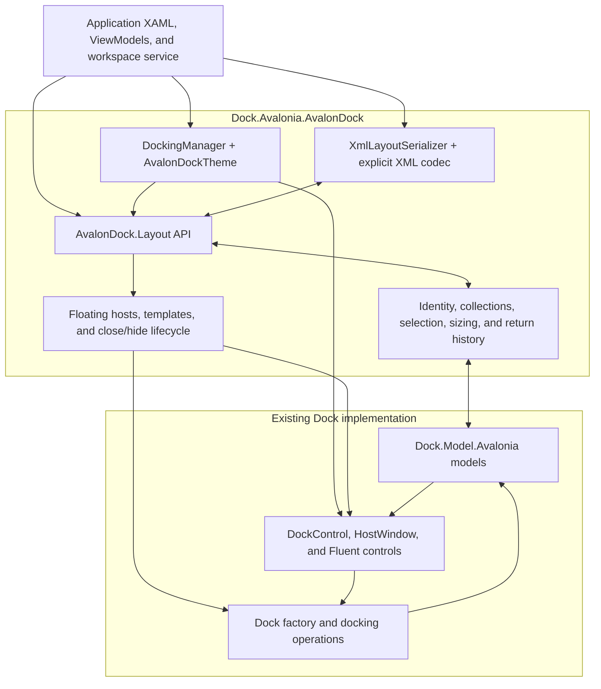

# AvalonDock compatibility

`Dock.Avalonia.AvalonDock` lets an Avalonia application use the
`AvalonDock` C# namespaces and layout names. The implementation wraps
`Dock.Model.Avalonia` models and renders them through Dock's controls. It is an
in-progress compatibility project; the
[acceptance checklist](https://github.com/wieslawsoltes/Dock/blob/feature/avalondock-compatibility/src/Dock.Avalonia.AvalonDock/COMPATIBILITY.md)
records implemented behavior and remaining API gaps. WPF controls, dependency
properties, and assemblies require their Avalonia counterparts.

The CLR namespaces are `AvalonDock.*`; update using directives and any explicit
CLR namespace declarations when porting source from the WPF library. The
assembly/package name remains `Dock.Avalonia.AvalonDock`.

## Reference the package and theme

The project builds NuGet packages for .NET 8 and .NET 10. To try the package from
this branch before publication, build it from the Dock repository:

```sh
dotnet pack src/Dock.Avalonia.AvalonDock -c Release -o artifacts/avalondock-nuget
```

Add that directory as a local NuGet source in your consuming application and
reference the generated `Dock.Avalonia.AvalonDock` package version. Keep your
normal package sources configured for its dependencies. The package references
Dock's Avalonia model and Fluent theme; use compatible Avalonia package versions.

In `App.axaml`, with the default `xmlns="https://github.com/avaloniaui"`, add:

```xml
<Application.Styles>
  <FluentTheme />
  <AvalonDockTheme />
</Application.Styles>
```

`AvalonDockTheme` includes Dock's Fluent resources and the manager/content
templates that connect the compatibility API to Dock's controls.

## Declare a layout in XAML

Place this layout inside an Avalonia view. Declare `x:DataType` on the view for
its ViewModel when using compiled bindings. This example uses literal content:

```xml
<DockingManager x:Name="DockManager">
  <LayoutRoot>
    <LayoutPanel Orientation="Horizontal">
      <LayoutAnchorablePane DockWidth="240">
        <LayoutAnchorable ContentId="properties" Title="Properties">
          <TextBlock Text="Workspace properties" Margin="12" />
        </LayoutAnchorable>
      </LayoutAnchorablePane>
      <LayoutDocumentPane>
        <LayoutDocument ContentId="readme" Title="Readme">
          <TextBox Text="Editable document" AcceptsReturn="True" />
        </LayoutDocument>
      </LayoutDocumentPane>
    </LayoutPanel>
  </LayoutRoot>
</DockingManager>
```

The assembly maps the manager, layout, and theme namespaces to Avalonia's
default XML namespace, so these elements require no AvalonDock prefix.
The Xceed XML namespace is also supported:

```xml
<Window xmlns="https://github.com/avaloniaui"
        xmlns:ad="http://schemas.xceed.com/wpf/xaml/avalondock">
  <ad:DockingManager>
    <ad:LayoutRoot>
      <ad:LayoutPanel>
        <ad:LayoutDocumentPane>
          <ad:LayoutDocument Title="Document">
            <TextBlock Text="Avalonia content" />
          </ad:LayoutDocument>
        </ad:LayoutDocumentPane>
      </ad:LayoutPanel>
    </ad:LayoutRoot>
  </ad:DockingManager>
</Window>
```

`ad` is an arbitrary alias. Using a prefix can make the library boundary
explicit in a mixed XAML file; it does not change the layout's behavior.

## Use the C# layout API

The following code belongs in a workspace service called by ViewModel commands.
`manager` is the `DockingManager` declared above, supplied by application startup.
The sample uses an `ILayoutWorkspace` interface so its ViewModel has no Avalonia
dependency and its view code-behind only initializes XAML.

```csharp
using System.Linq;
using AvalonDock.Layout;
using AvalonDock.Layout.Serialization;

LayoutDocument document = manager.Layout.Descendents()
    .OfType<LayoutDocument>().Single(item => item.ContentId == "readme");
LayoutAnchorable properties = manager.Layout.Descendents()
    .OfType<LayoutAnchorable>().Single(item => item.ContentId == "properties");

document.IsActive = true;
document.Float();
document.Dock();

properties.Hide();
properties.Show();
properties.ToggleAutoHide();

new XmlLayoutSerializer(manager).Serialize("layout.xml");
new XmlLayoutSerializer(manager).Deserialize("layout.xml");
```

Content methods operate through the native Dock factory. Closing and hiding
honor the corresponding capabilities and cancelable events. A tool's return
pane and tab position are retained when it floats, docks, hides, or is restored.
After deserialization, look up layout nodes again: the manager now owns a new
layout tree, while content can retain its application identity.

## Bind ViewModel content

`DocumentsSource` and `AnchorablesSource` accept observable collections of
application objects. With a view's `x:DataType` set to a ViewModel exposing
`Documents` and `Tools`, bind the sources and provide typed templates:

```xml
<DockingManager DocumentsSource="{Binding Documents}"
                AnchorablesSource="{Binding Tools}">
  <DockingManager.DataTemplates>
    <DataTemplate DataType="{x:Type vm:EditorViewModel}"
                  x:DataType="vm:EditorViewModel">
      <TextBox Text="{Binding Text, Mode=TwoWay}" AcceptsReturn="True" />
    </DataTemplate>
    <DataTemplate DataType="{x:Type vm:PropertiesViewModel}"
                  x:DataType="vm:PropertiesViewModel">
      <TextBlock Text="{Binding Description}" Margin="12" />
    </DataTemplate>
  </DockingManager.DataTemplates>
</DockingManager>
```

Here `vm` refers to the application's ViewModel namespace. The ViewModels derive
from `ReactiveObject`; editing properties must notify changes. Keep UI logic in
commands and services. A `LayoutUpdateStrategy` can set each generated layout
item's title and stable `ContentId`, and choose its destination pane. There is
no implicit mapping from a ViewModel's property names to these layout properties.

Source additions, removals, replacements, and resets update the live layout.
Moving a source entry preserves the user's tab order. Resetting a source clears
all layout items of that type, including manually inserted items. Floating
hosts resolve content templates from the manager's current scope, including
ancestor templates.

## Restore application content from XML

The XML describes layout structure and metadata; it does not serialize controls
or arbitrary ViewModels. A newly constructed `XmlLayoutSerializer` captures
existing content by `ContentId`. Construct it after the relevant content exists.
For a new application session, resolve IDs using a content registry:

```csharp
XmlLayoutSerializer serializer = new(manager);
serializer.LayoutSerializationCallback += (_, args) =>
{
    if (contentById.TryGetValue(args.Model.ContentId, out object? content))
        args.Content = content;
    else
        args.Cancel = true;
};
serializer.Deserialize("layout.xml");
```

`contentById` is an application-owned dictionary of stable identifiers to
ViewModels. Set `Cancel` to omit an unavailable item. Source collection
notifications are suspended while callbacks run, then resume even if loading
fails. Parsing and content resolution finish before replacing the manager's
layout. The runnable sample writes to a temporary file and replaces the saved
file after a successful save.

Docked, hidden, auto-hide, and supported floating layouts retain return
locations and floating geometry. Native grouped-document or mixed floating
shapes that the current AvalonDock hierarchy cannot represent are rejected
before an existing save file is overwritten.

Individual content, pane/group, root, and floating models also implement
`IXmlSerializable`. Their `WriteXml` methods write attributes and children inside
an element opened by the caller; `ReadXml` consumes that element. Content reads
preserve an existing `Content` object, group reads append children, and root
reads replace the hierarchy while retaining the native root and factory.
These methods do not resolve application content or return-container references;
use `XmlLayoutSerializer` for complete layout restoration and content callbacks.

## Implementation architecture



The facade wraps the same native objects that Dock renders and moves.
`LayoutModelContext` preserves wrapper identity, and `LayoutChildren` projects
native child lists as observable AvalonDock collections. Native changes flow
back into public ownership, selection, and active-content state. Compatibility
metadata, such as AvalonDock return-container references, remains in the adapter.

| AvalonDock API | Native Dock implementation |
| --- | --- |
| `LayoutRoot` | `RootDock` and its factory |
| `LayoutPanel`, document/tool pane groups | `ProportionalDock` |
| `LayoutDocumentPane` | `DocumentDock` |
| `LayoutAnchorablePane` | `ToolDock` |
| `LayoutDocument`, `LayoutAnchorable` | `Document`, `Tool` |
| `LayoutAnchorSide`, `LayoutAnchorGroup` | Projections over native pinned lists |
| Document/tool floating windows | `DockWindow`, a floating `RootDock`, and `HostWindow` |
| `DockingManager` | A themed `DockControl` using the live root and factory |

`LayoutFactory` extends the native Avalonia factory at the window-close and
batch-floating boundaries. It composes lifecycle helpers to honor AvalonDock
capabilities and return positions, then delegates actual movement to Dock.
`LayoutFloatingWindowPresenter`, the host factory, and scoped templates manage
floating presentation and preserve the manager's template lookup scope.

`XmlLayoutSerializer` uses explicit codecs and content callbacks without
runtime type discovery. It restores the facade and its native models together.
The core docking algorithms, input handling, recycling, and control rendering
remain in Dock. See the [Dock architecture overview](dock-architecture.md) for
the native interaction pipeline.

## Sample and validation

From the repository root:

```sh
dotnet run --project samples/DockAvalonDockSample
dotnet test tests/Dock.Avalonia.AvalonDock.Tests -c Release
```

The [sample](https://github.com/wieslawsoltes/Dock/tree/feature/avalondock-compatibility/samples/DockAvalonDockSample)
demonstrates documents, tool panes, Agenda/Contacts auto-hide strips, floating,
and save/load commands. Its XAML adapts Xceed Live Explorer 3.7.0 and includes
the original Ms-PL license and attribution. The adapter implementation is new
MIT-licensed code.

The test project covers compiled default/Xceed namespaces, Headless input and
rendering, native model synchronization, XML, and lifecycle behavior. The
separate NuGet consumer builds against the packed assemblies. The
[compatibility checklist](https://github.com/wieslawsoltes/Dock/blob/feature/avalondock-compatibility/src/Dock.Avalonia.AvalonDock/COMPATIBILITY.md)
also describes the pinned API audit and the work still required before claiming
full compatibility.
