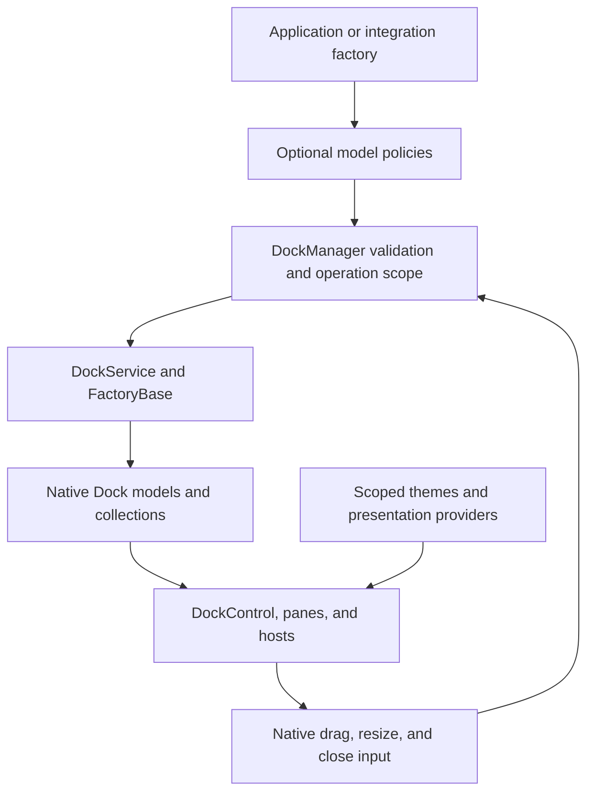

# Extending docking operations and hosts

Dock exposes optional policies for integrations that need different docking rules,
selection behavior, sizing, or window lifetimes. The integration supplies decisions;
Dock continues to validate capabilities, move its models, render panes, and handle
pointer input. These contracts do not depend on a compatibility package.



## Model policies

Implement the required interfaces on the factory that owns the layout. The
interfaces are in `Dock.Model.Core`; they contain no Avalonia types.

| Contract | Purpose | Behavior without the contract |
| --- | --- | --- |
| `IDockDropPolicy` | Veto a source, destination, and operation before target display or drop execution. Both participating factories can reject a drop. | Existing capability and docking-group validation applies. |
| `IDockItemDragPolicy` | Independently allow dragging a tab or pin and reordering it within its strip. | Existing item drag behavior applies. |
| `IDockSplitPolicy` | Choose a document pane when splitting tool content. | Tool splits create tool panes. |
| `IDockOuterSplitPolicy` | Resolve an outer split to the hovered dock or an enclosing region. | Outer split operations are unavailable. |
| `IDockOperationObserver` | Begin a scope before a validated operation mutates the layout. | Operations run without a scope. |
| `IDockWindowHostFactory` | Create a host with access to its `IDockWindow` model, including when presenting it again. | `GetHostWindow(window.Id)` resolves the host. |
| `IDockWindowClosePolicy` | Preserve a floating model and its contents when only its host closes. | Closing the host also runs normal layout cleanup. |

For example, an application can compose a destination rule with the Avalonia
factory without replacing Dock's execution logic:

```csharp
using System;
using Dock.Model.Avalonia;
using Dock.Model.Core;

sealed class WorkspaceFactory : Factory, IDockDropPolicy
{
    private readonly Func<IDockable, IDockable, DockOperation, bool> _canDrop;

    public WorkspaceFactory(
        Func<IDockable, IDockable, DockOperation, bool> canDrop)
    {
        _canDrop = canDrop;
    }

    public bool CanDrop(IDockable source, IDockable target, DockOperation operation)
        => _canDrop(source, target, operation);
}
```

Drop and outer-region policies also run during pointer movement. Keep them free
of layout mutations. Returning `true` from `CanDrop` allows native validation to
continue; it does not override capability restrictions. Direct factory edits do
not consult the drag/drop policy.

An operation observer returns an `IDockOperationScope` or `null`. Dock calls
`Complete()` only after successful execution and always disposes the scope,
including when execution fails or throws. Validation-only and rejected operations
do not open scopes. Composite operations can nest scopes; disposal alone is not
a completion notification or a rollback mechanism.

## Outer splits

`OuterLeft`, `OuterTop`, `OuterRight`, and `OuterBottom` split beside the region
selected by `IDockOuterSplitPolicy`. Dragged panes and groups move as a unit,
preserving their child order and selected content. A single document or tool gets
a new native pane. The corresponding left/top/right/bottom operation mask applies
to each outer direction.

Dock checks factory ownership, region ancestry, source and destination
capabilities, docking groups, and whether the destination will retain content
before changing collections. A policy cannot redirect an outer operation to an
unrelated region. The target theme must provide selectors with the matching
attached dock operations; implementing the policy alone does not add visuals.

## Host lifetime and selection

`IDockWindowHostFactory.CreateHostWindow` is called when initializing a window
and when presenting an existing window that no longer has a host. Returning
`null` leaves it unhosted; it does not invoke a second locator. The overload that
initializes an explicitly supplied host continues to use that host.

Hosts that can cancel or defer `Exit()` implement `IHostWindowCloseState`.
`IsClosed` becomes true only after closure completes. A hidden host or a canceled
close returns false. Dock retains the live host and restores its tracking after
a canceled exit, protects against reentrant exit, and preserves a replacement
host installed during callbacks. `HostWindow` implements this contract.

When `IDockWindowClosePolicy.PreserveLayoutOnHostClose` returns true, the native
host still runs cancelable window notifications and saves its geometry. A
successful close releases host registration and the model's host reference,
while preserving the floating model, its ownership, and its contents for later
presentation. Both `HostWindow` and `ManagedHostWindow` honor this policy. Managed
presentation is released before the factory's closed notification, so a callback
can present the retained model immediately. The integration owns any subsequent
content/model cleanup.

On successful desktop host closure, Dock also releases nested model presenters,
including presenters from a replaced template, before the `Closed` event. A
retained Avalonia layout therefore does not retain its closed native window.
The host's `Content` value and the layout's ownership remain available; canceled
closure keeps the current presentation. A `Closed` callback can present the
preserved layout in another host immediately.

Factory subclasses can override `ShouldFocusActiveDockable` to distinguish pane
selection from focus and `GetActiveDockableAfterRemoval` to choose a replacement
selection. Defaults preserve native focus and selection behavior.
`CloseDockableCore` and `PinDockableCore` let an integration implement explicit
model operations independently of command capability flags, while retaining
native cancellation, events, ItemsSource updates, ownership, and cleanup. The
pin overload accepts the pin-owning root and the unpin destination.

`Dock.Model.Avalonia.Core.DockableBase.OwnerChanging` reports old and new owners
before assignment. Equal assignments are silent, and UI-thread access is checked
before notification. This event is specific to the Avalonia model implementation.

## Presentation and sizing

The following extension points belong to the Avalonia control layer:

| API | Use |
| --- | --- |
| `DockAdornerWindow.Factory` / `IDockAdornerWindowFactory` | Supply an unshown floating overlay host in a visual scope. Dock assigns its native target, owner, position, and size. Returning null uses the standard host. |
| `DockTarget.AdornerHostProvider` / `IDockAdornerHostProvider` | Expand a local preview to an ancestor control without changing the docking destination. |
| `DockTarget.TargetMargin` | Position pane-local selectors inside an expanded preview. Region-wide indicators can use the full host. |
| `DockTarget.TargetTheme` | Inherit a local target `ControlTheme` from the docking surface. |
| `DockTargetBase.GetSelector` | Inspect the current template's registered selector for an operation. It can be hidden; lookup does not validate a drop or apply a template. |
| `HostWindow.TryBeginMoveDrag` | Start a move from custom chrome while retaining factory cancellation and native docking targets. |
| `PinnedDockControl.MinimumPinnedWidth` / `MinimumPinnedHeight` | Set finite nonnegative minimum content sizes. Both default to 50. |
| `ProportionalStackPanelSplitter.PreviewBackground` / `PreviewOpacity` | Customize live resize previews. Defaults retain the accent resource and opacity 1. |

Expanded adorner geometry follows layout and window movement for inline, native
window, and managed window hosting. Providers returning null, the surface itself,
or an unrelated control retain the ordinary surface-sized preview. Detachment
releases geometry subscriptions and references to the previous surface.

`ProportionalStackPanel` subclasses can override `OnAssignProportions`,
`GetProportionalDimension`, `GetMeasureConstraint`, `GetChildMeasureConstraint`,
and `ResizeProportions` to translate another sizing model into native allocation.
Measurement, arrangement, splitter input, and preview commit/cancel continue to
run through the existing panel. The default measurement still rejects infinite
space along the split axis; an override can resolve intrinsic sizes first.

Custom templates can use any `Control` for `DockControl.PART_ContentControl` and
a `Thumb` for `PinnedDockControl.PART_PinnedDockSplitter`. A custom pinned thumb
owns its resize behavior; the default `GridSplitter` retains native handlers.
The Fluent layout presenter defers content realization, and the document create
button remains visible alongside tab-strip extension content.

## Regression coverage

The native tests exercise these contracts without an adapter assembly:

| Area | Representative tests |
| --- | --- |
| Drop, split, and operation scope | `DockDropPolicyTests`, `DockSplitPolicyTests`, `DockOuterSplitTests`, `DockOperationObserverTests` |
| Host creation, cancellation, and preservation | `DockWindowHostFactoryTests`, `HostExitCancellationTests`, `HostCloseCancellationTests`, `HostWindowClosePolicyTests` |
| Ownership, selection, and explicit operations | `DockableOwnerTests`, `FactorySelectionPolicyTests`, `FactoryExplicitOperationTests`, `FactoryPinnedRootTests` |
| Pointer targets and geometry | `TabItemDragPolicyTests`, `OuterWindowDragTests`, `AdornerGeometryTests`, `AdornerWindowFactoryTests` |
| Sizing and resource lifetime | `ProportionalStackPanelPolicyTests`, `ProportionalStackPanelSplitterSizingTests`, `PinnedDockSizingTests`, `ThemeCommandInteractionLeakTests` |

Run the complete native solution validation with `dotnet build -c Release` and
`dotnet test -c Release --no-build`. The solution also builds the linked Avalonia
11 controls and tests the other model implementations.
