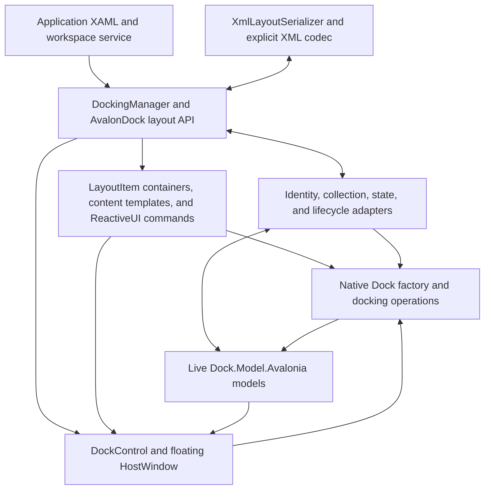

# AvalonDock compatibility for Dock

This package is under development. It exposes the `AvalonDock`
namespaces over `Dock.Model.Avalonia` and Dock's controls. Its XAML types are
available in Avalonia's default `https://github.com/avaloniaui` XML namespace
and in `http://schemas.xceed.com/wpf/xaml/avalondock`. Dock owns the live layout,
selection, dragging, docking, floating, and rendering.

Use `AvalonDock`, `AvalonDock.Layout`, and `AvalonDock.Layout.Serialization`
in C#. The upstream `Xceed.Wpf` CLR namespace prefix is intentionally omitted.

The compatibility target is the public AvalonDock API documented at
https://github.com/xceedsoftware/wpftoolkit/wiki/AvalonDock and the upstream
source at commit `2c71faba5eecc1b6ae6cd3d269408e0df37715d8`.
The implementation is new MIT-licensed adapter code; it does not incorporate
the upstream WPF docking engine.

Reference this package and add the adapter theme alongside your Avalonia theme:

```xml
<Application.Styles>
  <FluentTheme />
  <AvalonDockTheme />
</Application.Styles>
```

With `xmlns="https://github.com/avaloniaui"` on your view, no additional XML
namespace declaration or AvalonDock prefix is needed:

```xml
<DockingManager>
  <LayoutRoot>
    <LayoutPanel>
      <LayoutDocumentPane>
        <LayoutDocument Title="Document">
          <TextBox Text="Editable content" />
        </LayoutDocument>
      </LayoutDocumentPane>
    </LayoutPanel>
  </LayoutRoot>
</DockingManager>
```

The existing `xmlns:ad="http://schemas.xceed.com/wpf/xaml/avalondock"`
declaration and prefixed types such as `ad:DockingManager` remain supported.
The runnable `samples/DockAvalonDockSample` contains a licensed adaptation of
the Xceed Live Explorer 3.7.0 sample.

The familiar C# operations are available to a workspace service called by
ViewModel commands. Given a manager and content nodes from its layout:

```csharp
using AvalonDock.Layout;
using AvalonDock.Layout.Serialization;

document.IsActive = true;
document.Float();
document.Dock();
tool.Hide();
tool.Show();
tool.ToggleAutoHide();

new XmlLayoutSerializer(manager).Serialize("layout.xml");
new XmlLayoutSerializer(manager).Deserialize("layout.xml");
```

XML restores layout nodes and resolves application content by `ContentId`.
Construct the serializer after the content exists, or provide
`LayoutSerializationCallback` to resolve ViewModels from an application-owned
registry. Look up layout nodes again after loading, because the manager's layout
tree has been replaced.

`manager.GetLayoutItemFromModel(document)` returns a stable `LayoutDocumentItem`
or `LayoutAnchorableItem` in `AvalonDock.Controls`. Its `Model` is the application
content; its metadata, selection, and capabilities track the live Dock model.
Default ReactiveUI commands support close, float, activate, dock-as-document,
close document sets, split/move document groups, and tool hide/auto-hide/dock.
Commands honor capabilities and cancellation and can be replaced with
application commands. For example:

```csharp
using AvalonDock.Controls;

LayoutItem? item = manager.GetLayoutItemFromModel(document);
if (item?.FloatCommand is { } command && command.CanExecute(null))
    command.Execute(null);
```

Containers survive moves and floating. Layout replacement detaches old
containers, so look them up again after loading XML. Container commands are
available to compiled bindings; manager container styles/selectors and native
chrome command overrides remain open compatibility work.

`LayoutItem.View` is the presenter displayed by the native Dock controls.
`DockingManager.LayoutItemTemplate` accepts an Avalonia `IDataTemplate` for
application content. Alternatively, use `LayoutItemTemplateSelector` with an
`AvalonDock.Controls.DataTemplateSelector` subclass overriding
`SelectTemplate(object?, AvaloniaObject)`. Its arguments are the application
content and actual presenter. An explicit template takes precedence; a null
selector result uses normal template lookup. Template changes update existing
docked and floating presenters. Inline controls retain their identity through
Dock's native content handling, and selected templates only recycle their own
controls. The full guide includes compiled XAML and selector examples.

`DocumentsSource` and `AnchorablesSource` accept observable content collections.
Bind them within a view with an explicit `x:DataType`, and supply compiled
Avalonia `DataTemplate` entries for the content ViewModels. A manager's
`LayoutUpdateStrategy` can set titles and identifiers and choose destination
panes. Collection changes update the live Dock models. As in AvalonDock,
moving source entries leaves the user's tab order intact, and resetting a
source clears all layout items of that type.

`LayoutAnchorSide` and `LayoutAnchorGroup` expose the four native auto-hide
strips. The XML serializer preserves these groups, their content identities,
and return panes alongside docked and hidden content.

`LayoutRoot.FloatingWindows` exposes `LayoutDocumentFloatingWindow` and
`LayoutAnchorableFloatingWindow` over native Dock windows. Floating geometry
and maximization synchronize with the content and pane models and persist in
XML. Layout reloads and manager reattachment preserve the application content.

Avalonia applications use Avalonia controls, properties, templates, and
bindings. WPF framework types and compiled WPF assemblies cannot be loaded as
Avalonia controls. Framework type substitutions and any outstanding API or
behavior gaps are tracked in [COMPATIBILITY.md](COMPATIBILITY.md). Full API
compatibility has not yet been established.

## Architecture



The compatibility layer wraps Dock's live models and delegates movement and
rendering to Dock. It supplies AvalonDock ownership projections, return history,
content-template scope, and close/hide semantics. The explicit XML codec needs
no runtime type discovery.

The [full guide](https://github.com/wieslawsoltes/Dock/blob/feature/avalondock-compatibility/docfx/articles/dock-avalondock.md)
includes complete usage examples, source bindings, content callbacks, and a
mapping of AvalonDock types to their native Dock models.

## Development validation

```sh
dotnet test tests/Dock.Avalonia.AvalonDock.Tests -c Release
dotnet run --project samples/DockAvalonDockSample
dotnet pack src/Dock.Avalonia.AvalonDock -c Release -o artifacts/nuget
```
