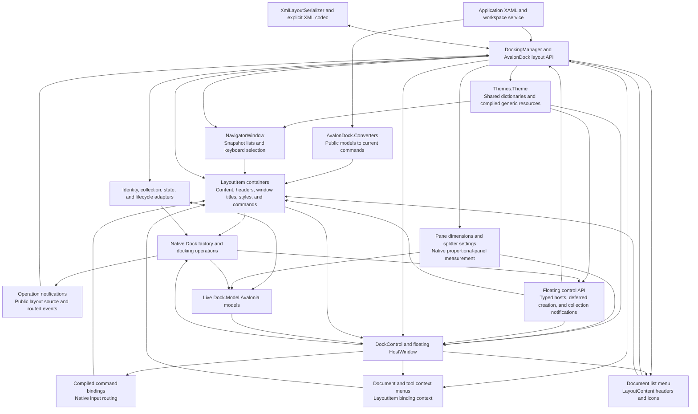

# AvalonDock compatibility for Dock

This package is under development. It exposes the `AvalonDock`
namespaces over `Dock.Model.Avalonia` and Dock's controls. Its XAML types are
available in Avalonia's default `https://github.com/avaloniaui` XML namespace
and in `http://schemas.xceed.com/wpf/xaml/avalondock`. Dock owns the live layout,
selection, dragging, docking, floating, and rendering.

Use `AvalonDock`, `AvalonDock.Layout`, and `AvalonDock.Layout.Serialization`
in C#. The upstream `Xceed.Wpf` CLR namespace prefix is intentionally omitted.

The compatibility target is the public AvalonDock API documented at
https://github.com/xceedsoftware/wpftoolkit/wiki/AvalonDock and the upstream
source at commit `2c71faba5eecc1b6ae6cd3d269408e0df37715d8`.
The implementation is new MIT-licensed adapter code; it does not incorporate
the upstream WPF docking engine.

Reference this package and add the adapter theme alongside your Avalonia theme:

```xml
<Application.Styles>
  <FluentTheme />
  <AvalonDockTheme />
</Application.Styles>
```

With `xmlns="https://github.com/avaloniaui"` on your view, no additional XML
namespace declaration or AvalonDock prefix is needed:

```xml
<DockingManager>
  <LayoutRoot>
    <LayoutPanel>
      <LayoutDocumentPane>
        <LayoutDocument Title="Document">
          <TextBox Text="Editable content" />
        </LayoutDocument>
      </LayoutDocumentPane>
    </LayoutPanel>
  </LayoutRoot>
</DockingManager>
```

The existing `xmlns:ad="http://schemas.xceed.com/wpf/xaml/avalondock"`
declaration and prefixed types such as `ad:DockingManager` remain supported.
The runnable `samples/DockAvalonDockSample` contains a licensed adaptation of
the Xceed Live Explorer 3.7.0 sample.

The familiar C# operations are available to a workspace service called by
ViewModel commands. Given a manager and content nodes from its layout:

```csharp
using AvalonDock.Layout;
using AvalonDock.Layout.Serialization;

document.IsActive = true;
document.Float();
document.Dock();
tool.Hide();
tool.Show();
tool.ToggleAutoHide();

new XmlLayoutSerializer(manager).Serialize("layout.xml");
new XmlLayoutSerializer(manager).Deserialize("layout.xml");
```

XML restores layout nodes and resolves application content by `ContentId`.
Construct the serializer after the content exists, or provide
`LayoutSerializationCallback` to resolve ViewModels from an application-owned
registry. Look up layout nodes again after loading, because the manager's layout
tree has been replaced.

`manager.GetLayoutItemFromModel(document)` returns a stable `LayoutDocumentItem`
or `LayoutAnchorableItem` in `AvalonDock.Controls`. Its `Model` is the application
content; its metadata, selection, and capabilities track the live Dock model.
Default ReactiveUI commands support close, float, activate, dock-as-document,
close document sets, split/move document groups, and tool hide/auto-hide/dock.
Commands honor capabilities and cancellation and can be replaced with
application commands. For example:

```csharp
using AvalonDock.Controls;

LayoutItem? item = manager.GetLayoutItemFromModel(document);
if (item?.FloatCommand is { } command && command.CanExecute(null))
    command.Execute(null);
```

Containers survive moves and floating. Layout replacement detaches old
containers, so look them up again after loading XML. Native close/pin buttons,
document/tool/auto-hide menus, and tab middle/double-clicks use the current
container commands in docked and floating hosts. Commands receive a null
parameter and observe `CanExecute`. Tool close buttons choose `CloseCommand`
when `CanClose` is true and `HideCommand` otherwise; cancellation and application
overrides also work in floating windows.

`DocumentContextMenu` and `AnchorableContextMenu` accept custom Avalonia menus.
Their data context is the requested `LayoutItem`, including in floating windows:

```xml
<DockingManager>
  <DockingManager.DocumentContextMenu>
    <ContextMenu x:DataType="LayoutItem">
      <MenuItem Header="Close" Command="{Binding CloseCommand}" />
      <MenuItem Header="Float" Command="{Binding FloatCommand}" />
    </ContextMenu>
  </DockingManager.DocumentContextMenu>
</DockingManager>
```

Use `x:DataType="LayoutAnchorableItem"` for a tool menu with `HideCommand`,
`AutoHideCommand`, or `DockCommand`. Tool menus apply to tabs, title bars, and
auto-hide strips; tools docked as documents use the document menu. Keyboard
context-menu requests use the active item unless a child control owns the menu.
The theme provides default menus per manager; explicit `null` disables a menu,
and runtime replacement closes the old one. Menu invocation state is cleared
when the menu closes or its layout/view detaches. The full guide covers menu
ownership, active-item changes, and cancellation.

`LayoutItemContainerStyle` accepts an Avalonia `ControlTheme`, with the item
container as its data context. Bind through `Model` to application properties
using compiled bindings. For an `EditorViewModel` with `Title` and `ContentId`:

```xml
<DockingManager DocumentsSource="{Binding Documents}">
  <DockingManager.LayoutItemContainerStyle>
    <ControlTheme TargetType="LayoutItem" x:DataType="LayoutItem">
      <Setter Property="Title" Value="{Binding ((vm:EditorViewModel)Model).Title}" />
      <Setter Property="ContentId" Value="{Binding ((vm:EditorViewModel)Model).ContentId}" />
    </ControlTheme>
  </DockingManager.LayoutItemContainerStyle>
</DockingManager>
```

Here `vm` is the application's ViewModel XML namespace and the enclosing view
declares its own `x:DataType`. For mixed content types, use
`LayoutItemContainerStyleSelector` with an `AvalonDock.Controls.StyleSelector`
subclass overriding `ControlTheme? SelectStyle(object?, AvaloniaObject)`. An
explicit theme takes precedence. Themes use the manager's logical resource
scope, including while floating. Runtime style and content changes detach old
bindings and apply the appropriate theme. Command setters can supply
application commands; for an `EditorViewModel` with a `CloseCommand`, add:

```xml
<Setter Property="CloseCommand" Value="{Binding ((vm:EditorViewModel)Model).CloseCommand}" />
```

The native tab close button, Close menu item, and middle-click invoke it.
Removing the theme restores available defaults without disposing application
commands. Layout methods remain direct model operations. The full guide covers
selectors, capabilities, and two-way metadata bindings.

`LayoutItem.View` is the presenter displayed by the native Dock controls.
`DockingManager.LayoutItemTemplate` accepts an Avalonia `IDataTemplate` for
application content. Alternatively, use `LayoutItemTemplateSelector` with an
`AvalonDock.Controls.DataTemplateSelector` subclass overriding
`SelectTemplate(object?, AvaloniaObject)`. Its arguments are the application
content and actual presenter. An explicit template takes precedence; a null
selector result uses normal template lookup. Template changes update existing
docked and floating presenters. Inline controls retain their identity through
Dock's native content handling, and selected templates only recycle their own
controls. The full guide includes compiled XAML and selector examples.

`DocumentHeaderTemplate` and `AnchorableHeaderTemplate` customize native tabs
and auto-hide strips using compiled Avalonia templates. Headers receive the
public `LayoutContent` / `LayoutAnchorable` node, so `Title` and other metadata
can be bound directly. Document headers also apply to tools docked as documents.
The corresponding `DocumentHeaderTemplateSelector` and
`AnchorableHeaderTemplateSelector` receive the layout node and its header
presenter. Header selectors take precedence and coerce the explicit header
template to null; a null selection falls back to the title. Runtime changes
update docked, floating, and auto-hide headers while preserving native input.

`AnchorableTitleTemplate` customizes the selected tool's title bar independently
of its tab header, including floating panes and open auto-hide previews:

```xml
<DockingManager.AnchorableTitleTemplate>
  <DataTemplate x:DataType="LayoutAnchorable">
    <TextBlock Text="{Binding Title}" FontWeight="SemiBold" TextTrimming="CharacterEllipsis" />
  </DataTemplate>
</DockingManager.AnchorableTitleTemplate>
```

`AnchorableTitleTemplateSelector` receives the selected layout node and its
presenter. As with header selectors, it takes precedence and coerces the explicit
template to null; a null selection uses the default title text. Template changes,
tab selection, and metadata changes update the visible title. Native context
menus and title-bar buttons keep their command behavior. Floating document title
and document-menu header templates are described below.

`DocumentsSource` and `AnchorablesSource` accept observable content collections.
Bind them within a view with an explicit `x:DataType`, and supply compiled
Avalonia `DataTemplate` entries for the content ViewModels. A manager's
`LayoutUpdateStrategy` can set titles and identifiers and choose destination
panes. Collection changes update the live Dock models. As in AvalonDock,
moving source entries leaves the user's tab order intact, and resetting a
source clears all layout items of that type.

`LayoutAnchorSide` and `LayoutAnchorGroup` expose the four native auto-hide
strips. The XML serializer preserves these groups, their content identities,
and return panes alongside docked and hidden content.

Floating document captions use `DocumentTitleTemplate` and its selector with the
public `LayoutDocument` from `LayoutDocumentFloatingWindow.RootDocument`:

```xml
<DockingManager.DocumentTitleTemplate>
  <DataTemplate x:DataType="LayoutDocument">
    <TextBlock Text="{Binding Title}" FontWeight="SemiBold" TextTrimming="CharacterEllipsis" />
  </DataTemplate>
</DockingManager.DocumentTitleTemplate>
```

The selector receives the actual presenter, takes precedence over an explicit
template, and falls back to the document title text when it returns null.
Runtime changes update the caption without changing tab headers. The caption
uses native window dragging and state, the document context menu, and the
current item close command. Double-click and maximize/restore buttons change
the native window state; closing honors cancellation. XML replacement and
source removal release old title presenters and caption commands.

`PreviewFloat`, `Floated`, `PreviewDock`, and `Docked` are bubbling routed events.
`Source` contains the public `LayoutContent`; `Handled` affects routing without
canceling the operation. Layout methods, float/dock commands, native menu input, and native
drag execution share operation scopes, so a split or group move raises one pair.
Native validation and document tab-group commands are silent. Reordering tabs or reusing a previous floating pane
without creating a window is also silent. Subscribe from a workspace service
and unsubscribe when that service detaches. Derived managers can override the
corresponding `Raise…Event(LayoutContent)` methods.

The document tab strip's **Open documents** button lists the pane's
`ChildrenSorted` and invokes the selected item's current `ActivateCommand`.
`DocumentPaneMenuItemHeaderTemplate` and its selector customize the entry header;
`IconContentTemplate` and its selector customize the icon. Their data is the
public `LayoutContent`, including tools docked as documents:

```xml
<DockingManager.DocumentPaneMenuItemHeaderTemplate>
  <DataTemplate x:DataType="LayoutContent">
    <TextBlock Text="{Binding Title}" FontWeight="SemiBold" />
  </DataTemplate>
</DockingManager.DocumentPaneMenuItemHeaderTemplate>
```

Menu headers fall back to the document header template. Header selectors take
precedence; assigning a document header selector supplies the menu selector when
unset. Icon selectors receive the node and its `MenuItem`, take precedence, and
preserve the explicit icon template for use after the selector is cleared.
Default menu icons display the node's Avalonia `IImage` in `IconSource`. Open
menus follow collection and template changes in docked and floating panes.

Set `GridSplitterWidth` and `GridSplitterHeight` on `DockingManager` to control
the gap between horizontally and vertically arranged panes. Both default to six
device-independent pixels and support styles and bindings:

```xml
<DockingManager GridSplitterWidth="8" GridSplitterHeight="6">
  <!-- Add a LayoutRoot or bind the content sources here. -->
</DockingManager>
```

Pane `DockWidth`/`DockHeight` pixel and star values use the actual space in each
nested or floating native panel. Runtime splitter settings and window resizing
preserve pixel pane sizes where available space and native constraints permit;
star panes share the remainder. Native dragging updates public pane dimensions.
Manager settings survive XML restoration and view reattachment and remain
independent between managers.

`LayoutRoot.FloatingWindows` exposes `LayoutDocumentFloatingWindow` and
`LayoutAnchorableFloatingWindow` over native Dock windows. Floating geometry
and maximization synchronize with the content and pane models and persist in
XML. Layout reloads and manager reattachment preserve the application content.

`DockingManager.FloatingWindows` exposes the actual native hosts as
`LayoutDocumentFloatingWindowControl` and `LayoutAnchorableFloatingWindowControl`.
Their `Model` is the same public floating model, and `IsDragging`/`IsMaximized`
follow native window state. Document hosts expose `RootDocumentLayoutItem`;
tool hosts bind `SingleContentLayoutItem` to the selected item in their only
visible pane, using compiled bindings and `LayoutItemFromLayoutModelConverter`.
The converter is available in both XML namespaces without a required prefix.

`ActivateCommandLayoutItemFromLayoutModelConverter`,
`HideCommandLayoutItemFromLayoutModelConverter`, and
`AutoHideCommandLayoutItemFromLayoutModelConverter` resolve a public content
model to its current container command. The hide converters accept tools;
command overrides are observed when conversion runs. All converters are in
`AvalonDock.Converters` and can be declared unprefixed in Avalonia XAML.
`BoolToVisibilityConverter` and `InverseBoolToVisibilityConverter` return Boolean
values for `IsVisible`; use a Boolean converter parameter for the non-visible
result. `AnchorableContextMenuHideVisibilityConverter` combines `IsVisible` and
`CanClose` in a `MultiBinding`. The side converters expose header angle and
orientation, and `NullToDoNothingConverter` retains the target on a null input.
The full guide includes compiled converter bindings. URI image loading and the
localized auto-hide header converter remain open work.

Subscribe to `LayoutFloatingWindowControlCollectionChanged` in a workspace
service to observe added/removed host controls and their collection indices;
unsubscribe when the service detaches. A canceled close preserves registration.
Layout replacement and view reattachment replace host instances while retaining
the appropriate model/application content.

Hiding a tool group retains its floating host in `manager.FloatingWindows`.
Restoring a tool reuses that same control, including its resources and geometry.
Retained floating return panes also keep their hidden hosts after docking.
Hide/show cycles preserve a single native factory registration. XML reload and
view reattachment replace hosts while preserving the models' hidden state.
Hidden windows do not become docking drop targets or activate when Dock brings
the visible workspace windows forward during dragging.

Create an unshown native window when the workspace service needs to configure
it before display:

```csharp
LayoutFloatingWindowControl? window =
    manager.CreateFloatingWindow(document, isContentImmutable: true);
window?.Show();
```

Creation moves the content into a new floating layout and raises the float
notifications; showing the control raises native `WindowOpened`. Rejected
floating returns null. The immutability option prevents replacement of loaded
window `Content`; the layout and document remain editable. Standalone panes,
unattached tools, cross-manager content, and creation before the main view loads
are supported. Documents need a parent pane.

Tool hosts expose `CloseWindowCommand` and `HideWindowCommand` for all tools in
their layout. Check `CanExecute(parameter)` before calling `Execute(parameter)`;
the parameter is passed to each current item command. Compiled bindings can use
`x:DataType="LayoutAnchorableFloatingWindowControl"` with the host as their data
context. Enablement follows tool capabilities, membership, and command changes.
Native window-close requests respect factory vetoes and use those item commands
with a null parameter, falling back to hiding when closing is disabled. Content
cancellation keeps the remaining tools open. Closing the host releases command
subscriptions while preserving application command ownership. Exact close-event
ordering, cancellation during manager layout replacement/view
unload, and remaining floating-control hooks are still open.

Canceling native window closing or the factory's `WindowClosing` event keeps a
cleanup request's host tracked, registered, and linked to its floating model.
Collection removal or replacement leaves the original entry when closing is
canceled; a transfer to another manager throws `InvalidOperationException`
instead of adopting a still-live host. Retry after the veto is lifted. If content
has already closed or docked, that content operation stays applied, and
`Layout.CollectGarbage()` can retry removing the remaining empty floating window.
Dock's optional `IHostWindowCloseState` reports completed closure so its model
adapter and factory preserve ownership while a host remains live. Native and
managed Dock hosts implement it; existing custom hosts without the contract keep
their synchronous, unconditional exit behavior.

Derived floating controls can inspect `CloseInitiatedByUser` in their closing
callbacks. It becomes false for internal model cleanup, layout replacement, or
native window exit, even if the request is canceled. Hiding and ordinary view
unload preserve its value; the property tracks internal-close requests rather
than physical user input.

Set `AllowMovingFloatingWindowWithKeyboard="True"` on the manager to move its
floating windows with unhandled arrow keys. The default is false; compiled
bindings and styles can update it at runtime. Its setter is public for Avalonia's
compiled literal XAML, which directly calls the CLR setter; upstream WPF writes
the dependency property despite its private CLR setter. Each arrow moves by 25
device-independent units with desktop scaling applied. Keys handled by an editor keep their normal behavior, and
native layout saving retains the window's new position.

`ResizeBorderThickness` configures each floating host's resize hit areas and
defaults to 10 device-independent units on all edges. A style after
`AvalonDockTheme` in `Application.Styles` can set all hosts:

```xml
<Style Selector=":is(LayoutFloatingWindowControl)" x:DataType="LayoutFloatingWindowControl">
  <Setter Property="ResizeBorderThickness" Value="6,8,10,12" />
</Style>
```

The values specify left, top, right, and bottom thickness. Compiled bindings and
runtime assignments update the hit areas. The template uses native resize roles
and window dragging, keeps application content inside a border/inset, and hides
resize grips when `CanResize` is false or the host is maximized/fullscreen. Zero
removes the adapter's hit area on that edge; system decorations remain controlled
by the platform. A replacement window template must supply its own resize areas.

Avalonia applications use Avalonia controls, properties, templates, and
bindings. WPF framework types and compiled WPF assemblies cannot be loaded as
Avalonia controls. Framework type substitutions and any outstanding API or
behavior gaps are tracked in [COMPATIBILITY.md](COMPATIBILITY.md). Full API
compatibility has not yet been established.

`DockingManager.Theme` accepts AvalonDock resource themes independently of
Avalonia's inherited `StyledElement.Theme` control-template property. Use
`<DockingManager.Theme><GenericTheme /></DockingManager.Theme>` in unprefixed XAML,
or derive from `AvalonDock.Themes.DictionaryTheme` and pass a resource dictionary.
Shared dictionaries, dynamic resources, and theme variants reach the manager,
floating hosts, and navigator, including runtime replacement. Closed windows
release their resource providers. `GenericTheme.GetResourceUri()` identifies the
compiled `Themes/Generic.axaml` bundle, which also supports compiled
`ResourceInclude` from consumer XAML. General custom URI loading is
still open; currently other URIs raise `NotSupportedException`. See the full guide
for sharing, control-theme disambiguation, and invalid-theme behavior.

Ctrl+Tab opens `AvalonDock.Controls.NavigatorWindow` from docked or floating
content. Its document and tool lists expose the live item containers and execute
their current activation commands. Documents are ordered by recent activation;
visible, enabled tools retain layout order. Arrow keys cycle within or across
lists, and Tab traverses both. Releasing a non-navigation key commits the selected
item, following upstream behavior, including Escape and forward-only Shift+Tab.
Focus restoration follows Dock's queued deferred content presentation.
Selecting a document hides the navigator. The hidden window remains reusable
and follows its former owner's lifetime: a canceled owner close preserves it,
and a completed owner close releases it from Avalonia's desktop window list.
Showing it again replaces that owner connection.

Override `DockingManager.CreateNavigatorWindow()` to customize the window before
it is shown, or style `LayoutDocumentsLabel` and `LayoutAnchorablesLabel` in
unprefixed XAML. `Documents`, `Anchorables`, `SelectedDocument`, and
`SelectedAnchorable` support compiled templates. The parameterless public
`OnApplyTemplate()` hook is invoked when Avalonia applies the template.
The full guide covers list filtering, initial selection, command availability,
protected extensibility, and modal lifetime. General theme URI loading and
desktop modality/focus verification remain open.

## Architecture



The compatibility layer wraps Dock's live models and delegates movement and
rendering to Dock. It supplies AvalonDock ownership projections, return history,
content-template scope, and close/hide semantics. The explicit XML codec needs
no runtime type discovery. The document list occupies the native tab strip's
right-content slot, uses Avalonia menu input, and invokes the current item
activation command. Its public-model header and icon templates share the item
container's presentation lifecycle.
Floating document captions compose native window state and dragging. Pane
templates keep public layout wrappers in content hosts and native models in
Dock's data contexts, preserving ownership during view reattachment.
The optional native factory observation contract brackets executed drag
operations before their first mutation. The adapter scopes notifications by
content and clears them on completion or failure, including reentrant handlers.
The optional `IDockWindowHostFactory` contract supplies the native window model
when its host is initialized or recreated. The adapter preserves native and
application locators, selects a typed `HostWindow`, and observes its lifetime
separately from the persistent floating model.

The [full guide](https://github.com/wieslawsoltes/Dock/blob/feature/avalondock-compatibility/docfx/articles/dock-avalondock.md)
includes complete usage examples, source bindings, content callbacks, and a
mapping of AvalonDock types to their native Dock models.

## Development validation

```sh
dotnet test tests/Dock.Avalonia.AvalonDock.Tests -c Release
dotnet run --project samples/DockAvalonDockSample
dotnet pack src/Dock.Avalonia.AvalonDock -c Release -o artifacts/nuget
```
