# AvalonDock compatibility for Dock

This package is under development. It exposes the `AvalonDock`
namespaces over `Dock.Model.Avalonia` and Dock's controls. Its XAML types are
available in Avalonia's default `https://github.com/avaloniaui` XML namespace
and in `http://schemas.xceed.com/wpf/xaml/avalondock`. Dock owns the live layout,
selection, dragging, docking, floating, and rendering.

Use `AvalonDock`, `AvalonDock.Layout`, and `AvalonDock.Layout.Serialization`
in C#. The upstream `Xceed.Wpf` CLR namespace prefix is intentionally omitted.

The compatibility target is the public AvalonDock API documented at
https://github.com/xceedsoftware/wpftoolkit/wiki/AvalonDock and the upstream
source at commit `2c71faba5eecc1b6ae6cd3d269408e0df37715d8`.
The implementation is new MIT-licensed adapter code; it does not incorporate
the upstream WPF docking engine.

Reference this package and add the adapter theme alongside your Avalonia theme:

```xml
<Application.Styles>
  <FluentTheme />
  <AvalonDockTheme />
</Application.Styles>
```

With `xmlns="https://github.com/avaloniaui"` on your view, no additional XML
namespace declaration or AvalonDock prefix is needed:

```xml
<DockingManager>
  <LayoutRoot>
    <LayoutPanel>
      <LayoutDocumentPane>
        <LayoutDocument Title="Document">
          <TextBox Text="Editable content" />
        </LayoutDocument>
      </LayoutDocumentPane>
    </LayoutPanel>
  </LayoutRoot>
</DockingManager>
```

The existing `xmlns:ad="http://schemas.xceed.com/wpf/xaml/avalondock"`
declaration and prefixed types such as `ad:DockingManager` remain supported.
The runnable `samples/DockAvalonDockSample` contains a licensed adaptation of
the Xceed Live Explorer 3.7.0 sample.

The familiar C# operations are available to a workspace service called by
ViewModel commands. Given a manager and content nodes from its layout:

```csharp
using AvalonDock.Layout;
using AvalonDock.Layout.Serialization;

document.IsActive = true;
document.Float();
document.Dock();
tool.Hide();
tool.Show();
tool.ToggleAutoHide();

new XmlLayoutSerializer(manager).Serialize("layout.xml");
new XmlLayoutSerializer(manager).Deserialize("layout.xml");
```

Explicit `Close()`, `ToggleAutoHide()`, and `DockAsDocument()` follow upstream
model behavior independently of `CanClose`, `CanAutoHide`, and
`CanDockAsTabbedDocument`. Closing still honors cancellation. Default item
commands and native factory methods retain capability checks, and commands
observe replacement native policies and last-child close restrictions.
`Float()` can reuse an existing previous floating pane when `CanFloat` is false;
creating a new window still requires the native float capability. The call
selects and activates the content in either case.

`manager.Layout.ActiveContent` identifies the active layout node across docked
and floating windows; `manager.ActiveContent` exposes its application content.
Set either property, set a node's `IsActive`, or use its activation command.
The bridge selects and focuses the node in its owning native Dock root, then
notifies bindings. `LastFocusedDocument` tracks documents and tools hosted in
document panes, with `IsLastFocusedDocument` notifications on the affected nodes.
Window deactivation retains this history; clearing active content or removing
the corresponding layout nodes clears it.

Pane selection is separate from activation: `SelectedContentIndex` and a node's
`IsSelected` update the selected tab without changing `LayoutRoot.ActiveContent`.
Use `IsActive` or the activation command when focus should follow. Removing the
selected document from a rooted pane selects and activates the remaining item
with the latest `LastActivationTimeStamp`; ties use child order, including disabled
items. Detached document panes and tool panes choose the first enabled child.
Emptying a rooted document pane clears root activation, even if a tool in another
pane was active. `MoveChild` retains the selected content, notifies its changed
index, and invokes the protected `ChildMoved` hook after reordering.

Public `LayoutDocumentPaneControl` and `LayoutAnchorablePaneControl` wrap Dock's
native panes and expose their existing public `Model` and live `ItemsSource`.
Set `DocumentPaneControlStyle` or `AnchorablePaneControlStyle` on the manager to
an Avalonia `ControlTheme`, including in floating hosts. For example:

```xml
<ControlTheme x:Key="DocumentPaneAppearance"
              TargetType="LayoutDocumentPaneControl"
              BasedOn="{StaticResource {x:Type LayoutDocumentPaneControl}}">
  <Setter Property="MinHeight" Value="100" />
</ControlTheme>
```

Use `DocumentPaneControlStyle="{StaticResource DocumentPaneAppearance}"` on
the manager. Both XML namespace forms work. Runtime theme replacement and
manager transfers update existing panes without allocating another layout or
application view. Model-driven selection remains passive; explicit document
control selection activates its document. Empty selection is supported, and
`LayoutCachePaneControl` suppresses its bubbling selection notification.
The tool-pane constructor accepts an existing `LayoutAnchorablePane`; the
document-pane constructor remains internal, as upstream. Avalonia uses its own
logical-child collection instead of the WPF `LogicalChildren` enumerator hook.
`DockingManager.LogicalChildrenPublic` enumerates that collection, including
current layout item containers; template visuals are not logical children.

Set `LayoutDocumentPane.ShowHeader="False"` to hide a pane's tabs, document list
menu, and separator while retaining the selected content view, activation, and
focus. This live setting defaults to `true`, round-trips in XML, and respects
Dock's dynamic `DockDocumentControlTabStripVisible` resource. Each pane has its
own policy, including newly created floating panes; docking back restores the
original pane's policy. Both XML namespace forms support it:

```xml
<LayoutDocumentPane ShowHeader="False">
  <LayoutDocument Title="Preview" ContentId="preview">
    <TextBox Text="Preview content" />
  </LayoutDocument>
</LayoutDocumentPane>
```

Public split containers are `LayoutPanelControl`,
`LayoutDocumentPaneGroupControl`, and `LayoutAnchorablePaneGroupControl`, all
derived from `LayoutGridControl<T>`. They expose the existing layout `Model`
and its live `Orientation`, and can be targeted by styles in either XML
namespace. Their constructors are internal, as upstream.
`manager.LayoutRootPanel` exposes the actual displayed root control after load;
root replacement and XML restoration update it. Clearing and restoring the
property removes and restores the native presentation without replacing content
views. Derived managers have an `OnLayoutRootPanelChanged` hook with Avalonia
property-change arguments.

Pane groups convert non-star child lengths to `1*` on their split axis when
initially displayed or rebuilt, including after direct-child, visibility, or
orientation changes. Existing star weights and cross-axis lengths are preserved.
Pixel and `Auto` changes after layout remain until a rebuild. Plain layout panels apply no
such conversion. The grids host compiled Dock items presenters; Dock retains
measurement and splitter input. Their child/row/column collections consequently
differ from WPF's direct pane/splitter tree. Fixed lengths preserve unused space
or extend beyond a constrained viewport. `Auto` sizes to the pane's content and chrome.

Derived documents and tools can override `OnIsSelectedChanged(bool, bool)` and
`OnIsActiveChanged(bool, bool)`. They receive the old and new states before the
corresponding property-changed notification. Native activation finishes selection
and root focus before invoking the active hook. Call the base hooks to retain the
public events and, on activation, the timestamp update.

`OnClosing(CancelEventArgs)` can cancel a close; its base implementation raises
`Closing`. For documents, the manager's `DocumentClosing` event runs first and
can prevent the content hook from running. `OnClosed()` runs after detachment and
layout cleanup, and its base implementation raises `Closed`. A closed override
can reopen the content in another pane. These hooks also apply to item commands,
native factory closes, and floating-window closure.

`LayoutRoot.ElementAdded` and `ElementRemoved` identify the public element whose
parent transition enters or leaves the layout. Attaching a subtree reports its
topmost transitioning node. Derived layout types can override `OnParentChanging`,
`OnParentChanged`, and `OnRootChanged`; call the base root hook to preserve the
membership events. These hooks also observe native Dock owner changes, with the
old parent available before assignment and the new parent afterward. Floating
documents expose their public floating window throughout these callbacks.

Content deselects before leaving a parent; content already selected when first
inserted becomes its pane's selected item. This also works before a root supplies
the native factory. Collection observers see initialized ownership and selection.
Group visibility recomputes on parent/child changes and propagates to ancestors;
derived groups can use the protected `IsVisible` setter and
`OnIsVisibleChanged` hook. Empty main document panes remain visible, while empty
panes inside document groups collapse. Tool panes and their groups require
visible content. Tool visibility notifications run before the parent notification,
and floating-pane state uses the public window's visible pane count.

XML restores layout nodes and resolves application content by `ContentId`.
Construct the serializer after the content exists, or provide
`LayoutSerializationCallback` to resolve ViewModels from an application-owned
registry. Look up layout nodes again after loading, because the manager's layout
tree has been replaced.

`manager.GetLayoutItemFromModel(document)` returns a stable `LayoutDocumentItem`
or `LayoutAnchorableItem` in `AvalonDock.Controls`. Its `Model` is the application
content; its metadata, selection, and capabilities track the live Dock model.
Default ReactiveUI commands support close, float, activate, dock-as-document,
close document sets, split/move document groups, and tool hide/auto-hide/dock.
Commands honor capabilities and cancellation and can be replaced with
application commands. For example:

```csharp
using AvalonDock.Controls;

LayoutItem? item = manager.GetLayoutItemFromModel(document);
if (item?.FloatCommand is { } command && command.CanExecute(null))
    command.Execute(null);
```

Containers survive moves and floating. Layout replacement detaches old
containers, so look them up again after loading XML. Native close/pin buttons,
document/tool/auto-hide menus, and tab middle/double-clicks use the current
container commands in docked and floating hosts. Commands receive a null
parameter and observe `CanExecute`. Tool close buttons choose `CloseCommand`
when `CanClose` is true and `HideCommand` otherwise; cancellation and application
overrides also work in floating windows.

`DocumentContextMenu` and `AnchorableContextMenu` accept custom Avalonia menus.
Their data context is the requested `LayoutItem`, including in floating windows:

```xml
<DockingManager>
  <DockingManager.DocumentContextMenu>
    <ContextMenu x:DataType="LayoutItem">
      <MenuItem Header="Close" Command="{Binding CloseCommand}" />
      <MenuItem Header="Float" Command="{Binding FloatCommand}" />
    </ContextMenu>
  </DockingManager.DocumentContextMenu>
</DockingManager>
```

Use `x:DataType="LayoutAnchorableItem"` for a tool menu with `HideCommand`,
`AutoHideCommand`, or `DockCommand`. Tool menus apply to tabs, title bars, and
auto-hide strips; tools docked as documents use the document menu. Keyboard
context-menu requests use the active item unless a child control owns the menu.
The theme provides default menus per manager; explicit `null` disables a menu,
and runtime replacement closes the old one. Menu invocation state is cleared
when the menu closes or its layout/view detaches. The full guide covers menu
ownership, active-item changes, and cancellation.

`ContextMenuEx` and `MenuItemEx` are the public menu controls used by the default
menus. `ContextMenuEx` refreshes its bound item source on opening and generates
`MenuItemEx` containers. `MenuItemEx.IconTemplate` creates icons with the item's
data context; `IconTemplateSelector` receives the current icon and item and
takes precedence, including a null result that keeps the current icon.

`AvalonDock.Controls.DropDownButton` opens `DropDownContextMenu` below itself and
tracks its checked state. `DropDownControlArea` opens it on right-button release,
respecting child menus. Both copy `DropDownContextMenuDataContext` when opening
and clear invocation references on closing, cancellation, replacement, or view
detachment. Existing context-menu bindings and application menu content remain
usable on reopening. A retained compiled template keeps its normal XAML resource
scope, which can retain the declaring view.

Avalonia has its own `DropDownButton`, so use `ad:DropDownButton` in an ordinary
Avalonia view. For an unprefixed compatibility button, set the historical
AvalonDock URI as the **root** default namespace in a dedicated control/resource
file and prefix Avalonia controls and markup extensions. Avalonia does not allow
namespace declarations on nested elements. The layout API and other menu types
still work unprefixed in Avalonia's default namespace. In C#, disambiguate with
`using DropDownButton = AvalonDock.Controls.DropDownButton;`. The full guide
contains both XAML forms, compiled icon bindings, and protected override hooks.

`LayoutItemContainerStyle` accepts an Avalonia `ControlTheme`, with the item
container as its data context. Bind through `Model` to application properties
using compiled bindings. For an `EditorViewModel` with `Title` and `ContentId`:

```xml
<DockingManager DocumentsSource="{Binding Documents}">
  <DockingManager.LayoutItemContainerStyle>
    <ControlTheme TargetType="LayoutItem" x:DataType="LayoutItem">
      <Setter Property="Title" Value="{Binding ((vm:EditorViewModel)Model).Title}" />
      <Setter Property="ContentId" Value="{Binding ((vm:EditorViewModel)Model).ContentId}" />
    </ControlTheme>
  </DockingManager.LayoutItemContainerStyle>
</DockingManager>
```

Here `vm` is the application's ViewModel XML namespace and the enclosing view
declares its own `x:DataType`. For mixed content types, use
`LayoutItemContainerStyleSelector` with an `AvalonDock.Controls.StyleSelector`
subclass overriding `ControlTheme? SelectStyle(object?, AvaloniaObject)`. An
explicit theme takes precedence. Themes use the manager's logical resource
scope, including while floating. Runtime style and content changes detach old
bindings and apply the appropriate theme. Command setters can supply
application commands; for an `EditorViewModel` with a `CloseCommand`, add:

```xml
<Setter Property="CloseCommand" Value="{Binding ((vm:EditorViewModel)Model).CloseCommand}" />
```

The native tab close button, Close menu item, and middle-click invoke it.
Removing the theme restores available defaults without disposing application
commands. Layout methods remain direct model operations. The full guide covers
selectors, capabilities, and two-way metadata bindings.

`LayoutItem.View` is the presenter displayed by the native Dock controls.
`AvalonDock.Controls.LayoutDocumentControl` and `LayoutAnchorableControl` wrap
that same presenter inside native panes. Their `Model` is the public layout
node; their read-only `LayoutItem` resolves its manager's existing container.
Tools hosted as documents use `LayoutDocumentControl`; ordinary tools and
auto-hide previews use `LayoutAnchorableControl`. Both types are available in
the default Avalonia XML namespace and the historical Xceed URI.

The controls follow model enablement, select an enabled sibling when active
content is disabled, and activate content from focus or document pointer input.
Derived controls can override `OnModelChanged(AvaloniaPropertyChangedEventArgs)`,
use protected `SetLayoutItem`, and override the keyboard/pointer hooks with
Avalonia event arguments. The full guide explains the focus-routing difference
from WPF and includes compiled template examples. Dock may recycle a generated
control for another tab; track the model or container when identity matters.

`AvalonDock.Controls.AnchorablePaneTitle` is the public title inside native tool
chrome for docked/floating panes and auto-hide previews. Its `Model` is the tool,
and its read-only `LayoutItem` supplies the existing container and manager title
templates. Custom hosts can use `<AnchorablePaneTitle Model="{Binding}" />` in
a compiled template with `x:DataType="LayoutAnchorable"`.

The nonfocusable title activates its tool on release. Leaving a pressed custom
title floats its pane through Dock; auto-hidden tools float individually, and
single-pane floating windows reuse their existing native drag. Native chrome
keeps its grip handling. `HostWindow.TryBeginMoveDrag` preserves factory drag
cancellation and completion; cancellation does not undo an earlier pane float.
Interactive title children keep their input. Derived titles can override the
model and mouse-named hooks using Avalonia property/pointer event arguments.
The full guide documents those signatures, lifetime rules, and platform limits.

`LayoutDocumentTabItem` and `LayoutAnchorableTabItem` are the public headers
inside native document/tool tab containers. Both take a `LayoutContent` model,
resolve the existing read-only `LayoutItem`, and use the manager's header
templates and selectors. Tools docked as documents use the document tab control.
Dock's native theme hides a tool pane's tab strip when it contains only one tool.
Custom tab rows can bind them to a pane's `Children` in compiled templates:

```xml
<DataTemplate x:DataType="LayoutContent">
  <LayoutDocumentTabItem Model="{Binding}" />
</DataTemplate>
```

Use `LayoutAnchorableTabItem` for tool rows. Both the default Avalonia XML
namespace and the historical alias work. Custom document tabs activate on press,
tool tabs on release, and document middle-click invokes the current close
command. Custom rows reorder the live pane and float a tab when it leaves the
row; native containers retain Dock's input and drag preview/drop behavior.
`CanMove`, enablement, and drag capabilities restrict dragging;
`CanRepositionItems` on the pane or its immediate group restricts reordering.
The factory's optional `IDockItemDragPolicy` applies these restrictions to native
tab input without changing ordinary factories or direct factory operations.

Model/container hooks and mouse-named hooks use Avalonia event arguments.
Manager transfers refresh the existing item; generated tabs release old models
on removal or XML replacement. Custom tabs preserve an explicitly assigned model
and cancel pending input on replacement/detachment. The full guide includes a
bound tab row, hook signatures, and lifetime and platform limits.

`DocumentPaneTabPanel` and `AnchorablePaneTabPanel` provide the public tab layout
inside native horizontal strips, including floating windows. Document headers
keep their natural widths and suppress overflow. Selecting a hidden document
moves it to the front of the live pane; the native document-list menu can activate
it there. Tool headers use natural widths when space permits and share constrained
space, with native containers clipping each header to its own slot.

Both panels work as `ItemsPanelTemplate` content in either XML namespace. Keep
custom rows bound to the pane's `Children` so selection-driven moves update their
visual order. The panels start with left-to-right flow. Derived panels can override
measure/arrange; document panels additionally expose
`OnMouseLeave(PointerEventArgs)`.

Avalonia has no WPF `Visibility.Hidden`: overflow keeps each header measured and
preserves its application `IsVisible`, while temporary opacity/input layers hide
it and prevent focus. Expansion, removal, or detachment restores underlying
property values and bindings. The native drag helper excludes noninteractive
targets. The full guide describes overwide headers and the sizing rules.

`DockingManager.LayoutItemTemplate` accepts an Avalonia `IDataTemplate` for
application content. Alternatively, use `LayoutItemTemplateSelector` with an
`AvalonDock.Controls.DataTemplateSelector` subclass overriding
`SelectTemplate(object?, AvaloniaObject)`. Its arguments are the application
content and actual presenter. An explicit template takes precedence; a null
selector result uses normal template lookup. Template changes update existing
docked and floating presenters. Inline controls retain their identity through
Dock's native content handling, and selected templates only recycle their own
controls. The full guide includes compiled XAML and selector examples.

`DocumentHeaderTemplate` and `AnchorableHeaderTemplate` customize native tabs
and auto-hide strips using compiled Avalonia templates. Headers receive the
public `LayoutContent` / `LayoutAnchorable` node, so `Title` and other metadata
can be bound directly. Document headers also apply to tools docked as documents.
The corresponding `DocumentHeaderTemplateSelector` and
`AnchorableHeaderTemplateSelector` receive the layout node and its header
presenter. Header selectors take precedence and coerce the explicit header
template to null; a null selection falls back to the title. Runtime changes
update docked, floating, and auto-hide headers while preserving native input.

`AnchorableTitleTemplate` customizes the selected tool's title bar independently
of its tab header, including floating panes and open auto-hide previews:

```xml
<DockingManager.AnchorableTitleTemplate>
  <DataTemplate x:DataType="LayoutAnchorable">
    <TextBlock Text="{Binding Title}" FontWeight="SemiBold" TextTrimming="CharacterEllipsis" />
  </DataTemplate>
</DockingManager.AnchorableTitleTemplate>
```

`AnchorableTitleTemplateSelector` receives the selected layout node and its
presenter. As with header selectors, it takes precedence and coerces the explicit
template to null; a null selection uses the default title text. Template changes,
tab selection, and metadata changes update the visible title. Native context
menus and title-bar buttons keep their command behavior. Floating document title
and document-menu header templates are described below.

`DocumentsSource` and `AnchorablesSource` accept observable content collections.
Bind them within a view with an explicit `x:DataType`, and supply compiled
Avalonia `DataTemplate` entries for the content ViewModels. A manager's
`LayoutUpdateStrategy` can set titles and identifiers and choose destination
panes. Collection changes update the live Dock models. As in AvalonDock,
moving source entries leaves the user's tab order intact, and resetting a
source clears all layout items of that type.

Initial attachment snapshots source values before invoking insertion strategies,
skips nulls and values already present in the layout, and preserves duplicate
values within the source. Add/replace notifications import all new entries.
The default destination stays fixed for each import/notification batch; a new
fallback tool pane is reused within that batch.

Insertion reads `LayoutUpdateStrategy` again before `AfterInsertDocument` or
`AfterInsertAnchorable`. A `BeforeInsert…` callback can replace or clear the
strategy; its `true` result skips default placement but still permits the
current strategy's after callback. Source imports, live additions, fallback
`Dock()` placement, and hidden-tool `Show()` use this contract. Initial imports
retain their supplied root; live callbacks read the manager's current root.
The batch destination remains fixed, so a strategy replacing the layout should
handle placement itself when the old pane is no longer suitable.

A tool's `Show()` callback can change `PreviousContainer` and
`PreviousContainerIndex` before default restoration. Clearing the return pane
keeps the tool hidden. The after callback runs before hidden-return history is
cleared.

`GetLayoutItemFromModel` only looks up registered containers; passing null returns
null. A newly imported source item has no container during its before or after
callback. The manager creates and styles the container after that item's after
callback returns, before processing the next source entry. This also holds when
a callback forces layout or opens a floating host: existing content controls,
headers, and command buttons pick up the completed container afterward.

Initial imports register a container even when a handled item remains detached;
live additions register only items belonging to this manager. Ordinary layout
attachment creates containers eagerly, with documents preceding tools on initial
attachment. Removed containers remain available until deferred cleanup; their
commands already respect the detached model state. A callback exception releases
the source-creation suspension and propagates to the caller without rolling back
model changes.

Derived managers can override `OnReceiveWeakEvent(Type, object, EventArgs)` to
observe source changes before the default update. Call base to update the layout,
or return `true` to handle the event yourself. Returning `false` for a delivered
collection event raises `InvalidOperationException`. The manager uses Avalonia's
`IWeakEventSubscriber<NotifyCollectionChangedEventArgs>` and
`WeakEvents.CollectionChanged`; `managerType` is
`typeof(WeakEvent<INotifyCollectionChanged, NotifyCollectionChangedEventArgs>)`,
replacing WPF's `CollectionChangedEventManager`. Replacing the source inside the
hook makes base ignore the old event. A collection shared by both sources sends
one notification to the hook, with documents taking precedence.

`LayoutAnchorSide` and `LayoutAnchorGroup` expose the four native auto-hide
strips. The XML serializer preserves these groups, their content identities,
and return panes alongside docked and hidden content.

Each explicit `ToggleAutoHide()` creates a group for one tool, retaining its
position across hide/show. Floating tools use the manager's main strip and keep
their floating return pane through preview cycles and XML restoration. Their
`IsFloating` flag remains true, as upstream; commands use current layout
ancestors when deciding whether content is hosted in a floating window.
Restoring selects the tool in its return pane, creating an edge pane when one
is unavailable. Hidden tools that remember the group are redirected to that
pane. Closing applies this cleanup after cancellation succeeds; hiding cleans
up native pins and previews even when the auto-hide command is disabled.

The strips present public `LayoutAnchorSideControl`, `LayoutAnchorGroupControl`,
and `LayoutAnchorControl` instances from `AvalonDock.Controls`. The manager's
`LeftSidePanel`, `TopSidePanel`, `RightSidePanel`, and `BottomSidePanel` expose the
displayed sides. Each side and group exposes its model and observable `Children`;
each anchor exposes its `LayoutAnchorable` model and `Side`. Constructors are
internal, as upstream: customize the generated controls through styles and
`AnchorSideTemplate`, `AnchorGroupTemplate`, and `AnchorTemplate`.

```xml
<DockingManager.AnchorTemplate>
  <ControlTemplate TargetType="LayoutAnchorControl" x:DataType="LayoutAnchorControl">
    <Border Padding="8,5" Background="Transparent">
      <TextBlock Text="{Binding ((LayoutAnchorable)Model).Title, RelativeSource={RelativeSource TemplatedParent}}" />
    </Border>
  </ControlTemplate>
</DockingManager.AnchorTemplate>
```

Both XML namespaces support these controls. An unhandled pointer press opens and
activates the tool through Dock's native preview. Hovering for 400 milliseconds
or setting an attached auto-hidden tool's `IsSelected` opens a passive preview;
selection resets to false without changing the active document. Setting
`IsActive` opens and activates it. The default group template keeps native pinned
dragging. Replacing a manager template updates existing controls; clearing a side
property removes that presentation until restored or its side model is replaced.

`DockingManager.AutoHideWindow` exposes a `LayoutAutoHideWindowControl` around
the existing native preview. Its readonly `Model` is the current tool, or null
while closed. `Background` and `AnchorableStyle` (an Avalonia `ControlTheme` for
the preview's `LayoutAnchorableControl`) update the existing presentation.
`AutoHideWindowClosingTimer` defaults to 1500 milliseconds; negative values
coerce to that default. Idle monitoring runs every 50 milliseconds before the
closing delay. An active tool, pointer over the preview or anchor, or native
splitter drag keeps it open; interaction at the deadline restarts monitoring.
Dock's `KeepPinnedDockableVisible` is also respected. Changing the delay updates
a pending deadline. Native close, unpin, hide, float, layout replacement, and
manager detachment clear `Model`. Dock retains the content view and pinned bounds.

Auto-hide previews use `LayoutGridResizerControl` in the native pinned host.
`GridSplitterWidth` sizes the left/right resizer and `GridSplitterHeight` sizes
the top/bottom resizer; changes apply immediately, with six as the `NaN`
fallback. `AutoHideMinWidth` and `AutoHideMinHeight` default to 100 and constrain
the native content. Assigning `AutoHideWidth` or `AutoHideHeight` clamps the value
to its current minimum, with changing/changed notifications; negative minima
throw `ArgumentException`. Changing a minimum does not rewrite the stored size.

Drag previews use `BackgroundWhileDragging` and `OpacityWhileDragging` and
commit the size on release. Escape, lost capture, disabled resizing, model or
layout replacement, and detachment discard an unfinished drag. The behavior
supports every edge, right-to-left content, and Dock's inline preview mode.
Native layout reserves 50 units for the remaining content area. The resizer is
a sibling of the public preview content in `PinnedDockControl`, so styles for
it should target `LayoutGridResizerControl` directly or through the manager.

The preview is created when the manager loads. Derived managers can use
`SetAutoHideWindow`, `OnAutoHideWindowChanged`, and
`OnAutoHideWindowClosingTimerChanged`. Changed hooks use
`AvaloniaPropertyChangedEventArgs`. The Avalonia control replaces WPF's
`HwndHost`; Win32 child-window hooks, native separate pinned-window modes, and
desktop focus behavior are not covered by the current compatibility claim.

Floating document captions use `DocumentTitleTemplate` and its selector with the
public `LayoutDocument` from `LayoutDocumentFloatingWindow.RootDocument`:

```xml
<DockingManager.DocumentTitleTemplate>
  <DataTemplate x:DataType="LayoutDocument">
    <TextBlock Text="{Binding Title}" FontWeight="SemiBold" TextTrimming="CharacterEllipsis" />
  </DataTemplate>
</DockingManager.DocumentTitleTemplate>
```

The selector receives the actual presenter, takes precedence over an explicit
template, and falls back to the document title text when it returns null.
Runtime changes update the caption without changing tab headers. The caption
uses native window dragging and state, the document context menu, and the
current item close command. Double-click and maximize/restore buttons change
the native window state; closing honors cancellation. XML replacement and
source removal release old title presenters and caption commands.

`PreviewFloat`, `Floated`, `PreviewDock`, and `Docked` are bubbling routed events.
`Source` contains the public `LayoutContent`; `Handled` affects routing without
canceling the operation. Layout methods, float/dock commands, native menu input, and native
drag execution share operation scopes, so a split or group move raises one pair.
Native validation and document tab-group commands are silent. Reordering tabs or reusing a previous floating pane
without creating a window is also silent. Subscribe from a workspace service
and unsubscribe when that service detaches. Derived managers can override the
corresponding `Raise…Event(LayoutContent)` methods.

The document tab strip's **Open documents** button lists the pane's
`ChildrenSorted` and invokes the selected item's current `ActivateCommand`.
`DocumentPaneMenuItemHeaderTemplate` and its selector customize the entry header;
`IconContentTemplate` and its selector customize the icon. Generated templates
inherit the public `LayoutContent`, including tools docked as documents:

```xml
<DockingManager.DocumentPaneMenuItemHeaderTemplate>
  <DataTemplate x:DataType="LayoutContent">
    <TextBlock Text="{Binding Title}" FontWeight="SemiBold" />
  </DataTemplate>
</DockingManager.DocumentPaneMenuItemHeaderTemplate>
```

A null menu header template falls back to `DocumentHeaderTemplate`, even when a
menu selector is present; that non-null fallback takes precedence when rendered.
An explicit non-null menu template is coerced to null while a selector is set.
Assigning a document header selector supplies the menu selector when unset.

Document entries use public `MenuItemEx` containers. Icon selectors receive the
current `Icon` (possibly null or an already-created control) and that container;
read its `DataContext` for the public layout model. A null selector result keeps
the existing icon. The explicit icon template remains available when the selector
is cleared. The default manager theme supplies an icon template bound to
`IconSource`; template-generated controls inherit the entry's data context.
Default menu icons display the node's Avalonia `IImage` in `IconSource`. Open
menus follow collection and template changes in docked and floating panes.

Set `GridSplitterWidth` and `GridSplitterHeight` on `DockingManager` to control
the gap between horizontally and vertically arranged panes. Both default to six
device-independent pixels and support styles and bindings:

```xml
<DockingManager GridSplitterWidth="8" GridSplitterHeight="6">
  <!-- Add a LayoutRoot or bind the content sources here. -->
</DockingManager>
```

Pane `DockWidth`/`DockHeight` pixel, `Auto`, and star values use the actual space in each
nested or floating native panel. Runtime splitter settings and window resizing
preserve requested pixel lengths, including all-pixel splits. Fixed panes leave
unused space in a larger host and can exceed a smaller viewport. Star panes
share the remainder after fixed sizes, intrinsic `Auto` sizes, and minimum constraints are reserved.
`DockMinWidth` and `DockMinHeight` default to 25, reject negative values, and
update layout without overwriting the requested `DockWidth` or `DockHeight`.

`Auto` measures the existing pane without constraining its split axis. Content
changes and tab selection update its size; growing the host leaves that natural
size unchanged. All-`Auto` layouts can leave unused space or extend beyond a small
viewport. Nested panels also measure their contents intrinsically: stars inside
an unconstrained split retain their natural minimums when arranging. Collapsed
return panes consume neither an intrinsic extent nor a minimum. For example, a
plain `LayoutPanel` preserves this tool pane's content-sized width:

```xml
<DockingManager>
  <LayoutRoot>
    <LayoutPanel Orientation="Horizontal">
      <LayoutAnchorablePane DockWidth="Auto" DockMinWidth="180">
        <LayoutAnchorable Title="Properties" ContentId="properties">
          <Border Width="240" Height="160" />
        </LayoutAnchorable>
      </LayoutAnchorablePane>
      <LayoutDocumentPane DockWidth="*">
        <LayoutDocument Title="Editor" ContentId="editor">
          <TextBox Text="Document content" />
        </LayoutDocument>
      </LayoutDocumentPane>
    </LayoutPanel>
  </LayoutRoot>
</DockingManager>
```

Native splitters display a preview and commit public dimensions on release;
losing pointer capture cancels the gesture. A resized star/star pair preserves
its combined weight and leaves other star weights unchanged. Pixel lengths
retain their units after resizing, XML restoration, and host resizing.
Resizing an `Auto` pane converts its actual length plus the drag delta to pixels
on commit; XML restoration otherwise preserves `Auto` and remeasures its content.
The pane-group rebuild policy described above can convert pixel and `Auto` lengths to stars.
Manager settings survive XML restoration and view reattachment and remain
independent between managers. Replacing a resource theme restores generated
presenter dimensions even when their model proportions have not changed.

Derived positionable groups can override `OnDockWidthChanged()` and
`OnDockHeightChanged()`. A changed value raises property notifications before
the hook; equal assignments do nothing. Committed native splitter sizes and
external proportion changes invoke the hooks, while render-time proportion
updates and XML length restoration do not. A tool group's base hooks copy a
changed pixel dimension to its only child, including nested single-child tool
groups. Other units, multiple children, child additions, plain panels, and
document groups do not copy dimensions. Calling the base hook preserves this
behavior when deriving from `LayoutAnchorablePaneGroup`.

`LayoutRoot.FloatingWindows` exposes `LayoutDocumentFloatingWindow` and
`LayoutAnchorableFloatingWindow` over native Dock windows. Floating geometry
and maximization synchronize with the content and pane models and persist in
XML. Layout reloads and manager reattachment preserve the application content.

`DockingManager.FloatingWindows` exposes the actual native hosts as
`LayoutDocumentFloatingWindowControl` and `LayoutAnchorableFloatingWindowControl`.
Their `Model` is the same public floating model, and `IsDragging`/`IsMaximized`
follow native window state. Document hosts expose `RootDocumentLayoutItem`;
tool hosts bind `SingleContentLayoutItem` to the selected item in their only
visible pane, using compiled bindings and `LayoutItemFromLayoutModelConverter`.
The converter is available in both XML namespaces without a required prefix.

`ActivateCommandLayoutItemFromLayoutModelConverter`,
`HideCommandLayoutItemFromLayoutModelConverter`, and
`AutoHideCommandLayoutItemFromLayoutModelConverter` resolve a public content
model to its current container command. The hide converters accept tools;
command overrides are observed when conversion runs. All converters are in
`AvalonDock.Converters` and can be declared unprefixed in Avalonia XAML.
`BoolToVisibilityConverter` and `InverseBoolToVisibilityConverter` return Boolean
values for `IsVisible`; use a Boolean converter parameter for the non-visible
result. `AnchorableContextMenuHideVisibilityConverter` combines `IsVisible` and
`CanClose` in a `MultiBinding`. The side converters expose header angle and
orientation, and `NullToDoNothingConverter` retains the target on a null input.
`AnchorableContextMenuAutoHideHeaderConverter` uses the public
`AvalonDock.Properties.Resources` strings for Auto Hide and Restore.
`Resources.ResourceManager` exposes all command labels and hints; set
`Resources.Culture` for subsequent lookups without changing the thread's UI
culture. The package currently provides English fallback strings only.
`UriSourceToBitmapImageConverter` returns an Avalonia `Image` for file, `avares`,
HTTP, and HTTPS URIs, accepts a base URI as its converter parameter, and retains
the binding target on null. Network images load asynchronously and update
`Image.Source` on the UI thread. Detaching cancels a pending request; reattaching
retries it. Redirects and TLS verification use `HttpClient` defaults. Failures,
including timeouts and invalid image data, leave the image empty and log a warning
in Avalonia's `AvalonDock` log area. A replacement `Image.Source` is preserved.
An optional `HttpClient` constructor allows application headers and transport
settings; the caller retains ownership of that client. Dispose a programmatically
owned converter to cancel its outstanding loads and release its default client.
Completed bitmap sources remain owned by their images; dispose a bitmap when it
is no longer needed.

Native document/tool tabs and custom public tab controls bind `IsEnabled` and
`ToolTip` to their public layout content. Default tool headers show `IconSource`
in docked, floating, and auto-hide locations; default document headers remain
text-only. A custom header template replaces the entire default header.

`LayoutGridResizerControl` is the proportional pane splitter used by the
adapter. Its `BackgroundWhileDragging` and `OpacityWhileDragging` properties
configure Dock's native preview, including during an active drag. Defaults are
black and 0.5; use opacity between zero and one. Native Dock splitters retain
their accent brush and opacity of one. Auto-hide resizing uses a separate native
grid splitter.

Derived floating controls can override `OnStateChanged(EventArgs)`; call the
base hook to synchronize `IsMaximized` with the native window state.

Derived managers and floating controls can override `OnInitialized(EventArgs)`;
Avalonia invokes this once before its `Initialized` event. The manager's public
`OnApplyTemplate()` runs after each applied Avalonia template and refreshes the
public root, side, and auto-hide presentations, reusing unchanged models.
Call the base hooks to preserve this behavior.

Floating controls also expose `OnClosing(CancelEventArgs)`. Native closure passes
the same `WindowClosingEventArgs` instance to this hook and Avalonia's `Closing`
event. Set `Cancel` before calling base to veto the close before Dock factory or
content commands run. Calling base preserves native event, factory, and content
cancellation; the Avalonia `OnClosing(WindowClosingEventArgs)` overload remains
available. These hooks also run during internal layout cleanup.

`OverlayWindow.OnClosing(CancelEventArgs)` shares Avalonia's native arguments
and preserves content and selector projections when canceled. The document/tool
floating controls and overlay have protected constructors for custom hosts
supplied through Dock's window factories.

`ShowSystemMenu="False"` on the manager disables Windows native-caption
system-menu fallback. Custom document and single-pane tool menus still take
precedence, receive the current item container, and open at the native screen
position. Canceling their opening consumes the request. The protected
`FilterMessage(IntPtr, int, IntPtr, IntPtr, ref bool)` hooks use Avalonia's Win32
callback from the first opening until close. Call base to retain caption
activation and menu routing; Avalonia and Dock handle unconsumed native input.
On Windows, the adapter opens the operating system's window menu through
source-generated native interop. Its Close item follows the current close/hide
command eligibility; selected commands use the native host's state and closing
lifecycle. Windows-specific decorations preserve the system-menu handle while
Dock supplies the visible caption and resize controls. Other platforms keep
their managed captions and menus.

The additional protected `ShowSystemMenu(PixelPoint)` hook lets a host override
the native fallback. Return `true` when the request was consumed, including a
menu dismissed without choosing a command. The default returns `false` without
a Windows native handle. Headless tests cover routing, coordinates, and override
behavior; Windows 11 ARM64 desktop checks cover native callback delivery,
custom/canceled menus, system-menu display, and close/hide cancellation.
Selecting native menu items through real pointer/keyboard input and broader
desktop dragging, resizing, and focus validation remain open.

When Dock's floating docking adorners are enabled with
`.UseFloatingDockAdorner(true)` on the application builder, native dragging
creates public `OverlayWindow` hosts. They contain the existing `DockTarget`
and `GlobalDockTarget`; Dock still performs hit testing, capability validation,
input capture, and docking. Inline adorners keep the native layer presentation.
Manager resource themes also reach these overlay windows.

Docking destinations follow AvalonDock's floating-window rules: single-document
floating windows do not accept incoming drops, and floating tool windows accept
tools from the same manager. Native target visibility and drop execution share
these checks. Splitting into a floating tool group preserves its typed public
groups, content containers, and XML round trip.

`AllowMixedOrientation` also controls native document-pane split targets. When
its parent group has more than one visible child, the default `False` permits
only splits matching that group's orientation. `True` permits either axis;
an empty sibling does not restrict the available axis. Native splits inside a
document group create `LayoutDocumentPaneGroup` wrappers for new split groups.

The native factory exposes optional `IDockDropPolicy` validation, implemented
by the adapter's `LayoutDropPolicy`. Direct native factory edits bypass this
drag policy; generic, grouped-document, or mixed floating shapes remain outside
the supported public hierarchy and are rejected by XML serialization.

`DropArea<T>`, `IDropArea`, `DropAreaType`, `OverlayArea`, the manager/document/tool
overlay-area types, `OverlayWindowDropTarget`, and both target enums describe
the existing controls. Their constructors remain internal, as upstream. The
adapter additionally exposes `OverlayWindow.DropArea`, `Area`, and `DropTargets`
as snapshots for inspection. Rectangles use physical screen pixels; read again
after layout or native target validation changes. Closing releases the window's
projection and native content. `OnApplyTemplate()` applies the native target
template. Both XML namespace forms support overlay control themes and enum values.
Snapshots use the native target's registered selectors and attached docking
operations, including custom templates. `DockTargetBase.GetSelector(operation)`
exposes that same mapping. Nested controls with similar names are excluded, and
replacing or clearing a template releases its previous part registrations.

WPF's full overlay template-part arrangement and its separate tool-beside-document
selector family are still tracked as compatibility gaps. Use Dock's selector
templates for the current native presentation.

Subscribe to `LayoutFloatingWindowControlCollectionChanged` in a workspace
service to observe added/removed host controls and their collection indices;
unsubscribe when the service detaches. A canceled close preserves registration.
Layout replacement and view reattachment replace host instances while retaining
the appropriate model/application content.

Hiding a tool group retains its floating host in `manager.FloatingWindows`.
Restoring a tool reuses that same control, including its resources and geometry.
Retained floating return panes also keep their hidden hosts after docking.
Hide/show cycles preserve a single native factory registration. XML reload and
view reattachment replace hosts while preserving the models' hidden state.
Hidden windows do not become docking drop targets or activate when Dock brings
the visible workspace windows forward during dragging.

Create an unshown native window when the workspace service needs to configure
it before display:

```csharp
LayoutFloatingWindowControl? window =
    manager.CreateFloatingWindow(document, isContentImmutable: true);
window?.Show();
```

Creation moves the content into a new floating layout and raises the float
notifications; showing the control raises native `WindowOpened`. Rejected
floating returns null. The immutability option prevents replacement of loaded
window `Content`; the layout and document remain editable. Standalone panes,
unattached tools, cross-manager content, and creation before the main view loads
are supported. Documents need a parent pane.

Tool hosts expose `CloseWindowCommand` and `HideWindowCommand` for all tools in
their layout. Check `CanExecute(parameter)` before calling `Execute(parameter)`;
the parameter is passed to each current item command. Compiled bindings can use
`x:DataType="LayoutAnchorableFloatingWindowControl"` with the host as their data
context. Enablement follows tool capabilities, membership, and command changes.
Native window-close requests respect factory vetoes and use those item commands
with a null parameter, falling back to hiding when closing is disabled. Content
cancellation keeps the remaining tools open. Closing the host releases command
subscriptions while preserving application command ownership. Exact close-event
ordering, cancellation during manager layout replacement/view
unload, and remaining floating-control hooks are still open.

Canceling native window closing or the factory's `WindowClosing` event keeps a
cleanup request's host tracked, registered, and linked to its floating model.
Collection removal or replacement leaves the original entry when closing is
canceled; a transfer to another manager throws `InvalidOperationException`
instead of adopting a still-live host. Retry after the veto is lifted. If content
has already closed or docked, that content operation stays applied, and
`Layout.CollectGarbage()` can retry removing the remaining empty floating window.
Dock's optional `IHostWindowCloseState` reports completed closure so its model
adapter and factory preserve ownership while a host remains live. Native and
managed Dock hosts implement it; existing custom hosts without the contract keep
their synchronous, unconditional exit behavior.

Derived floating controls can inspect `CloseInitiatedByUser` in their closing
callbacks. It becomes false for internal model cleanup, layout replacement, or
native window exit, even if the request is canceled. Hiding and ordinary view
unload preserve its value; the property tracks internal-close requests rather
than physical user input.

Set `AllowMovingFloatingWindowWithKeyboard="True"` on the manager to move its
floating windows with unhandled arrow keys. The default is false; compiled
bindings and styles can update it at runtime. Its setter is public for Avalonia's
compiled literal XAML, which directly calls the CLR setter; upstream WPF writes
the dependency property despite its private CLR setter. Each arrow moves by 25
device-independent units with desktop scaling applied. Keys handled by an editor keep their normal behavior, and
native layout saving retains the window's new position.

`ResizeBorderThickness` configures each floating host's resize hit areas and
defaults to 10 device-independent units on all edges. A style after
`AvalonDockTheme` in `Application.Styles` can set all hosts:

```xml
<Style Selector=":is(LayoutFloatingWindowControl)" x:DataType="LayoutFloatingWindowControl">
  <Setter Property="ResizeBorderThickness" Value="6,8,10,12" />
</Style>
```

The values specify left, top, right, and bottom thickness. Compiled bindings and
runtime assignments update the hit areas. The template uses native resize roles
and window dragging, keeps application content inside a border/inset, and hides
resize grips when `CanResize` is false or the host is maximized/fullscreen. Zero
removes the adapter's hit area on that edge; system decorations remain controlled
by the platform. A replacement window template must supply its own resize areas.

Avalonia applications use Avalonia controls, properties, templates, and
bindings. WPF framework types and compiled WPF assemblies cannot be loaded as
Avalonia controls. Framework type substitutions and any outstanding API or
behavior gaps are tracked in [COMPATIBILITY.md](COMPATIBILITY.md). Full API
compatibility has not yet been established.

`DockingManager.Theme` accepts AvalonDock resource themes independently of
Avalonia's inherited `StyledElement.Theme` control-template property. Use
`<DockingManager.Theme><GenericTheme /></DockingManager.Theme>` in unprefixed XAML,
or derive from `AvalonDock.Themes.DictionaryTheme` and pass a resource dictionary.
Shared dictionaries, dynamic resources, and theme variants reach the manager,
floating hosts, and navigator, including runtime replacement. Closed windows
release their resource providers. `GenericTheme.GetResourceUri()` identifies the
compiled `Themes/Generic.axaml` bundle, which also supports compiled
`ResourceInclude` from consumer XAML. General custom URI loading is
still open; currently other URIs raise `NotSupportedException`. See the full guide
for sharing, control-theme disambiguation, and invalid-theme behavior.

Ctrl+Tab opens `AvalonDock.Controls.NavigatorWindow` from docked or floating
content. Its document and tool lists expose the live item containers and execute
their current activation commands. Documents are ordered by recent activation;
visible, enabled tools retain layout order. Arrow keys cycle within or across
lists, and Tab traverses both. Releasing a non-navigation key commits the selected
item, following upstream behavior, including Escape and forward-only Shift+Tab.
Focus restoration waits for Dock's deferred content presentation, including
delayed timelines and budgets in docked and floating documents. Pending requests
end on content replacement/deactivation, manager detachment, or a newer focus
choice in the destination window. Floating selection activates the native host.
Selecting a document hides the navigator. The hidden window remains reusable
and follows its former owner's lifetime: a canceled owner close preserves it,
and a completed owner close releases it from Avalonia's desktop window list.
Showing it again replaces that owner connection.

Override `DockingManager.CreateNavigatorWindow()` to customize the window before
it is shown, or style `LayoutDocumentsLabel` and `LayoutAnchorablesLabel` in
unprefixed XAML. `Documents`, `Anchorables`, `SelectedDocument`, and
`SelectedAnchorable` support compiled templates. The parameterless public
`OnApplyTemplate()` hook is invoked when Avalonia applies the template.
The full guide covers list filtering, initial selection, command availability,
protected extensibility, and modal lifetime. General theme URI loading and
desktop modality/focus verification remain open.

`AvalonDock.Controls.Extentions` supplies the upstream tree helpers with
`AvaloniaObject` parameters: `FindVisualChildren<T>`, `FindLogicalChildren<T>`,
`FindVisualAncestor<T>`, `FindLogicalAncestor<T>`, `FindLogicalAncestorsAndSelf`,
and `FindVisualTreeRoot`. Descendant searches preserve depth-first child order;
ancestor searches exclude self except for the explicitly named self variant.
Logical ancestor searches prefer logical parents and fall back to visual
parents. These query current UI trees, including native Dock controls; layout
nodes use `Descendents()`. The visual root may be Avalonia's host above a window.
Logical descendant queries do not cross visual-only template boundaries.
The full guide documents null/nonvisual inputs and includes a usage example.

## Serialization hooks and content recovery

`XmlLayoutSerializer` captures existing document and tool models separately.
Restoration looks up their current `ContentId`, content, and icon values; create
the serializer after those models exist. Tool callbacks run before document
callbacks, and already-populated models skip recovery.

Supply content through `LayoutSerializationCallback`'s `args.Content`. Set
`args.Cancel = true` to request closure, which raises content closing/closed
events and permits a closing-event veto before the new layout has a manager.
With a callback installed, leaving both content values null retains a placeholder.
Assigning `args.Model.Content` while leaving `args.Content` null hides a tool or
closes a document, matching upstream. Callback code owns icon restoration;
without a callback, the matching previous model supplies its content and icon.
Without either a callback or a matching model, tools hide and documents close.

Nested virtual `WriteXml` overrides participate in complete layout saves, including
hidden, pinned, and floating content. Write extra group attributes before calling
base, because base writes the children. A shared writer prepares return-container
IDs once, and a failing override leaves an existing save file untouched.
Whole-layout XML still uses known base element names and constructs built-in
models when reading. Automatic custom CLR subtype discovery remains open;
custom instances can call their own `ReadXml` overrides directly.

## Architecture

```mermaid
flowchart TB
    App["Application XAML and workspace service"]
    Api["DockingManager and AvalonDock layout API"]
    Items["LayoutItem containers<br/>Content, headers, window titles, styles, and commands"]
    Registration["Container registration<br/>After source callbacks; eager layout attachment"]
    Api --> Registration
    Registration --> Items
    GridControls["Public split-container grids<br/>Live model, orientation, and length policies"]
    PaneControls["Public pane controls<br/>Live model, selection, and manager ControlThemes"]
    Anchors["Public auto-hide side, group, and anchor controls<br/>Manager templates and preview gestures"]
    AutoHide["LayoutAutoHideWindowControl<br/>Preview model, content theme, and idle closing"]
    ContentControls["LayoutDocumentControl / LayoutAnchorableControl<br/>Model, LayoutItem, and existing View"]
    TabPanels["DocumentPaneTabPanel / AnchorablePaneTabPanel<br/>Natural widths, compression, and overflow selection"]
    Tabs["LayoutDocumentTabItem / LayoutAnchorableTabItem<br/>Existing items, header templates, and custom row input"]
    DragPolicy["Optional IDockItemDragPolicy<br/>Native tab drag and reorder checks"]
    DropPolicy["Optional IDockDropPolicy<br/>Floating destinations and mixed-orientation splits"]
    ToolTitle["AnchorablePaneTitle<br/>Current item, title templates, and custom grip input"]
    Commands["Compiled command bindings<br/>Native input routing"]
    Converters["AvalonDock.Converters<br/>Public models to current commands"]
    Navigator["NavigatorWindow<br/>Snapshot lists and keyboard selection"]
    ResourceThemes["Themes.Theme<br/>Shared dictionaries and compiled generic resources"]
    Overlays["OverlayWindow and geometry snapshots<br/>Native selector registrations"]
    Menus["Document and tool context menus<br/>LayoutItem binding context"]
    MenuControls["DropDownButton / DropDownControlArea<br/>ContextMenuEx / MenuItemEx"]
    DocumentList["Document list menu<br/>LayoutContent headers and icons"]
    Bridge["Identity, collection, state, and lifecycle adapters"]
    Selection["Pane selection and removal fallback<br/>Native factory focus policies"]
    Focus["Active content and document history<br/>Across native roots"]
    ContentHooks["Content state and close overrides"]
    TreeEvents["Parent and root hooks<br/>Layout membership events"]
    Events["Operation notifications<br/>Public layout source and routed events"]
    Hosts["Floating control API<br/>Typed hosts, deferred creation, and collection notifications"]
    Sizing["Pixel/Auto/star lengths and minimums<br/>Native panel measurement and resize policies"]
    SplitterInput["Native splitter input and preview<br/>Commit public lengths on release"]
    Models["Live Dock.Model.Avalonia models"]
    Factory["Native Dock factory and docking operations"]
    View["DockControl and floating HostWindow"]
    Xml["XmlLayoutSerializer and explicit XML codec<br/>Virtual write hooks and phased content recovery"]
    Api -->|LayoutRootPanel| GridControls
    GridControls --> Sizing
    GridControls --> View
    Api --> PaneControls
    Api -->|Side panels and anchor templates| Anchors
    Anchors --> Models
    Anchors -->|Pinned reorder and preview| Factory
    Api -->|AutoHideWindow and closing delay| AutoHide
    AutoHide --> ContentControls
    AutoHide -->|Observe preview and close through Dock| Factory
    View --> Anchors
    PaneControls --> ContentControls
    PaneControls --> Tabs
    PaneControls --> Selection
    App --> Api
    App --> Converters
    Converters --> Items
    Api --> ResourceThemes
    ResourceThemes --> Navigator
    ResourceThemes --> Hosts
    ResourceThemes --> View
    ResourceThemes --> Overlays
    View --> Overlays
    Overlays -->|Native target input| Factory
    Api --> Navigator
    Navigator --> Items
    Api --> Items
    Items -->|Capability and last-child checks| Factory
    Api --> ModelOperations["Explicit model operation contracts"]
    ModelOperations -->|Shared native lifecycle| Factory
    Api <--> Bridge
    Bridge <--> Models
    Api --> Selection
    Selection --> Models
    Selection --> Factory
    Api --> Sizing
    Sizing --> Models
    Sizing --> View
    View --> SplitterInput
    SplitterInput --> Sizing
    Bridge --> Factory
    Factory --> Models
    Factory --> Focus
    Focus --> Bridge
    Focus --> ContentHooks
    Factory --> ContentHooks
    ContentHooks --> Api
    Models --> TreeEvents
    TreeEvents --> Api
    Factory --> Events
    Events --> Api
    Factory --> Hosts
    Hosts --> View
    Hosts --> Api
    Hosts --> Items
    Hosts --> Caption["Platform caption and closing hooks"]
    Caption --> SystemMenu["Windows system-menu service<br/>Source-generated interop"]
    SystemMenu -->|Native window commands| Hosts
    Api --> View
    Items --> View
    View --> ContentControls
    ContentControls --> Items
    ContentControls --> Api
    View --> TabPanels
    TabPanels --> Api
    TabPanels --> View
    View --> Tabs
    Tabs --> Items
    Tabs --> Api
    Tabs --> Factory
    View --> DragPolicy
    DragPolicy --> Factory
    View --> DropPolicy
    DropPolicy --> Api
    DropPolicy --> Factory
    View --> ToolTitle
    ToolTitle --> Items
    ToolTitle --> Factory
    ToolTitle --> View
    View --> Commands
    Commands --> Items
    Api --> Menus
    View --> Menus
    Menus --> Items
    App --> MenuControls
    MenuControls --> Menus
    Api --> DocumentList
    View --> DocumentList
    DocumentList --> Api
    DocumentList --> Items
    DocumentList -->|MenuItemEx containers| MenuControls
    Models --> View
    View --> Factory
    Xml <--> Api
```



The compatibility layer wraps Dock's live models and delegates movement and
rendering to Dock. It supplies AvalonDock ownership projections, return history,
content-template scope, and close/hide semantics. The explicit XML codec needs
no runtime type discovery. The document list occupies the native tab strip's
right-content slot, uses Avalonia menu input, and invokes the current item
activation command. Its public-model header and icon templates share the item
container's presentation lifecycle.
Floating document captions compose native window state and dragging. Pane
templates keep public layout wrappers in content hosts and native models in
Dock's data contexts, preserving ownership during view reattachment.
The optional native factory observation contract brackets executed drag
operations before their first mutation. The adapter scopes notifications by
content and clears them on completion or failure, including reentrant handlers.
The optional `IDockWindowHostFactory` contract supplies the native window model
when its host is initialized or recreated. The adapter preserves native and
application locators, selects a typed `HostWindow`, and observes its lifetime
separately from the persistent floating model.

The [full guide](https://github.com/wieslawsoltes/Dock/blob/feature/avalondock-compatibility/docfx/articles/dock-avalondock.md)
includes complete usage examples, source bindings, content callbacks, and a
mapping of AvalonDock types to their native Dock models.

## Development validation

```sh
dotnet test tests/Dock.Avalonia.AvalonDock.Tests -c Release
dotnet test tests/Dock.Avalonia.AvalonDock.ImageTests -c Release
dotnet run --project samples/DockAvalonDockSample
dotnet pack src/Dock.Avalonia.AvalonDock -c Release -o artifacts/nuget
```
