# AvalonDock compatibility for Dock

This package is under development. It exposes the `AvalonDock`
namespaces over `Dock.Model.Avalonia` and Dock's controls. Its XAML types are
available in Avalonia's default `https://github.com/avaloniaui` XML namespace
and in `http://schemas.xceed.com/wpf/xaml/avalondock`. Dock owns the live layout,
selection, dragging, docking, floating, and rendering.

Use `AvalonDock`, `AvalonDock.Layout`, and `AvalonDock.Layout.Serialization`
in C#. The upstream `Xceed.Wpf` CLR namespace prefix is intentionally omitted.

The compatibility target is the public AvalonDock API documented at
https://github.com/xceedsoftware/wpftoolkit/wiki/AvalonDock and the upstream
source at commit `2c71faba5eecc1b6ae6cd3d269408e0df37715d8`.
The implementation is new MIT-licensed adapter code; it does not incorporate
the upstream WPF docking engine.

Reference this package and add the adapter theme alongside your Avalonia theme:

```xml
<Application.Styles>
  <FluentTheme />
  <AvalonDockTheme />
</Application.Styles>
```

With `xmlns="https://github.com/avaloniaui"` on your view, no additional XML
namespace declaration or AvalonDock prefix is needed:

```xml
<DockingManager>
  <LayoutRoot>
    <LayoutPanel>
      <LayoutDocumentPane>
        <LayoutDocument Title="Document">
          <TextBox Text="Editable content" />
        </LayoutDocument>
      </LayoutDocumentPane>
    </LayoutPanel>
  </LayoutRoot>
</DockingManager>
```

The existing `xmlns:ad="http://schemas.xceed.com/wpf/xaml/avalondock"`
declaration and prefixed types such as `ad:DockingManager` remain supported.
The runnable `samples/DockAvalonDockSample` contains a licensed adaptation of
the Xceed Live Explorer 3.7.0 sample.

Dragging a document, tool, or tool pane shows its full content by default through
Dock's native drag preview. The preview captures the registered visual, including
custom content and pane templates, before the source selects another tab. It
retains those pixels until the drag ends without moving the live control into
another parent. Native windows and managed overlays use the same per-manager setting.
For a compact caption/status preview, set the Avalonia extension
`ShowDockablePreviewOnDrag="False"` on `DockingManager`. Changes apply to the next
drag and do not modify `DockSettings.ShowDockablePreviewOnDrag` for other Dock
workspaces. Floating layouts follow their owning manager's setting.

The familiar C# operations are available to a workspace service called by
ViewModel commands. Given a manager and content nodes from its layout:

```csharp
using AvalonDock.Layout;
using AvalonDock.Layout.Serialization;

document.IsActive = true;
document.Float();
document.Dock();
tool.Hide();
tool.Show();
tool.ToggleAutoHide();

new XmlLayoutSerializer(manager).Serialize("layout.xml");
new XmlLayoutSerializer(manager).Deserialize("layout.xml");
```

Explicit `Close()`, `ToggleAutoHide()`, and `DockAsDocument()` follow upstream
model behavior independently of `CanClose`, `CanAutoHide`, and
`CanDockAsTabbedDocument`. Closing still honors cancellation. Default item
command availability and native factory methods retain capability checks.
Command queries observe replacement native policies and last-child close
restrictions; direct `ICommand.Execute` does not repeat `CanExecute`.
`Float()` can reuse an existing previous floating pane when `CanFloat` is false;
creating a new window still requires the native float capability. The call
selects and activates the content in either case.

Direct `Dock()` and creation of a new floating window require a root and manager;
missing context throws before movement. Restoring an existing floating pane can
work without a manager. Return panes may belong to another layout, and collection
observers see the requested insertion index immediately; negative indices fail.
The original manager receives `PreviewDock`, and the resulting layout's manager
receives `Docked`. Callback failures retain changes completed before the failure.
Without a previous pane, `Dock()` calls `InternalDock()` without adding activation.
Its completion event precedes clearing the floating flag and garbage collection.
`DockAsDocument()` completes insertion before explicitly selecting and activating
the content. It uses the last focused document's pane, or searches all document
panes when there is no last focused document, creating a pane if necessary.
An already document-hosted item is a no-op; a rootless item is rejected.
Garbage collection clears disconnected/foreign return references while retaining
their index and identifier, and leaves unreferenced metadata alone.

Floating widths and heights initially use zero; Dock supplies a valid window
size when content is floated without explicit dimensions. Document-list sorting
uses the content object's `IComparable` implementation when available, otherwise
the layout title. Set `PreviousContainer` to retain a return destination; its
change notification runs before an unset pane identifier is initialized. The
separate `PreviousContainerId` property is quiet serialization metadata. XML
restoration accepts explicit empty pane identifiers and resolves previous and
initial destinations before invoking application content callbacks.

`manager.Layout.ActiveContent` identifies the active layout node across docked
and floating windows. `manager.ActiveContent` retains explicit assignments;
layout-driven activation publishes the layout node. Read
`manager.Layout.ActiveContent?.Content` for the application object. Manager lookup
uses content identity, then a supplied node's identifier, then empty content.
Distinct empty items should have distinct `ContentId` values; assigning null can
activate the first empty item. Layout replacement does not republish the manager
value. `LastFocusedDocument` and its item flags follow WPF notification ordering,
including history left by reentrant activation.

New documents and tools have a null `ContentId`. Assigning a named control to
`Content` supplies its name only when the identifier is still null, after content
notifications finish. Empty and explicit identifiers are preserved. Renaming the
control or assigning the same content again does not recompute the identifier.
`LayoutItem.ContentId` is an independent container input, initially null; changes
to it forward the value, including null, to the model. Bind that property explicitly
when the container should track an application identifier.

Setting `IsActive=false` retains the root's active-content reference and pane
selection. Activation hooks receive the previous and requested values even when
a callback redirects activation or clears the flag. Nested assignments publish
their own hooks before the outer assignment resumes. The base active hook records
the activation timestamp for a requested true value; suppressing the base call
suppresses that timestamp update and the public active-state event.

`ActiveContentProperty` supports styles and defaults to one-way binding. Use
`Mode=TwoWay` to write activation back to the ViewModel. The adapter stays
reflection-free: assignments and `ClearValue` retain Avalonia bindings, and style
removal can retain a current-value override. Dispose a binding explicitly when
replacing it; clear a retained override with `ClearValue` after removing its style.
These differences from WPF are recorded separately in the compatibility tests.

Pane selection is separate from activation: `SelectedContentIndex` and a node's
`IsSelected` update the selected tab without changing `LayoutRoot.ActiveContent`.
Use `IsActive` or the activation command when focus should follow. Removing the
selected document from a rooted pane selects and activates the remaining item
with the latest `LastActivationTimeStamp`; ties use child order, including disabled
items. Detached document panes and tool panes choose the first enabled child.
Emptying a rooted document pane clears root activation, even if a tool in another
pane was active. `MoveChild` retains the selected content, notifies its changed
index, and invokes the protected `ChildMoved` hook after reordering.

Public `LayoutDocumentPaneControl` and `LayoutAnchorablePaneControl` wrap Dock's
native panes and expose their existing public `Model` and live `ItemsSource`.
Set `DocumentPaneControlStyle` or `AnchorablePaneControlStyle` on the manager to
an Avalonia `ControlTheme`, including in floating hosts. For example:

```xml
<ControlTheme x:Key="DocumentPaneAppearance"
              TargetType="LayoutDocumentPaneControl"
              BasedOn="{StaticResource {x:Type LayoutDocumentPaneControl}}">
  <Setter Property="MinHeight" Value="100" />
</ControlTheme>
```

Use `DocumentPaneControlStyle="{StaticResource DocumentPaneAppearance}"` on
the manager. Both XML namespace forms work. Runtime theme replacement and
manager transfers update existing panes without allocating another layout or
application view. Model-driven selection remains passive; explicit document
control selection activates its document. Empty selection is supported, and
`LayoutCachePaneControl` suppresses its bubbling selection notification.
The tool-pane constructor accepts an existing `LayoutAnchorablePane`; the
document-pane constructor remains internal, as upstream. Avalonia uses its own
logical-child collection instead of the WPF `LogicalChildren` enumerator hook.
`DockingManager.LogicalChildrenPublic` enumerates that collection, including
current layout item containers; template visuals are not logical children.

Set `LayoutDocumentPane.ShowHeader="False"` to hide a pane's tabs, document list
menu, and separator while retaining the selected content view, activation, and
focus. This live setting defaults to `true`, round-trips in XML, and respects
Dock's dynamic `DockDocumentControlTabStripVisible` resource. Each pane has its
own policy, including newly created floating panes; docking back restores the
original pane's policy. Both XML namespace forms support it:

```xml
<LayoutDocumentPane ShowHeader="False">
  <LayoutDocument Title="Preview" ContentId="preview">
    <TextBox Text="Preview content" />
  </LayoutDocument>
</LayoutDocumentPane>
```

Public split containers are `LayoutPanelControl`,
`LayoutDocumentPaneGroupControl`, and `LayoutAnchorablePaneGroupControl`, all
derived from `LayoutGridControl<T>`. They expose the existing layout `Model`
and its live `Orientation`, and can be targeted by styles in either XML
namespace. Their constructors are internal, as upstream.
`manager.LayoutRootPanel` exposes the actual displayed root control after load;
root replacement and XML restoration update it. Clearing and restoring the
property removes and restores the native presentation without replacing content
views. Derived managers have an `OnLayoutRootPanelChanged` hook with Avalonia
property-change arguments.

Pane groups convert non-star child lengths to `1*` on their split axis when
initially displayed or rebuilt, including after direct-child, visibility, or
orientation changes. Existing star weights and cross-axis lengths are preserved.
Pixel and `Auto` changes after layout remain until a rebuild. Plain layout panels apply no
such conversion. `Children` contains the actual public pane/group controls and
`LayoutGridResizerControl` instances in split order. The active axis has one real
row or column definition per child; hidden panes retain zero-length slots and
unused splitter gaps collapse. Lengths, minimums, orientation and manager splitter
sizes update those definitions. Application edits to a definition participate in
actual Grid layout until the corresponding model metadata changes.

The compatibility grid styles disable layout rounding, matching WPF's default
and preserving exact pixel lengths when fixed panes leave unused space. Model
minimums constrain grid definitions; public pane themes can independently set
the pane control's own minimums. An empty middle pane leaves a single splitter
between the visible panes on either side.

Dock retains model ownership, docking operations, tracking and splitter input.
`DockableControlTracker` registers each public grid with the native factory;
`IProportionalSplitterHost` routes native preview and resize gestures back to the
public lengths. Pane visuals remain compiled templates containing Dock controls.
Reordering children reuses their public controls and content views. Fixed lengths
preserve unused space or extend beyond a constrained viewport; `Auto` measures
content and chrome through Avalonia Grid.

Derived documents and tools can override `OnIsSelectedChanged(bool, bool)` and
`OnIsActiveChanged(bool, bool)`. They receive the old and new states before the
corresponding property-changed notification. Native activation finishes selection
and root focus before invoking the active hook. Call the base hooks to retain the
public events and, on activation, the timestamp update.

`OnClosing(CancelEventArgs)` can cancel a close; its base implementation raises
`Closing`. For documents, the manager's `DocumentClosing` event runs first and
can prevent the content hook from running. `OnClosed()` runs after detachment and
layout cleanup, and its base implementation raises `Closed`. A closed override
can reopen the content in another pane. These hooks also apply to item commands,
native factory closes, and floating-window closure.

`LayoutRoot.ElementAdded` and `ElementRemoved` identify the public element whose
parent transition enters or leaves the layout. Attaching a subtree reports its
topmost transitioning node. Derived layout types can override `OnParentChanging`,
`OnParentChanged`, and `OnRootChanged`; call the base root hook to preserve the
membership events. These hooks also observe native Dock owner changes, with the
old parent available before assignment and the new parent afterward. Floating
documents expose their public floating window throughout these callbacks.

After a leaf has recorded its root, public pane removal raises `ElementRemoved` before
the pane replaces its selection and activation history. Removing a whole group
clears focus on its descendants before that membership notification.

`Root` walks the current parent chain; an unparented `LayoutRoot.Root` is null.
Use `GetRoot()` to include the root element itself. Root membership hooks compare
against the root recorded after the last successful `OnParentChanged` callback.
Moving an ancestor does not update each child's record. A failing parent hook
keeps the earlier record; a failing root hook retains the newly recorded root.
Parent transitions raise `Parent` notifications without an additional `Root`
property notification, and `Updated` uses the current root after observers run.
Reordering children, propagating group-tree notifications, and removing a
floating child whose public parent is retained do not raise `Updated`.
Internal structure notifications keep native commands and container cleanup
current without adding public root events.

`Parent` accepts application-defined `ILayoutContainer` objects without assigning
a native owner. A custom `ILayoutRoot` reaches `OnRootChanged`; the default hook
requires a concrete `LayoutRoot`, so applications supporting another root type
must override that hook. The side's default `OnParentChanged` requires a root:
assigning a null or unrooted parent throws after the parent write. Native pinned
ownership is still released, and a later valid assignment can restore the strip.

Content deselects before leaving a parent; content already selected when first
inserted becomes its pane's selected item. This also works before a root supplies
the native factory. Collection observers see initialized ownership and selection.
Group visibility recomputes on parent/child changes and propagates to ancestors;
derived groups can use the protected `IsVisible` setter and
`OnIsVisibleChanged` hook. Empty main document panes remain visible, while empty
panes inside document groups collapse. Tool panes and their groups require
visible content. Tool visibility notifications run before the parent notification,
and floating-pane state uses the public window's visible pane count.

XML restores layout nodes and resolves application content by `ContentId`.
Construct the serializer after the content exists, or provide
`LayoutSerializationCallback` to resolve ViewModels from an application-owned
registry. Look up layout nodes again after loading, because the manager's layout
tree has been replaced.

`manager.GetLayoutItemFromModel(document)` returns a stable `LayoutDocumentItem`
or `LayoutAnchorableItem` in `AvalonDock.Controls`. Its `Model` is the application
content; its metadata, selection, and capabilities track the live Dock model.
Default ReactiveUI commands support close, float, activate, dock-as-document,
close document sets, split/move document groups, and tool hide/auto-hide/dock.
Command availability honors capabilities; execution retains cancellation.
Commands can be replaced with application commands. For example:

```csharp
using AvalonDock.Controls;

LayoutItem? item = manager.GetLayoutItemFromModel(document);
if (item?.FloatCommand is { } command && command.CanExecute(null))
    command.Execute(null);
```

Direct `Execute` invokes the action even when `CanExecute` is false, matching
AvalonDock. Item commands ignore the caller's parameter and propagate original
application errors synchronously, including reentrant calls. The protected
`LayoutItem.Float()` hook is a no-op and is not used by the default float command.
Unattached direct actions retain their missing-context failures; tool hide and
auto-hide actions explicitly guard missing context.

Split availability checks `CanMove`, document count, and `AllowMixedOrientation`;
adjacent-pane movement does not check `CanMove`. Direct split/move actions use
the native Dock-backed collections and activate the content without docking
notifications. A new split pane contains its document before insertion is
published. Closing document sets snapshots the documents, skips `CanClose=false`,
and uses each current command's `CanExecute`; a null command falls back to model
closure. Invalid destinations and missing containers fail direct execution.

Containers survive moves and floating. Layout replacement detaches old
containers, so look them up again after loading XML. Native close/pin buttons,
document/tool/auto-hide menus, and tab middle/double-clicks use the current
container commands in docked and floating hosts. Commands receive a null
parameter and observe `CanExecute`. Tool close buttons choose `CloseCommand`
when `CanClose` is true and `HideCommand` otherwise; cancellation and application
overrides also work in floating windows.

`DocumentContextMenu` and `AnchorableContextMenu` accept custom Avalonia menus.
Their data context is the requested `LayoutItem`, including in floating windows:

```xml
<DockingManager>
  <DockingManager.DocumentContextMenu>
    <ContextMenu x:DataType="LayoutItem">
      <MenuItem Header="Close" Command="{Binding CloseCommand}" />
      <MenuItem Header="Float" Command="{Binding FloatCommand}" />
    </ContextMenu>
  </DockingManager.DocumentContextMenu>
</DockingManager>
```

Use `x:DataType="LayoutAnchorableItem"` for a tool menu with `HideCommand`,
`AutoHideCommand`, or `DockCommand`. Tool menus apply to tabs, title bars, and
auto-hide strips; tools docked as documents use the document menu. Keyboard
context-menu requests use the active item unless a child control owns the menu.
The theme provides default menus per manager; explicit `null` disables a menu,
and runtime replacement closes the old one. Menu invocation state is cleared
when the menu closes or its layout/view detaches. The full guide covers menu
ownership, active-item changes, and cancellation.

`ContextMenuEx` and `MenuItemEx` are the public menu controls used by the default
menus. `ContextMenuEx` refreshes its bound item source on opening and generates
`MenuItemEx` containers. `MenuItemEx.IconTemplate` creates icons with the item's
data context; `IconTemplateSelector` receives the current icon and item and
takes precedence, including a null result that keeps the current icon.

`AvalonDock.Controls.DropDownButton` opens `DropDownContextMenu` below itself,
toggles, raises `Click`, and executes the current command when `CanExecute`
allows it, including when `Click` is handled. Repeated protected clicks preserve
the open popup and normal two-state/three-state toggling; closing resets the
checked state. `DropDownControlArea` opens during unhandled right-button release
tunneling without changing `Handled`, before nested areas and child menus run.
Both copy `DropDownContextMenuDataContext` when opening
and clear invocation references on closing, cancellation, replacement, or view
detachment. An ordinary `ContextMenu` binding is restored before popup opening,
avoiding duplicate dropdown requests while preserving application release
handlers, cancelable opening, resource updates, and reentrant menu callbacks.
Explicit protected calls also run on disabled controls; ordinary pointer input
retains Avalonia's enablement rules. Canceled opening leaves a button unchecked.
Application menu content remains usable on reopening. A retained compiled template keeps its normal XAML resource
scope, which can retain the declaring view.

Avalonia has its own `DropDownButton`, so use `ad:DropDownButton` in an ordinary
Avalonia view. For an unprefixed compatibility button, set the historical
AvalonDock URI as the **root** default namespace in a dedicated control/resource
file and prefix Avalonia controls and markup extensions. Avalonia does not allow
namespace declarations on nested elements. The layout API and other menu types
still work unprefixed in Avalonia's default namespace. In C#, disambiguate with
`using DropDownButton = AvalonDock.Controls.DropDownButton;`. The full guide
contains both XAML forms, compiled icon bindings, and protected override hooks.

`LayoutItemContainerStyle` accepts an Avalonia `ControlTheme`, with the item
container as its data context. Bind through `Model` to application properties
using compiled bindings. For an `EditorViewModel` with `Title` and `ContentId`:

```xml
<DockingManager DocumentsSource="{Binding Documents}">
  <DockingManager.LayoutItemContainerStyle>
    <ControlTheme TargetType="LayoutItem" x:DataType="LayoutItem">
      <Setter Property="Title" Value="{Binding ((vm:EditorViewModel)Model).Title}" />
      <Setter Property="ContentId" Value="{Binding ((vm:EditorViewModel)Model).ContentId}" />
    </ControlTheme>
  </DockingManager.LayoutItemContainerStyle>
</DockingManager>
```

Here `vm` is the application's ViewModel XML namespace and the enclosing view
declares its own `x:DataType`. For mixed content types, use
`LayoutItemContainerStyleSelector` with an `AvalonDock.Controls.StyleSelector`
subclass overriding `ControlTheme? SelectStyle(object?, AvaloniaObject)`. An
explicit theme takes precedence. Themes use the manager's logical resource
scope, including while floating. Runtime style and content changes detach old
bindings and apply the appropriate theme. Command setters can supply
application commands; for an `EditorViewModel` with a `CloseCommand`, add:

```xml
<Setter Property="CloseCommand" Value="{Binding ((vm:EditorViewModel)Model).CloseCommand}" />
```

The native tab close button, Close menu item, and middle-click invoke it.
A selector returning null removes the container theme and restores available
defaults without disposing application commands. Clearing both manager style
providers retains themes already applied to existing containers; new containers
use the current providers. Layout methods remain direct model operations. The
full guide covers selectors, capabilities, and two-way metadata bindings.

Style callbacks use the manager's current settings, including when a derived
manager replays captured change arguments. Omitting the base call retains the
existing styles; new source containers still read current settings. Selection
runs after default commands are cleared and before available defaults return.
An exception leaves those defaults cleared and preserves the previous theme;
a later successful application restores them. Each existing model attachment
refreshes registered containers in registration order, so selectors can run
more than once per manager style change. Detached containers remain eligible
until their deferred cleanup runs. Initial document and tool snapshots are
processed in that order.

Native layout additions also reapply current styles to registered containers.
Suppressing a manager style callback does not suppress that later attachment
path. Source insertion batches register their new containers after insertion
callbacks without restyling existing containers merely because an item was added.

Each successful style attachment registers a distinct pair of root element
listeners after its document/tool callbacks finish. Suppressing or throwing
before completion adds no registration. Listeners already in flight retain
their order around application handlers; a registration added during delivery
starts with the next event. Layout replacement removes one registration from
the current layout property and then attaches again after initializing its
containers. Retained old roots can consequently notify the manager, which
refreshes only its current layout and does not import the old root's new content.
These registrations use weak ownership so neither old roots nor unused managers
are retained. The native `Updated` subscription remains scoped to the presented
root.

`LayoutItem.View` is the presenter displayed by the native Dock controls.
`AvalonDock.Controls.LayoutDocumentControl` and `LayoutAnchorableControl` wrap
that same presenter inside native panes. Their `Model` is the public layout
node; their read-only `LayoutItem` resolves its manager's existing container.
Tools hosted as documents use `LayoutDocumentControl`; ordinary tools and
auto-hide previews use `LayoutAnchorableControl`. Both types are available in
the default Avalonia XML namespace and the historical Xceed URI.

The controls follow model enablement, select an enabled sibling when active
content is disabled, and activate content from focus or document pointer input.
Pointer-preview activation requires the source visual's nearest parent manager
to own the model, including when the event is handled. Focus activates the model
without this pointer ownership test, including outer content around a nested
manager, while preserving the floating-window focus exception. Tool-pane focus
similarly activates its selection; pane pointer hooks require an unhandled
event and the owning manager.
Derived controls can override `OnModelChanged(AvaloniaPropertyChangedEventArgs)`,
use protected `SetLayoutItem`, and override the keyboard/pointer hooks with
Avalonia event arguments. Base input hooks read the current public `Model` even
when an overridden model-change hook omits its base call. The full guide explains
the focus-routing difference from WPF and includes compiled template examples.
Dock may recycle a generated control for another tab; track the model or
container when identity matters.

`AvalonDock.Controls.AnchorablePaneTitle` is the public title inside native tool
chrome for docked/floating panes and auto-hide previews. Its `Model` is the tool,
and its read-only `LayoutItem` supplies the existing container and manager title
templates. Custom hosts can use `<AnchorablePaneTitle Model="{Binding}" />` in
a compiled template with `x:DataType="LayoutAnchorable"`.

The nonfocusable title activates its tool on release. Leaving a pressed custom
title inside a `LayoutAnchorablePaneControl` floats that visual pane through Dock.
Outside a pane control, only the title's model floats, including when its pane
contains other tools. Auto-hidden tools also float individually, and
single-pane floating windows reuse their existing native drag. Native chrome
keeps its grip handling. `HostWindow.TryBeginMoveDrag` preserves factory drag
cancellation and completion; cancellation does not undo a preceding float.
Interactive title children keep their input. Derived titles can override the
model and mouse-named hooks using Avalonia property/pointer event arguments.
The full guide documents those signatures, lifetime rules, and platform limits.

`LayoutDocumentTabItem` and `LayoutAnchorableTabItem` are the public headers
inside native document/tool tab containers. Both take a `LayoutContent` model,
resolve the existing read-only `LayoutItem`, and use the manager's header
templates and selectors. Tools docked as documents use the document tab control.
Dock's native theme hides a tool pane's tab strip when it contains only one tool.
Custom tab rows can bind them to a pane's `Children` in compiled templates:

```xml
<DataTemplate x:DataType="LayoutContent">
  <LayoutDocumentTabItem Model="{Binding}" />
</DataTemplate>
```

Use `LayoutAnchorableTabItem` for tool rows. Both the default Avalonia XML
namespace and the historical alias work. Custom document tabs activate on press,
tool tabs on release, and document middle-click invokes the current close
command when `CanExecute` permits it. `CanClose` gates the default command;
application commands can permit their own action while that flag is false.
Explicit native root/pane policies and per-item overrides remain effective.
The middle-click hook preserves the event's handled state and uses its current
`LayoutItem`, including when `Model` is unset. Custom rows reorder the live pane
and float a tab when it leaves the row; native containers retain Dock's input
and drag preview/drop behavior.
`CanMove`, enablement, and drag capabilities restrict dragging;
`CanRepositionItems` on the pane or its immediate group restricts reordering.
The factory's optional `IDockItemDragPolicy` applies these restrictions to native
tab input without changing ordinary factories or direct factory operations.

Model/container hooks and mouse-named hooks use Avalonia event arguments.
Explicit calls to the document press or tool/title release hooks activate their
model without applying drag eligibility, event-handled, or source-owner filters.
Manager transfers refresh the existing item; generated tabs release old models
on removal or XML replacement. Custom tabs preserve an explicitly assigned model
and cancel pending input on replacement/detachment. The full guide includes a
bound tab row, hook signatures, and lifetime and platform limits.

`DocumentPaneTabPanel` and `AnchorablePaneTabPanel` provide the public tab layout
inside native horizontal strips, including floating windows. Document headers
keep their natural widths and suppress overflow. Selecting a hidden document
moves it to the front of the live pane; the native document-list menu can activate
it there. Tool headers use natural widths when space permits and share constrained
space, with native containers clipping each header to its own slot.

Both panels work as `ItemsPanelTemplate` content in either XML namespace. Keep
custom rows bound to the pane's `Children` so selection-driven moves update their
visual order. The panels start with left-to-right flow. Derived panels can override
measure/arrange; document panels additionally expose
`OnMouseLeave(PointerEventArgs)`.

Avalonia has no WPF `Visibility.Hidden`: overflow keeps each header measured and
preserves its application `IsVisible`, while temporary opacity/input layers hide
it and prevent focus. Expansion, removal, or detachment restores underlying
property values and bindings. The native drag helper excludes noninteractive
targets. The full guide describes overwide headers and the sizing rules.

`DockingManager.LayoutItemTemplate` accepts an Avalonia `IDataTemplate` for
application content. Alternatively, use `LayoutItemTemplateSelector` with an
`AvalonDock.Controls.DataTemplateSelector` subclass overriding
`SelectTemplate(object?, AvaloniaObject)`. Its arguments are the application
content and actual presenter. An explicit template takes precedence; a null
selector result uses normal template lookup. Template changes update existing
docked and floating presenters. Inline controls retain their identity through
Dock's native content handling, and selected templates only recycle their own
controls. The full guide includes compiled XAML and selector examples.

`DocumentHeaderTemplate` and `AnchorableHeaderTemplate` customize native tabs
and auto-hide strips using compiled Avalonia templates. Headers receive the
public `LayoutContent` / `LayoutAnchorable` node, so `Title` and other metadata
can be bound directly. Document headers also apply to tools docked as documents.
The corresponding `DocumentHeaderTemplateSelector` and
`AnchorableHeaderTemplateSelector` receive the layout node and its header
presenter. Base selector callbacks clear the explicit header template and its
local binding; later template assignments are coerced to null while a selector
is set. A subclass can suppress the base callback and keep an existing template,
which is rendered before consulting the selector. A null selection falls back
to the title. Runtime changes
update docked, floating, and auto-hide headers while preserving native input.

Content, tab/header, title, and menu presenters receive each template or selector
value after its protected change callback returns successfully. A throwing
callback leaves that provider's previously delivered value in existing
presenters; completed nested changes remain applied. Updating the other provider
does not import a value whose callback failed. Newly created presenters read the
current manager properties. Nested callbacks that already delivered the final
settings do not rebuild those presenters a second time. A document-header change
does not refresh a menu whose coerced fallback template stayed unchanged.

Replaying a selector callback uses its supplied `NewValue` to decide whether to
clear the explicit template. Document-menu selector fallback instead reads the
current document-header selector at the base call and preserves an existing
non-null menu selector.

`AnchorableTitleTemplate` customizes the selected tool's title bar independently
of its tab header, including floating panes and open auto-hide previews:

```xml
<DockingManager.AnchorableTitleTemplate>
  <DataTemplate x:DataType="LayoutAnchorable">
    <TextBlock Text="{Binding Title}" FontWeight="SemiBold" TextTrimming="CharacterEllipsis" />
  </DataTemplate>
</DockingManager.AnchorableTitleTemplate>
```

`AnchorableTitleTemplateSelector` receives the selected layout node and its
presenter. It follows the header callback and coercion rules; a null selection
uses the default title text. Template changes,
tab selection, and metadata changes update the visible title. Native context
menus and title-bar buttons keep their command behavior. Floating document title
and document-menu header templates are described below.

`DocumentsSource` and `AnchorablesSource` accept observable content collections.
Bind them within a view with an explicit `x:DataType`, and supply compiled
Avalonia `DataTemplate` entries for the content ViewModels. A manager's
`LayoutUpdateStrategy` can set titles and identifiers and choose destination
panes. Collection changes update the live Dock models. As in AvalonDock,
moving source entries leaves the user's tab order intact, and resetting a
source clears all layout items of that type.

`Layout`, `DocumentsSource`, `AnchorablesSource`, and `LayoutUpdateStrategy`
support Avalonia styles, conditional selectors, and compiled style bindings.
Removing a source style detaches its collection subscription and removes its
imported contents; clearing a local source value reveals the style underneath.
Strategy changes apply to subsequent insertion callbacks.

Each manager starts with its own local `LayoutRoot`, containing a `LayoutPanel`,
a `LayoutDocumentPaneGroup`, and an empty `LayoutDocumentPane`. Clear
`DockingManager.LayoutProperty` before supplying a layout through a style;
otherwise the constructor's local value has precedence. A layout can belong to
only one manager, so supply a separate instance for each styled manager.
Assigning `Layout = null` creates a fresh empty layout. This replacement raises
`LayoutChanged` without `LayoutChanging`; assigning a non-null value invokes
`LayoutChanging` during coercion, including reassignment of the current layout.

The root's `RootPanel = null` creates a panel with one empty document pane.
Root panel, side, and manager assignments raise changing and changed
notifications. The four side properties accept null, including `{x:Null}` in
compiled XAML. Clearing a side removes its control and pinned projection;
reassignment restores it. Replaced sides retain their public parent, groups,
contents, and root without parent or membership notifications; unused native
ownership and subscriptions are released. Assigning a side to another root
retains the old root's slot reference while transferring the side's parent.
Two slots may reference one side. Its `Side` changes only when its parent changes;
the adapter separately routes the native pinned projection to a current slot.
XML writes a null side as an empty section and restores an empty side model.
Root children enumerate panel, floating windows, top/right/bottom/left sides,
then hidden tools, skipping null sides. `ChildrenCount` retains five fixed slots
plus window/hidden counts. `ReplaceChild` removes and then inserts collection
members; callback failures and floating-host cancellation stop the insertion.

`OnLayoutChanged` encloses ownership transfer, container/host updates, source
reattachment, and the `LayoutChanged` event. An override sees the new property
value before calling the base implementation and can suppress those side
effects by omitting that call. The constructor also invokes this hook with a
null old layout after creating the internal services; overrides must tolerate
that initial call. Property bindings use Avalonia's binding lifetime rules.

When an override redirects `Layout` or replays earlier arguments, the base hook
uses the **current `Layout`** for ownership, container attachment, pane/side
controls, floating hosts, and pinned previews. Source removal uses the supplied
old root; source import uses the supplied new root. Live source notifications
continue to use the current property. Replaying a foreign new-root argument does
not transfer that root's ownership.

Root property/update notifications are removed once from the supplied old root
before source removal and registered on the supplied new root only after imports
and presentation succeed. A failed import does not advance the base hook to panel/host setup or new
notification registration. Repeated successful
base calls retain independent registrations and application-handler ordering;
these subscriptions retain neither obsolete roots nor unused managers. A root
notification reads the current manager layout, even when its sender is an older
callback argument. Native container cleanup continues to observe the presented
root independently. A null new argument skips source import and notification
attachment while current layout ownership and containers are retained.

Initial attachment snapshots source values before invoking insertion strategies,
skips nulls and values already present in the layout, and preserves duplicate
values within the source. Add/replace notifications import all new entries.
The default destination stays fixed for each import/notification batch; a new
fallback tool pane is reused within that batch.

Insertion reads `LayoutUpdateStrategy` again before `AfterInsertDocument` or
`AfterInsertAnchorable`. A `BeforeInsert…` callback can replace or clear the
strategy; its `true` result skips default placement but still permits the
current strategy's after callback. Source imports, live additions, fallback
`Dock()` placement, and hidden-tool `Show()` use this contract. Initial imports
retain their supplied root; live callbacks read the manager's current root.
The batch destination remains fixed, so a strategy replacing the layout should
handle placement itself when the old pane is no longer suitable.

A tool's `Show()` callback can change `PreviousContainer` and
`PreviousContainerIndex` before default restoration. Clearing the return pane
keeps the tool hidden. The after callback runs before hidden-return history is
cleared.

`GetLayoutItemFromModel` only looks up registered containers; passing null returns
null. A newly imported source item has no container during its before or after
callback. The manager creates and styles the container after that item's after
callback returns, before processing the next source entry. This also holds when
a callback forces layout or opens a floating host: existing content controls,
headers, and command buttons pick up the completed container afterward.

Initial imports register a container even when a handled item remains detached;
live additions register only items belonging to this manager. Ordinary layout
attachment creates containers eagerly, with documents preceding tools on initial
attachment. Removed containers remain available until deferred cleanup; their
commands already respect the detached model state. A callback exception releases
the source-creation suspension and propagates to the caller without rolling back
model changes.

`OnDocumentsSourceChanged` and `OnAnchorablesSourceChanged` detach the source in
the callback's old value and import its new value. They do not reread the current
source property. An override which replaces the source before calling base can
therefore import both the redirected source and the original callback's source.
Suppressing or throwing before base leaves existing contents and subscriptions
in place. A later callback detaches its own old argument, not the last source
which was successfully imported. Replaying a captured callback also uses its
arguments. Call base once for each property change that should be applied.

Layout replacement detaches and imports the current source properties. Live
collection notifications use the manager's current layout, even if an override
suppressed its layout transition. Initial imports keep their supplied root and
subscribe to their supplied source only after the batch completes; a failed
initial import does not add a subscription. Callback exceptions preserve model
changes already made and release the source-creation suspension.

A fallback tool pane publishes its outer root panel after adding the original
panel. Live source changes reread the manager's layout after that move, while
initial imports retain their supplied root. A root-property callback failure
keeps the completed subtree and stops before tool insertion.

Derived managers can override `OnReceiveWeakEvent(Type, object, EventArgs)` to
observe source changes before the default update. Call base to update the layout,
or return `true` to handle the event yourself. Returning `false` for a delivered
collection event raises `InvalidOperationException`. The manager uses Avalonia's
`IWeakEventSubscriber<NotifyCollectionChangedEventArgs>` and
`WeakEvents.CollectionChanged`; `managerType` is
`typeof(WeakEvent<INotifyCollectionChanged, NotifyCollectionChangedEventArgs>)`,
replacing WPF's `CollectionChangedEventManager`. Replacing the source inside the
hook makes base ignore the old event. Each completed attachment adds a distinct
weak registration, and detachment removes one registration. A collection shared
by both sources delivers twice, with documents taking precedence on each
delivery, as in WPF. Repeated callback attachments likewise deliver separately;
in-flight deliveries finish even if an earlier delivery detaches a source.
Use separate document and tool collections when each change should be processed
once. Subscriptions retain neither an unused manager nor an obsolete collection.

`LayoutAnchorSide` and `LayoutAnchorGroup` expose the four native auto-hide
strips. The XML serializer preserves these groups, their content identities,
and return panes alongside docked and hidden content.

Each explicit `ToggleAutoHide()` creates a group for one tool, retaining its
position across hide/show. Floating tools use the manager's main strip and keep
their floating return pane through preview cycles and XML restoration. Their
`IsFloating` flag remains true, as upstream; commands use current layout
ancestors when deciding whether content is hosted in a floating window.
Restoring selects the tool in its return pane, creating an edge pane when one
is unavailable. Hidden tools that remember the group are redirected to that
pane. Closing applies this cleanup after cancellation succeeds; hiding cleans
up native pins and previews even when the auto-hide command is disabled.

The strips present public `LayoutAnchorSideControl`, `LayoutAnchorGroupControl`,
and `LayoutAnchorControl` instances from `AvalonDock.Controls`. The manager's
`LeftSidePanel`, `TopSidePanel`, `RightSidePanel`, and `BottomSidePanel` expose the
displayed sides. Each side and group exposes its model and observable `Children`;
each anchor exposes its `LayoutAnchorable` model and `Side`. Constructors are
internal, as upstream: customize the generated controls through styles and
`AnchorSideTemplate`, `AnchorGroupTemplate`, and `AnchorTemplate`.

```xml
<DockingManager.AnchorTemplate>
  <ControlTemplate TargetType="LayoutAnchorControl" x:DataType="LayoutAnchorControl">
    <Border Padding="8,5" Background="Transparent">
      <TextBlock Text="{Binding ((LayoutAnchorable)Model).Title, RelativeSource={RelativeSource TemplatedParent}}" />
    </Border>
  </ControlTemplate>
</DockingManager.AnchorTemplate>
```

Both XML namespaces support these controls. An unhandled pointer press opens and
activates the tool through Dock's native preview. Hovering for 400 milliseconds
or setting an attached auto-hidden tool's `IsSelected` opens a passive preview;
selection resets to false without changing the active document. Setting
`IsActive` opens and activates it. The default group template keeps native pinned
dragging. Replacing a manager template updates existing controls; clearing a side
property removes that presentation until restored or its side model is replaced.

`DockingManager.AutoHideWindow` exposes a `LayoutAutoHideWindowControl` around
the existing native preview. Its readonly `Model` is the current tool, or null
while closed. `Background` and `AnchorableStyle` (an Avalonia `ControlTheme` for
the preview's `LayoutAnchorableControl`) update the existing presentation.
`AutoHideWindowClosingTimer` defaults to 1500 milliseconds; negative values
coerce to that default. Idle monitoring runs every 50 milliseconds before the
closing delay. An active tool, pointer over the preview or anchor, or native
splitter drag keeps it open; interaction at the deadline restarts monitoring.
Dock's `KeepPinnedDockableVisible` is also respected. Changing the delay updates
a pending deadline. Native close, unpin, hide, float, layout replacement, and
manager detachment clear `Model`. Dock retains the content view and pinned bounds.

`OnAutoHideWindowClosingTimerChanged` applies its argument to the initialized
timer. Suppressing or throwing before the base call preserves the applied
interval, including for later previews; redirecting or replaying the callback
uses the order and values of the base calls. Before the preview infrastructure
is initialized, setup reads the current property value. Assigning a different
property value without a base callback does not retime an initialized timer.

Auto-hide previews use `LayoutGridResizerControl` in the native pinned host.
`GridSplitterWidth` sizes the left/right resizer and `GridSplitterHeight` sizes
the top/bottom resizer; changes apply immediately, with six as the `NaN`
fallback. `AutoHideMinWidth` and `AutoHideMinHeight` default to 100 and constrain
the native content. Assigning `AutoHideWidth` or `AutoHideHeight` clamps the value
to its current minimum, with changing/changed notifications; negative minima
throw `ArgumentException`. Changing a minimum does not rewrite the stored size.

Drag previews use `BackgroundWhileDragging` and `OpacityWhileDragging` and
commit the size on release. Escape, lost capture, disabled resizing, model or
layout replacement, and detachment discard an unfinished drag. The behavior
supports every edge, right-to-left content, and Dock's inline preview mode.
Native layout reserves 50 units for the remaining content area. The resizer is
a sibling of the public preview content in `PinnedDockControl`, so styles for
it should target `LayoutGridResizerControl` directly or through the manager.

The preview is created when the manager loads. Derived managers can use
`SetAutoHideWindow`, `OnAutoHideWindowChanged`, and
`OnAutoHideWindowClosingTimerChanged`. Changed hooks use
`AvaloniaPropertyChangedEventArgs`. With `Dock.Settings.DockSettings.UsePinnedDockWindow`
set to `true`, native Overlay previews host the same public preview and cached
editor in an owned `PinnedDockWindow`. Manager themes, content styles, context
menus, close commands, and Ctrl+Tab navigation also apply there. Switching a
tool to Inline mode returns its editor to the manager. The resizer remains in
the manager's pinned host. Windows 11 ARM64 desktop validation covers native
pointer resizing and editor focus on all four edges. The Avalonia control does
not provide WPF's `HwndHost` or its Win32 child-window hooks.

Floating document captions use `DocumentTitleTemplate` and its selector with the
public `LayoutDocument` from `LayoutDocumentFloatingWindow.RootDocument`:

```xml
<DockingManager.DocumentTitleTemplate>
  <DataTemplate x:DataType="LayoutDocument">
    <TextBlock Text="{Binding Title}" FontWeight="SemiBold" TextTrimming="CharacterEllipsis" />
  </DataTemplate>
</DockingManager.DocumentTitleTemplate>
```

The selector receives the actual presenter and follows the header callback and
coercion rules. A null result falls back to the document title text.
Runtime changes update the caption without changing tab headers. The caption
uses native window dragging and state, the document context menu, and the
current item close command. Double-click and maximize/restore buttons change
the native window state; closing honors cancellation. XML replacement and
source removal release old title presenters and caption commands.

`PreviewFloat`, `Floated`, `PreviewDock`, and `Docked` are bubbling routed events.
`Source` contains the public `LayoutContent`; `Handled` affects routing without
canceling the operation. Model docking reports its public insertion and activation
phases. Native drag execution uses operation scopes, so a split or group move raises one pair.
Native validation and document tab-group commands are silent. Reordering tabs or reusing a previous floating pane
without creating a window is also silent. Subscribe from a workspace service
and unsubscribe when that service detaches. Derived managers can override the
corresponding `Raise…Event(LayoutContent)` methods.

The document tab strip's **Open documents** button lists the pane's
`ChildrenSorted` and invokes the selected item's current `ActivateCommand`.
`DocumentPaneMenuItemHeaderTemplate` and its selector customize the entry header;
`IconContentTemplate` and its selector customize the icon. Generated templates
inherit the public `LayoutContent`, including tools docked as documents:

```xml
<DockingManager.DocumentPaneMenuItemHeaderTemplate>
  <DataTemplate x:DataType="LayoutContent">
    <TextBlock Text="{Binding Title}" FontWeight="SemiBold" />
  </DataTemplate>
</DockingManager.DocumentPaneMenuItemHeaderTemplate>
```

Assigning a null menu header template falls back to the current
`DocumentHeaderTemplate`, even when a menu selector is present. That non-null
fallback takes precedence when rendered. Changing the document header later
does not update the cached fallback until another assignment or explicit
`CoerceValue(DocumentPaneMenuItemHeaderTemplateProperty)` call. A non-null menu
template assignment is coerced to null while a selector is set. Assigning a
document header selector supplies the menu selector when unset.

Clearing a header/title selector does not automatically restore a previously
coerced template. Assign the template again or call `CoerceValue` explicitly.
Base `DocumentTitleTemplateSelector` and `AnchorableHeaderTemplateSelector`
callbacks always clear the template when given a selector; the document header,
tool title, and menu header callbacks do so only when their effective template
is non-null. Style bindings remain available beneath the local override.
Application calls to Avalonia's inherited `SetValue` retain bindings; dispose
an application binding explicitly when replacing it permanently.

Document entries use public `MenuItemEx` containers. Icon selectors receive the
current `Icon` (possibly null or an already-created control) and that container;
read its `DataContext` for the public layout model. A null selector result keeps
the existing icon. The explicit icon template remains available when the selector
is cleared. The default manager theme supplies an icon template bound to
`IconSource`; template-generated controls inherit the entry's data context.
Default menu icons display the node's Avalonia `IImage` in `IconSource`. Open
menus follow collection and template changes in docked and floating panes.

Set `GridSplitterWidth` and `GridSplitterHeight` on `DockingManager` to control
the gap between horizontally and vertically arranged panes. Both default to six
device-independent pixels and support styles and bindings:

```xml
<DockingManager GridSplitterWidth="8" GridSplitterHeight="6">
  <!-- Add a LayoutRoot or bind the content sources here. -->
</DockingManager>
```

Pane `DockWidth`/`DockHeight` pixel, `Auto`, and star values use the actual space in each
nested or floating native panel. Runtime splitter settings and window resizing
preserve requested pixel lengths, including all-pixel splits. Fixed panes leave
unused space in a larger host and can exceed a smaller viewport. Star panes
share the remainder after fixed sizes, intrinsic `Auto` sizes, and minimum constraints are reserved.
`DockMinWidth` and `DockMinHeight` default to 25, reject changed negative values, and
update layout without overwriting the requested `DockWidth` or `DockHeight`.
Their public notifications use those compatibility names, including native size
changes. Equality is checked before validation, so an unchanged negative XML
value can be reassigned. Changed negative values raise `ArgumentException` with
no parameter name; repeated `NaN` raises both notifications on each assignment.
Reentrant callbacks retain their notification phases and completed state.

`Auto` measures the existing pane without constraining its split axis. Content
changes and tab selection update its size; growing the host leaves that natural
size unchanged. All-`Auto` layouts can leave unused space or extend beyond a small
viewport. Nested panels also measure their contents intrinsically: stars inside
an unconstrained split retain their natural minimums when arranging. Collapsed
return panes consume neither an intrinsic extent nor a minimum. For example, a
plain `LayoutPanel` preserves this tool pane's content-sized width:

```xml
<DockingManager>
  <LayoutRoot>
    <LayoutPanel Orientation="Horizontal">
      <LayoutAnchorablePane DockWidth="Auto" DockMinWidth="180">
        <LayoutAnchorable Title="Properties" ContentId="properties">
          <Border Width="240" Height="160" />
        </LayoutAnchorable>
      </LayoutAnchorablePane>
      <LayoutDocumentPane DockWidth="*">
        <LayoutDocument Title="Editor" ContentId="editor">
          <TextBox Text="Document content" />
        </LayoutDocument>
      </LayoutDocumentPane>
    </LayoutPanel>
  </LayoutRoot>
</DockingManager>
```

Native splitters display a preview and commit public dimensions on release;
losing pointer capture cancels the gesture. A resized star/star pair preserves
its combined weight and leaves other star weights unchanged. Pixel lengths
retain their units after resizing, XML restoration, and host resizing.
Resizing an `Auto` pane converts its actual length plus the drag delta to pixels
on commit; XML restoration otherwise preserves `Auto` and remeasures its content.
The pane-group rebuild policy described above can convert pixel and `Auto` lengths to stars.
Manager settings survive XML restoration and view reattachment and remain
independent between managers. Public Grid definitions retain the requested
dimensions when resource themes are replaced.

Derived positionable groups can override `OnDockWidthChanged()` and
`OnDockHeightChanged()`. A changed value raises property notifications before
the hook; equal assignments do nothing. Committed native splitter sizes and
external proportion changes invoke the hooks, while render-time proportion
updates and XML length restoration do not. A tool group's base hooks copy a
changed pixel dimension to its only child, including nested single-child tool
groups. Other units, multiple children, child additions, plain panels, and
document groups do not copy dimensions. Calling the base hook preserves this
behavior when deriving from `LayoutAnchorablePaneGroup`.

`LayoutRoot.FloatingWindows` exposes `LayoutDocumentFloatingWindow` and
`LayoutAnchorableFloatingWindow` over native Dock windows. Floating geometry
and maximization synchronize with the content and pane models and persist in
XML. Layout reloads and manager reattachment preserve the application content.

`DockingManager.FloatingWindows` exposes the actual native hosts as
`LayoutDocumentFloatingWindowControl` and `LayoutAnchorableFloatingWindowControl`.
Their `Model` is the same public floating model, and `IsDragging`/`IsMaximized`
follow native window state. Document hosts expose `RootDocumentLayoutItem`;
tool hosts bind `SingleContentLayoutItem` to the selected item in their only
visible pane, using compiled bindings and `LayoutItemFromLayoutModelConverter`.
The converter is available in both XML namespaces without a required prefix.

`ActivateCommandLayoutItemFromLayoutModelConverter`,
`HideCommandLayoutItemFromLayoutModelConverter`, and
`AutoHideCommandLayoutItemFromLayoutModelConverter` resolve a public content
model to its current container command. The hide converters accept tools;
command overrides are observed when conversion runs. All converters are in
`AvalonDock.Converters` and can be declared unprefixed in Avalonia XAML.
`BoolToVisibilityConverter` and `InverseBoolToVisibilityConverter` return Boolean
values for `IsVisible`; use a Boolean converter parameter for the non-visible
result. `AnchorableContextMenuHideVisibilityConverter` combines `IsVisible` and
`CanClose` in a `MultiBinding`. The side converters expose header angle and
orientation, and `NullToDoNothingConverter` retains the target on a null input.
`AnchorableContextMenuAutoHideHeaderConverter` uses the public
`AvalonDock.Properties.Resources` strings for Auto Hide and Restore.
`Resources.ResourceManager` exposes all command labels and hints; set
`Resources.Culture` for subsequent lookups without changing the thread's UI
culture. The package includes all 21 keys in English and in these satellite
cultures: `cs-CZ`, `de`, `es`, `fr`, `hu`, `it`, `ja-JP`, `nl-BE`, `pt-BR`, `ro`,
`ru`, `sv`, and `zh-Hans`. These translations were written for Dock.

Set the culture before creating the theme and controls:

```csharp
AvalonDock.Properties.Resources.Culture =
    System.Globalization.CultureInfo.GetCultureInfo("fr-CA");
```

The normal .NET culture chain applies: `fr-CA` uses `fr`, while an unavailable
locale falls back to English. Region-specific resources do not serve sibling
cultures; for example, `pt-PT` does not select `pt-BR`. Null uses
`CultureInfo.CurrentUICulture`. An explicit culture passed to
`Resources.ResourceManager.GetString` takes precedence for that call.
Changing `Resources.Culture` affects subsequent lookups and newly constructed
XAML values; it does not refresh existing static XAML values or dictionaries.
Compatibility menus retain their dynamic resource keys for application overrides.
An open menu follows changes to its manager or window resources; closing the menu
releases the resource-change subscription.
Floating document/tool buttons use localized maximize/restore hints and accessible
names, with the label following the current window state.

`UriSourceToBitmapImageConverter` returns an Avalonia `Image` for file, `avares`,
HTTP, and HTTPS URIs, accepts a base URI as its converter parameter, and retains
the binding target on null. Network images load asynchronously and update
`Image.Source` on the UI thread. Detaching cancels a pending request; reattaching
retries it. Redirects and TLS verification use `HttpClient` defaults. Failures,
including timeouts and invalid image data, leave the image empty and log a warning
in Avalonia's `AvalonDock` log area. A replacement `Image.Source` is preserved.
An optional `HttpClient` constructor allows application headers and transport
settings; the caller retains ownership of that client. Dispose a programmatically
owned converter to cancel its outstanding loads and release its default client.
Completed bitmap sources remain owned by their images; dispose a bitmap when it
is no longer needed.

Native document/tool tabs and custom public tab controls bind `IsEnabled` and
`ToolTip` to their public layout content. Default tool headers show `IconSource`
in docked, floating, and auto-hide locations; default document headers remain
text-only. A custom header template replaces the entire default header.

`LayoutGridResizerControl` is the proportional pane splitter used by the
adapter. Its `BackgroundWhileDragging` and `OpacityWhileDragging` properties
configure Dock's native preview, including during an active drag. Defaults are
black and 0.5; use opacity between zero and one. Native Dock splitters retain
their accent brush and opacity of one. Auto-hide resizing uses a separate native
grid splitter.

Derived floating controls can override `OnStateChanged(EventArgs)`; call the
base hook to synchronize `IsMaximized` with the native window state.
`IsMaximizedProperty` supports assignment, styles, and bindings despite the
getter-only CLR wrapper. Setting the flag alone does not change `WindowState`.

Derived managers and floating controls can override `OnInitialized(EventArgs)`;
Avalonia invokes this once before its `Initialized` event. The manager's public
`OnApplyTemplate()` runs after each applied Avalonia template and refreshes the
public root, side, and auto-hide presentations, reusing unchanged models.
Call the base hooks to preserve this behavior.

Floating controls also expose `OnClosing(CancelEventArgs)`. Native closure passes
the same `WindowClosingEventArgs` instance to this hook and Avalonia's `Closing`
event. Calling base checks close/hide capabilities before raising that event;
nonclosable tools can hide even when the window close was already canceled.
The content's `Hiding` event cancels hiding. Native and factory window vetoes
remain available; the Avalonia `OnClosing(WindowClosingEventArgs)` overload remains
available. These hooks also run during internal layout cleanup.

`OverlayWindow.OnClosing(CancelEventArgs)` shares Avalonia's native arguments
and preserves content and selector projections when canceled. The document/tool
floating controls and overlay have protected constructors for custom hosts
supplied through Dock's window factories.

`ShowSystemMenu="False"` on the manager disables Windows native-caption
system-menu fallback. Custom document and single-pane tool menus still take
precedence, receive the current item container, and open at the native screen
position. Canceling their opening consumes the request. The protected
`FilterMessage(IntPtr, int, IntPtr, IntPtr, ref bool)` hooks use Avalonia's Win32
callback from the first opening until close. Call base to retain caption
activation and menu routing; Avalonia and Dock handle unconsumed native input.
On Windows, the adapter opens the operating system's window menu through
source-generated native interop. Its Close item follows the current close/hide
command eligibility; selected commands use the native host's state and closing
lifecycle. Windows-specific decorations preserve the system-menu handle while
Dock supplies the visible caption and resize controls. Other platforms keep
their managed captions and menus.

The additional protected `ShowSystemMenu(PixelPoint)` hook lets a host override
the native fallback. Return `true` when the request was consumed, including a
menu dismissed without choosing a command. The default returns `false` without
a Windows native handle. Headless tests cover routing, coordinates, and override
behavior; Windows 11 ARM64 desktop checks cover native callback delivery,
custom/canceled menus, system-menu display, and close/hide cancellation.
Selecting native menu items through real pointer/keyboard input and broader
desktop dragging, resizing, and focus validation remain open.

When Dock's floating docking adorners are enabled with
`.UseFloatingDockAdorner(true)` on the application builder, native dragging
creates public `OverlayWindow` hosts. They contain the existing `DockTarget`
and `GlobalDockTarget`; Dock still performs hit testing, capability validation,
input capture, and docking. Inline adorners keep the native layer presentation.
Manager resource themes also reach these overlay windows.

Docking destinations follow AvalonDock's floating-window rules: single-document
floating windows do not accept incoming drops, and floating tool windows accept
tools from the same manager. Native target visibility and drop execution share
these checks. Splitting into a floating tool group preserves its typed public
groups, content containers, and XML round trip.

`AllowMixedOrientation` also controls native document-pane split targets. When
its parent group has more than one visible child, the default `False` permits
only splits matching that group's orientation. `True` permits either axis;
an empty sibling does not restrict the available axis. Native splits inside a
document group create `LayoutDocumentPaneGroup` wrappers for new split groups.

The native factory exposes optional `IDockDropPolicy` validation, implemented
by the adapter's `LayoutDropPolicy`. Direct native factory edits bypass this
drag policy. Native grouped documents and generic or mixed panels use the
additional `LayoutGroupFloatingWindow` model and its native host. This extension
preserves the original pane wrappers, selection, geometry, and return panes.
Floating the entire root installs a replacement main panel before native removal.
Its `LayoutGroupFloatingWindow` XML element is a Dock extension; upstream WPF
readers cannot consume that element. Standard document/tool windows retain the
original AvalonDock XML format.

`DropArea<T>`, `IDropArea`, `DropAreaType`, `OverlayArea`, the manager/document/tool
overlay-area types, `OverlayWindowDropTarget`, and both target enums describe
the existing controls. Their constructors remain internal, as upstream. The
adapter additionally exposes `OverlayWindow.DropArea`, `Area`, and `DropTargets`
as snapshots for inspection. Rectangles use physical screen pixels; read again
after layout or native target validation changes. Closing releases the window's
projection, native content, and external presentation. `OnApplyTemplate()` connects
the named window parts through Dock's optional `IDockTargetPresentation` contract.
Both XML namespace forms support overlay control themes and enum values.
Snapshots and native hit testing use the same selectors, available through
`DockTargetBase.GetSelector(operation)`. Native templates retain their attached
operation mapping; nested controls with similar names are excluded.

The default overlay includes `PART_DropTargetsContainer`, the manager, tool,
document and optional full-document target grids, and `PART_PreviewBox`.
Selectors use AvalonDock's directional and `Into` part names; document groups
expose only the center destination. Native visibility policy selects the full
document group when outer tool targets are available. The preview path follows
the native operation and geometry. Custom templates should retain
`PART_NativeTargetPresenter` bound to the window's `Content`, preserving native
geometry and template fallback. Explicit native templates and custom target
themes take precedence. Replacing the window template or closing it clears the
presentation from Dock's reusable target and detaches its subscriptions.
The [overlay guide](https://github.com/wieslawsoltes/Dock/blob/feature/avalondock-compatibility/docfx/articles/dock-avalondock.md#inspect-floating-docking-overlays)
lists all part names and includes a compiled XAML example.

Dropping documents or tools on a document pane's split targets creates another
`LayoutDocumentPane` inside a `LayoutDocumentPaneGroup`. Mixed orientation creates
a nested document group; an existing group with the matching axis is reused.
A tool-pane drop keeps its tab order and existing layout item containers. Later
rendering may bring an overflowing selected tab to the front, as in WPF.
The compatibility factory supplies Dock's optional `IDockSplitPolicy` to select
the document destination; Dock creates the pane and moves the content. Ordinary
Dock factories keep their tool-pane split default.

The four `DocumentPaneDockAsAnchorable*` targets place tools beside the highest
containing document-pane group. They remain available when
`CanDockAsTabbedDocument` is false. Dropping a pane or group preserves that
container, its children and tab order; single tools get a new anchorable pane.
With `AllowMixedOrientation=False`, a group with multiple visible children
exposes only its outside edges along the existing axis. `True` enables all four.

The compatibility factory implements the optional `IDockOuterSplitPolicy`;
Dock validates capabilities and moves the native models. The adapter supplies
four extra selectors through `DockTarget.TargetTheme`, scoped to its surfaces.
They use native `OuterLeft`, `OuterTop`, `OuterRight` and `OuterBottom` operations
and the existing directional restrictions. The public overlay projection reports
the corresponding `DropTargetType.DocumentPaneDockAsAnchorable*` values.

Outer highlights span one third of the highest containing `LayoutDocumentPaneGroup`,
or the parent `LayoutPanel` when the pane has no document group. Ordinary document
splits still highlight half of the hovered pane, and a center drop highlights the
whole pane. Selectors remain centered over the hovered pane in all three cases.

The adapter supplies an inherited `DockTarget.AdornerHostProvider`. Its
`IDockAdornerHostProvider` resolves the enclosing control without changing the
docking destination. Dock updates the adorner bounds and read-only `TargetMargin`
when the layout or window changes; the target theme applies that inset to its
local selectors and indicators. Inline, native-window, and managed-window hosts
support the same geometry, including scaled layouts. Removal or surface detachment
releases geometry subscriptions and clears the inset. WPF's full overlay
template-part arrangement remains open.

Subscribe to `LayoutFloatingWindowControlCollectionChanged` in a workspace
service to observe added/removed host controls and their collection indices;
unsubscribe when the service detaches. A canceled close preserves registration.
Layout replacement and view reattachment replace host instances while retaining
the appropriate model/application content.

Hiding a tool group retains its floating host in `manager.FloatingWindows`.
Restoring a tool reuses that same control, including its resources and geometry.
Retained floating return panes also keep their hidden hosts after docking.
Hide/show cycles preserve a single native factory registration. XML reload and
view reattachment replace hosts while preserving the models' hidden state.
Hidden windows do not become docking drop targets or activate when Dock brings
the visible workspace windows forward during dragging.

Create an unshown native window when the workspace service needs to configure
it before display:

```csharp
LayoutFloatingWindowControl? window =
    manager.CreateFloatingWindow(document, isContentImmutable: true);
window?.Show();
```

Creation moves the content into a new floating layout and raises the float
notifications; showing the control raises native `WindowOpened`. Rejected
floating returns null. The immutability option prevents replacement of loaded
window `Content`; the layout and document remain editable. Standalone panes,
unattached tools, cross-manager content, and creation before the main view loads
are supported. Documents need a parent pane.

Tool hosts expose `CloseWindowCommand` and `HideWindowCommand` for all tools in
their layout. Check `CanExecute(parameter)` before calling `Execute(parameter)`;
the parameter is passed to each current item command. Compiled bindings can use
`x:DataType="LayoutAnchorableFloatingWindowControl"` with the host as their data
context. Enablement follows tool capabilities, membership, and command changes.
The capability hooks and tool commands use the current virtual `Model`, filtering
document/tool descendants according to the host type. Queries and execution
refresh subscriptions after an override changes that model; an execution already
in progress keeps its original content snapshot and resolves each command live.
Direct execution does not query capabilities again. Missing context or child
commands fail synchronously and stop later tools; guarded capability queries
return false for missing model/root/manager context.
An unparented `LayoutRoot` supplied as the virtual model has no enclosing root;
use a node such as `Layout.RootPanel` to provide its manager context.
Typed caption activation and `RootDocumentLayoutItem` use the constructor model.
After hiding or successful base closure, focus goes to the owner, or to the
current model manager's first focusable visual descendant when there is no owner.
Only that target is attempted, even if disabled, hidden, or unable to accept
focus. Callback failures stop restoration. Closure requests focus after `Closed`
and before typed subscription cleanup. Headless checks cover this ordering;
current-package desktop activation checks remain deferred.
Those commands honor content cancellation. `Window.Close()` checks current close
commands without executing them: an eligible host closes while its floating model
and content remain in the layout, without content `Closing`/`Closed` events.
Use `LayoutContent.Close()` or the item/window commands to remove content.
For nonclosable tools, the close is marked canceled before `CanHide`/`DoHide` run;
changes made by those hooks are preserved. Both run before the window `Closing`
event; cancel the content's `Hiding` event to prevent hiding. A window subscriber
can change the cancellation result before the factory veto runs.

Closing the owning application window closes its floating hosts without invoking
child close/hide commands or child `Closing` handlers, matching
[WPF owned-window closing](https://learn.microsoft.com/en-us/dotnet/api/system.windows.window.closing).
The owner's own `Closing` handler can still cancel shutdown. Successful owner
closure releases the native hosts and preserves their layout models.

Layout replacement queues host closure and immediately clears the manager's old
host list. A successful close detaches the old floating model without content
closure; cancellation leaves it attached to its original root. View unload queues
closure while preserving models and clears the public host list even if closure
is canceled. Reattachment creates fresh hosts or registers surviving hosts again.
Dock's optional `IDockWindowClosePolicy` separates host closure from native layout
cleanup for compatible hosts; ordinary Dock factories keep their existing behavior.
Closed hosts release command subscriptions without disposing application commands.
Dock's native host also detaches Avalonia layout content from its logical children
before `Closed` callbacks. Retaining a layout therefore does not retain the closed
window through `StyledElement.Parent`; its content value and preserved model stay
available. A canceled close keeps the logical parent until a later successful close.

The base floating `OnClosed` captures the current model's root. After native Dock
captures the model/factory/policy and marks the host closed, `HostWindow.OnClosedCore`
removes the manager registration and collects that root before `Closed`. Empty
floating models can be removed at this point without losing the original factory's
later `WindowClosed` notification. Redirecting `Model` inside a callback does not
redirect the captured-root collection, and there is no second collection after
`Closed`. To reuse a collected model for a replacement host, explicitly add it
back to `root.FloatingWindows` after assigning new content.

The document and tool controls declare `OnClosed` overrides that unsubscribe from
their constructor model after the base lifecycle returns successfully. Root changes
inside `Closed` can therefore still mark the request internal. The tool override
then clears local binding expressions for `IsVisible` and `SingleContentLayoutItem`
and releases its owned commands; these remain available during `Closed`. Raw
observable bindings retain Avalonia ownership; compiled bindings and `ToBinding()`
support expression cleanup. Suppressing a base call or throwing from a callback
stops the following stages and their cleanup.

All 168 recorded WPF close observations are compared: 48 protected-hook cases and
before/synchronous/dispatched states for 40 document/tool scenarios. Closing
content raises its events before the deferred host close. A document retains its
public floating parent and original root through `Closed`; its root becomes null
when the host closes successfully. Adding that document to another pane updates
its public parent and native owner. Empty tool models detach immediately, while
their host stays in the manager's public `FloatingWindows` collection even after
closure, as in WPF. The closed host releases native tracking and command
subscriptions. The public collection therefore does not imply that every host
is still open.

Floating document hosts queue closure from `RootDocumentChanged` when the
document becomes null. Tool hosts use the `RootPanel` property notification;
their visibility follows `IsVisible` property notifications. A model subclass
that suppresses those property notifications therefore affects tool closure and
visibility, while the document's explicit event still fires. Clearing and
restoring a child before dispatch does not cancel an already queued close.
Replacing a document or tool root panel retains the old child's public parent
until another container adopts it; the native owner detaches immediately.
All 180 WPF floating-model observations are compared, including notification
overrides, replacement, cancellation, and retained parent/root values.

Another 300 WPF observations compare floating-model notifications and values
inside model and child-parent callbacks. Root document changes raise
`PropertyChanging`, `PropertyChanged`, then `RootDocumentChanged`. Tool root
changes notify `RootPanel`, `IsSinglePane`, `SinglePane`, `Children`, and
`ChildrenCount`, with visibility changes occurring when the new group acquires
its parent. Empty tool windows start visible until visibility is computed;
explicit recomputation only notifies a changed visibility value. Visible nested
anchorable groups count toward `IsSinglePane`. Reading `SinglePane` refreshes
the returned pane's directly-hosted notification.

Empty floating XML preserves the existing child and native window bounds. A
self-closing tool element recomputes visibility; an explicit empty opening and
closing pair leaves it unchanged. Floating `RemoveChild` and `ReplaceChild`
operate on their single root slot, matching WPF Release behavior even if the
old-child argument differs. An incompatible replacement clears the slot.
Callers should pass the current child. Native adoption checks membership so
moving a retained former child preserves the source's replacement. The caption
binds visibility separately to reconnect selection after hidden-tool restoration.

On successful host closure, native Dock releases the layout models' logical
parents and deferred presentation, including presenters from replaced templates,
before `Closed`. Retaining a floating model therefore does not retain its closed
host. The host's `Content` value and the preserved layout graph remain available
for a replacement host. Canceling closure keeps the current presentation.

Canceling native window closing or the factory's `WindowClosing` event keeps a
host alive and natively tracked. Its public registration follows the operation
described above. Explicit removal or replacement of an attached document or
nonempty tool model leaves the original collection entry when closing is
canceled; a transfer to another manager throws `InvalidOperationException`
instead of adopting a still-live host. Retry after the veto is lifted. If content
has already closed or docked, that content operation stays applied. Internal
closure is queued only once; `Layout.CollectGarbage()` does not keep retrying a
canceled request. Call the retained host's `Close()` to retry after lifting the veto.
Dock's optional `IHostWindowCloseState` reports completed closure so its model
adapter and factory preserve ownership while a host remains live. Native and
managed Dock hosts implement it; existing custom hosts without the contract keep
their synchronous, unconditional exit behavior.

Derived floating controls can inspect `CloseInitiatedByUser` in their closing
callbacks. It becomes false for internal model cleanup, layout replacement, or
native window exit, even if the request is canceled. Hiding and ordinary view
unload preserve its value; the property tracks internal-close requests rather
than physical user input.

Set `AllowMovingFloatingWindowWithKeyboard="True"` on the manager to move its
floating windows with unhandled arrow keys. The default is false; compiled
bindings and styles can update it at runtime. Its setter is public for Avalonia's
compiled literal XAML, which directly calls the CLR setter; upstream WPF writes
the dependency property despite its private CLR setter. Each arrow moves by 25
device-independent units with desktop scaling applied. Keys handled by an editor keep their normal behavior, and
native layout saving retains the window's new position.

`ResizeBorderThickness` configures each floating host's resize hit areas and
defaults to 10 device-independent units on all edges. A style after
`AvalonDockTheme` in `Application.Styles` can set all hosts:

```xml
<Style Selector=":is(LayoutFloatingWindowControl)" x:DataType="LayoutFloatingWindowControl">
  <Setter Property="ResizeBorderThickness" Value="6,8,10,12" />
</Style>
```

The values specify left, top, right, and bottom thickness. Compiled bindings and
runtime assignments update the hit areas. The template uses native resize roles
and window dragging, keeps application content inside a border/inset, and hides
resize grips when `CanResize` is false or the host is maximized/fullscreen. Zero
removes the adapter's hit area on that edge; system decorations remain controlled
by the platform. A replacement window template must supply its own resize areas.

Avalonia applications use Avalonia controls, properties, templates, and
bindings. WPF framework types and compiled WPF assemblies cannot be loaded as
Avalonia controls. Framework type substitutions and any outstanding API or
behavior gaps are tracked in [COMPATIBILITY.md](COMPATIBILITY.md). Full API
compatibility has not yet been established.

`DockingManager.Theme` accepts AvalonDock resource themes independently of
Avalonia's inherited `StyledElement.Theme` control-template property. Use
`<DockingManager.Theme><GenericTheme /></DockingManager.Theme>` in unprefixed XAML,
or derive from `AvalonDock.Themes.DictionaryTheme` and pass a resource dictionary.
Shared dictionaries, dynamic resources, and theme variants reach the manager,
floating hosts, navigator, and overlays, including runtime replacement. Closed
windows release their resource providers, including when a resource notification
or `GetResourceUri()` override closes a window during theme replacement. A
canceled close keeps the window connected to the replacement and subsequent
themes. `GenericTheme.GetResourceUri()` identifies the
compiled `Themes/Generic.axaml` bundle, which also supports compiled
`ResourceInclude` from consumer XAML. Register additional compiled dictionaries
with `manager.ThemeResources.Register(uri, static () => new EditorThemeResources())`
before assigning a theme whose `GetResourceUri()` returns that URI. The factory
is used for the manager and each auxiliary window and may return a shared
dictionary. Unregistered URIs raise `NotSupportedException`; no assembly discovery
or runtime XAML loading is used. See the full guide for a complete example.

The protected `OnThemeChanged` hook uses its event argument's new value for
manager resources. Auxiliary windows read the manager's current `Theme`
property. If an override redirects the property before calling the base hook,
the manager can therefore display the originally requested theme while its
windows display the redirected theme. Suppressing or throwing before the base
call leaves existing resources intact; a newly created floating host, navigator,
or overlay still reads the current property. Replaying a captured base callback
applies its argument without changing the property. Resource reentrancy, close
cancellation, and closed-window cleanup retain their normal behavior.

Ctrl+Tab opens `AvalonDock.Controls.NavigatorWindow` from docked or floating
content. Its document and tool lists expose the live item containers and execute
their current activation commands. Documents are ordered by recent activation;
visible, enabled tools retain layout order. Arrow keys cycle within or across
lists, and Tab traverses both. Releasing a non-navigation key commits the selected
item, following upstream behavior, including Escape and forward-only Shift+Tab.
Focus restoration waits for Dock's deferred content presentation, including
delayed timelines and budgets in docked and floating documents. Pending requests
end on content replacement/deactivation, manager detachment, or a newer focus
choice in the destination window. Floating selection activates the native host.
Selecting a document hides the navigator. The hidden window remains reusable
and follows its former owner's lifetime: a canceled owner close preserves it,
and a completed owner close releases it from Avalonia's desktop window list.
Showing it again replaces that owner connection.

Override `DockingManager.CreateNavigatorWindow()` to customize the window before
it is shown, or style `LayoutDocumentsLabel` and `LayoutAnchorablesLabel` in
unprefixed XAML. `Documents`, `Anchorables`, `SelectedDocument`, and
`SelectedAnchorable` support compiled templates. The parameterless public
`OnApplyTemplate()` hook is invoked when Avalonia applies the template.
The full guide covers list filtering, initial selection, command availability,
protected extensibility, typed theme resource registration, and modal lifetime.
Broader desktop modality/focus verification remains open.

`AvalonDock.Controls.Extentions` supplies the upstream tree helpers with
`AvaloniaObject` parameters: `FindVisualChildren<T>`, `FindLogicalChildren<T>`,
`FindVisualAncestor<T>`, `FindLogicalAncestor<T>`, `FindLogicalAncestorsAndSelf`,
and `FindVisualTreeRoot`. Descendant searches preserve depth-first child order;
ancestor searches exclude self except for the explicitly named self variant.
Logical ancestor searches prefer logical parents and fall back to visual
parents. These query current UI trees, including native Dock controls; layout
nodes use `Descendents()`. The visual root may be Avalonia's host above a window.
Logical descendant queries do not cross visual-only template boundaries.
The full guide documents null/nonvisual inputs and includes a usage example.

`AvalonDock.Layout.Extensions` queries the layout hierarchy through its public
interfaces. `Descendents()` is deferred and visits children in depth-first order.
`FindParent<T>()` excludes the starting element; `GetRoot()` returns a starting
root or walks `Parent`, without reading `ILayoutElement.Root`. An unmatched
reference or nullable value type returns null; requesting an unmatched
non-nullable value type retains the upstream null-reference cast error.
`GetSide()` locates the element within the nearest containing split panel.

Group operations through `ILayoutGroup` retain their method-specific checks:
`ReplaceChildAt` ignores an invalid index before inspecting the replacement;
`RemoveChild` and `ReplaceChild` require the group's child type, while a missing
compatible child is ignored. Public removals detach ownership and repair pane
selection before group observers run. Automatic root-focus cleanup waits for
that replacement selection, preserving activation history through reentrant
removals and throwing observers. Group and ancestor tree callbacks precede
the `ChildrenCount` notification; an earlier exception prevents later callbacks.
Native Dock operations retain ownership of their intermediate transitions and
auto-hide projections.

Layout objects inherit Avalonia's sealed identity equality: application layout
subclasses cannot override `Equals` or `GetHashCode` as upstream CLR models can.
Child collections require Dock-backed elements and reject duplicate membership
and cycles. Clearing a collection detaches its former children to preserve the
native model graph; upstream's plain collection reset can retain stale parents.

## Serialization hooks and content recovery

`XmlLayoutSerializer` captures existing document and tool models separately.
Restoration looks up their current `ContentId`, content, and icon values; create
the serializer after those models exist. Tool callbacks run before document
callbacks, and already-populated models skip recovery.

Supply content through `LayoutSerializationCallback`'s `args.Content`. Set
`args.Cancel = true` to request closure, which raises content closing/closed
events and permits a closing-event veto before the new layout has a manager.
With a callback installed, leaving both content values null retains a placeholder.
Assigning `args.Model.Content` while leaving `args.Content` null hides a tool or
closes a document, matching upstream. Callback code owns icon restoration;
without a callback, the matching previous model supplies its content and icon.
Without either a callback or a matching model, tools hide and documents close.

Nested restores on one manager suspend source notifications until the outer
restore exits, including inner failures. Replacing a source inside a callback
immediately changes which collection is observed. That assignment and any
layout committed by callback code survive a later exception. `LayoutChanged`
runs after replacement; throwing from it does not restore the old layout, and
a nested restore from that event leaves its own layout installed.

Content `ReadXml` uses the ordinary setters in AvalonDock's order: document/tool
attributes first, then shared metadata, with selection immediately after the title
and before `ContentId`. A later conversion or application callback failure leaves
preceding assignments intact and the reader on the failing attribute. Content
reads advance the caller's reader once instead of buffering the element, so a
derived override can read its own child elements after `base.ReadXml(reader)`.
Explicit start/end tags leave the reader on the end tag; self-closing tags advance
to the following node. Groups, roots, and floating windows also use the original
reader: registered hooks retain the document depth, line information, namespaces,
and following siblings. Group metadata errors leave the reader on the failing
attribute. Completed children remain attached if a later child or XML syntax fails.
Unknown child names raise `ArgumentException` during type lookup.

Direct root reads apply sections incrementally. The root panel's children are
read before replacing the panel, then attach after the replacement notification.
Sides are replaced before their children are read; floating and hidden collections
are cleared before reading their replacements. Children of those sections attach
only after the section succeeds. A later failure retains those preceding changes.
Compact layouts may omit empty sections, and Dock's additional root-panel metadata
continues to round-trip. Self-closing root reads retain the existing layout.

Floating reads replace their root child for each successfully read child, keeping
the last replacement and its restored bounds. Later failures retain the preceding
replacement. Empty reads preserve existing children and geometry. The caller owns
the surrounding element name, including for standalone floating-window reads.

`XmlLayoutSerializer.Deserialize` keeps the manager's existing layout until parsing
and content recovery succeed. It consumes one layout and leaves following XML
available to the caller. Parse errors and errors from model `ReadXml` hooks become
`InvalidOperationException` with the original cause and reader location. Nested
model reads add nested wrappers, following the
[.NET XML serializer boundary](https://github.com/dotnet/runtime/blob/v8.0.0/src/libraries/System.Private.Xml/src/System/Xml/Serialization/XmlSerializer.cs#L415-L455).
Direct model metadata errors remain unwrapped. Content-recovery callbacks, return
reference resolution, and manager layout replacement happen after parsing and
retain their original errors.

Custom child payloads require a registered `ReadXml` override that consumes them.
An unregistered subclass's extra attributes can be read by the built-in model,
but arbitrary child XML, including comments appended inside content elements,
is not silently discarded by streaming readers.

`IsLastFocusedDocument` restores both true and false without changing root focus
references, `IsActive`, or the saved activation time. `IsFloating` also restores
both values as metadata without moving content or opening a window, and true
values are written back to XML. Subsequent native docking-state changes update
the floating flag. Full layout restoration continues to build native placement
from the layout hierarchy; a persisted focus flag does not activate its content.

Generic layout groups expose container/group APIs without automatically
implementing `ILayoutPane`, `ILayoutPanelElement`, or `ILayoutElementWithVisibility`.
Concrete document/tool panes and pane groups supply their pane interfaces;
`LayoutPanel` supplies panel-element and visibility interfaces. Auto-hide sides
and anchor groups retain their public visibility methods without becoming panes
or panel elements. Self-closing group XML invokes the class's visibility method,
so an additional interface on an application subclass does not replace that call.

`LayoutDocumentPane` and `LayoutAnchorablePaneGroup` recompute parent visibility
before their inherited visibility hook, which recomputes the current parent again.
A reentrant parent change redirects the second pass. Suppressing the base hook
skips both passes; a failure stops the remaining callbacks.

Group readers follow their class inheritance: concrete panes and orientable
groups restore their own metadata, `LayoutPositionableGroup<T>` restores dimensions,
and `LayoutGroup<T>` reads children. Adding an interface to an application subclass
does not make the base reader process that interface's attributes. Registered
custom overrides can call the appropriate base reader and retain the live reader
context. Suppressing a base call also suppresses that level's metadata and children.

Application classes may derive from `LayoutGroupBase` through its protected
parameterless constructor. Each instance receives its own native Dock container;
parent/root identity and protected collection/tree notification hooks remain usable.

Group `ReadXml` restores stored docked/floating dimensions, IDs, tool-pane
names, and document header flags without public setter notifications or pixel-size
propagation. Native minimum values still update the existing Dock model. Public
changes made by native observers, and later ordinary edits, retain notifications.
Attributes apply in inheritance order; a later conversion error leaves earlier
assignments in place. XML minima restore stored values even when negative, while
ordinary minimum setters reject changed negative values. Orientation accepts
case-insensitive names and numeric enum values. Self-closing empty groups recompute
visibility; explicit empty start/end pairs retain the current visibility.

The `RootPanel` section uses its own orientation rule: only the exact value
`Vertical` selects vertical layout; missing, differently cased, numeric, or invalid
values select horizontal layout. Standalone/nested `LayoutPanel.ReadXml` still
uses the enum parser, even when the caller names its element `RootPanel`.
Root panels and root side sections consume recognized children of other model
kinds without attaching them. Registered read hooks still run for those children,
but discarded content does not enter content recovery. Unknown child names still
fail, preserving the section's existing staging and partial-state rules.
Native root sizing/options and compact roots remain adapter XML extensions.

XML double attributes use invariant CLR number spellings, including `Infinity`,
`-Infinity`, and `NaN`, so the values accepted by the readers can be saved and read
again. Previous and initial container indices use the current culture for both
writing and reading, matching AvalonDock. Invalid standalone/nested group orientation text raises enum
parsing errors (`ArgumentException` or `OverflowException`) before later metadata
is applied.

Tool panes defer automatic fallback selection until XML restoration succeeds.
An explicit selected child or an application callback can still select immediately.
A failed metadata conversion or child callback leaves fallback selection disabled;
a later successful `ReadXml` reenables it. A successful nested read also reenables
it during the outer read. These rules apply to built-in panes and registered
subclasses, preserving the selection observed by child-collection hooks.

`LayoutAnchorablePane.Name` is layout metadata, separate from the native model's
Avalonia styling name. It remains editable after native styling and raises a
changed notification when its value changes. XML restoration writes it silently.

Concrete models declare their own `WriteXml` overrides. Tool-specific attributes
precede common content metadata; document-specific attributes follow it. Pane
IDs, names, and header flags precede dimensions, while orientable groups write
their orientation first. Generic base writers do not infer concrete attributes
from extra interfaces on application subclasses. Writer callbacks observe this
order, and a failure stops later attributes and hooks.

`Serialize(XmlWriter)` passes the live caller context to model hooks: namespace
prefixes, `xml:lang`, `xml:space`, settings, and output order remain available.
Serialized child elements use an empty namespace, independent of a containing
application element. Caller-owned output stays open. Text/stream overloads also
leave a retained hook writer usable after returning; failures do not complete
partial XML. Byte output uses UTF-8 without a byte order mark, while text output
uses the caller's encoding in its declaration.

Model and writer errors preserve nested `InvalidOperationException` wrappers at
the same serializer boundaries as group and floating child writes. Direct root
sections and hidden tools add no child serializer boundary. Each completed child
serializer flushes; its flush is outside its own error wrapper and inside any
parent serializer. The outermost flush error stays unchanged. See the
[.NET writer contract](https://github.com/dotnet/runtime/blob/v8.0.0/src/libraries/System.Private.Xml/src/System/Xml/Serialization/XmlSerializer.cs#L290-L365).
The file overload continues to stage output before opening its destination, so
model failures preserve an existing file; that is an intentional Dock extension.

Saved booleans use `True` and `False`. `CanClose` is always written because tools
and documents have different defaults. Default star lengths, 25-unit group
minima, zero floating dimensions, and default flags are omitted. Blank titles,
content IDs, descriptions, and string tooltips are omitted without modifying the
model; use nonblank content IDs for automatic recovery after a save. Explicit
empty pane IDs and pane names remain supported. Auto-hide sizes are written only
when positive. Following upstream's write condition, auto-hide minima of 25 are
omitted even though newly created tools start at 100 and write that value.

Saving does not assign IDs to unused containers. Existing IDs and explicit empty
IDs remain, and referenced native groups receive IDs for return-location recovery.
Duplicate native IDs are still made unique, preserving pane precedence. Return
references to roots, floating windows, or anchor sides are omitted because those
containers have no serializable pane identity. Native group IDs and nondefault
`AllowDuplicateContent` / `CanRepositionItems` remain Dock XML extensions.

Nested virtual `WriteXml` overrides participate in complete layout saves, including
hidden, pinned, and floating content. Write extra group attributes before calling
base, because base writes the children. A shared writer prepares return-container
IDs once, and a failing override leaves an existing save file untouched.
Register custom models on the serializer to preserve their concrete types and
invoke their `ReadXml` overrides during whole-layout restoration:

```csharp
var serializer = new AvalonDock.Layout.Serialization.XmlLayoutSerializer(manager);
serializer.KnownTypes.Register("EditorDocument", static () => new EditorDocument());
serializer.KnownTypes.Register("EditorPane", static () => new EditorPane());
```

Use the same registrations when saving and restoring. Each operation snapshots
the registry, including nested panes and floating windows. Factories must return
fresh detached instances of the exact registered type. Built-in XML names are
reserved. Unregistered subclasses retain their built-in element name on save;
unknown input names fail before replacing the manager's layout. Automatic CLR
assembly scanning is intentionally absent from this reflection-free path.

## Architecture

The shared Dock prerequisites are maintained in the native packages and were
merged through [PR #1160](https://github.com/wieslawsoltes/Dock/pull/1160).
The facade consumes those extension points after merging `master`; the native
projects have no dependency on AvalonDock. See the
[native extension guide](https://github.com/wieslawsoltes/Dock/blob/master/docfx/articles/dock-extension-policies.md)
for policy defaults, sizing and host contracts, examples, and regression coverage.

The merged native drag fixes improve adorner reuse, cancellation, selector
coordinates, global split proportions, and drag-window display scaling. Exact
projected layout previews remain disabled for the compatibility factory and its
public grid-length layout. Existing local and outer indicators retain
their documented geometry. See the
[integration analysis](https://github.com/wieslawsoltes/Dock/blob/feature/avalondock-compatibility/src/Dock.Avalonia.AvalonDock/COMPATIBILITY.md#recent-native-drag-and-preview-changes)
for the isolated factory, sizing, and template requirements for future projection
support.

```mermaid
flowchart TB
    App["Application XAML and workspace service"]
    Api["DockingManager and AvalonDock layout API"]
    Items["LayoutItem containers<br/>Content, headers, window titles, styles, and commands"]
    Registration["Container registration<br/>After source callbacks; eager layout attachment"]
    Api --> Registration
    Registration --> Items
    GridControls["Public grids<br/>Direct panes, splitters, rows and columns"]
    PaneControls["Public pane controls<br/>Live model, selection, and manager ControlThemes"]
    Anchors["Public auto-hide side, group, and anchor controls<br/>Manager templates and preview gestures"]
    AutoHide["LayoutAutoHideWindowControl<br/>Preview model, content theme, and idle closing"]
    ContentControls["LayoutDocumentControl / LayoutAnchorableControl<br/>Model, LayoutItem, and existing View"]
    TabPanels["DocumentPaneTabPanel / AnchorablePaneTabPanel<br/>Natural widths, compression, and overflow selection"]
    Tabs["LayoutDocumentTabItem / LayoutAnchorableTabItem<br/>Existing items, header templates, and custom row input"]
    DragPolicy["Optional IDockItemDragPolicy<br/>Native tab drag and reorder checks"]
    DropPolicy["Optional IDockDropPolicy<br/>Floating destinations and mixed-orientation splits"]
    SplitPolicy["Optional IDockSplitPolicy<br/>Tool drops into typed document groups"]
    ToolTitle["AnchorablePaneTitle<br/>Current item, title templates, and custom grip input"]
    Commands["Compiled command bindings<br/>Native input routing"]
    Converters["AvalonDock.Converters<br/>Public models to current commands"]
    Navigator["NavigatorWindow<br/>Snapshot lists and keyboard selection"]
    ResourceThemes["Themes.Theme<br/>Shared dictionaries and typed compiled URI factories"]
    Overlays["OverlayWindow named parts and geometry snapshots"]
    Menus["Document and tool context menus<br/>LayoutItem binding context"]
    MenuControls["DropDownButton / DropDownControlArea<br/>ContextMenuEx / MenuItemEx"]
    DocumentList["Document list menu<br/>LayoutContent headers and icons"]
    Bridge["Identity, collection, state, and lifecycle adapters"]
    Selection["Pane selection and removal fallback<br/>Native factory focus policies"]
    Focus["Active content and document history<br/>Across native roots"]
    ContentHooks["Content state and close overrides"]
    TreeEvents["Parent and root hooks<br/>Layout membership and Updated events"]
    Structure["Internal structure notifications<br/>Command refresh and item cleanup"]
    Events["Operation notifications<br/>Public layout source and routed events"]
    Hosts["Floating control API<br/>Typed and grouped hosts, deferred creation, and notifications"]
    Sizing["Pixel/Auto/star lengths and minimums<br/>Grid definitions and native proportions"]
    SplitterInput["Native IProportionalSplitterHost input and preview<br/>Commit public lengths on release"]
    Models["Live Dock.Model.Avalonia models"]
    Factory["Native Dock factory and docking operations"]
    View["DockControl and floating HostWindow"]
    DragPreview["Native full-content drag preview<br/>Factory policy and content snapshots"]
    Xml["XmlLayoutSerializer and explicit XML codec<br/>Live readers and writers, typed custom factories, virtual hooks, and content recovery"]
    Api -->|LayoutRootPanel| GridControls
    GridControls --> Sizing
    GridControls --> PaneControls
    Tracking["Native DockableControlTracker"]
    GridControls --> Tracking
    Tracking --> Models
    GridControls --> View
    Bridge --> Structure
    Structure --> Items
    Api --> PaneControls
    Api -->|ShowDockablePreviewOnDrag| DragPreview
    Factory --> DragPreview
    View -->|Existing document, tool, and pane visuals| DragPreview
    Api -->|Side panels and anchor templates| Anchors
    Anchors --> Models
    Anchors -->|Pinned reorder and preview| Factory
    Api -->|AutoHideWindow and closing delay| AutoHide
    PinnedWindows["Native PinnedDockWindow binding<br/>Single editor host, themes, and input"]
    AutoHide --> PinnedWindows
    ResourceThemes --> PinnedWindows
    PinnedWindows --> ContentControls
    AutoHide --> ContentControls
    AutoHide -->|Observe preview and close through Dock| Factory
    View --> Anchors
    PaneControls --> ContentControls
    PaneControls --> Tabs
    PaneControls --> Selection
    App --> Api
    App --> Converters
    ResourceCultures["21 command resource keys<br/>English and 13 satellite cultures"] --> Converters
    ResourceCultures --> ResourceThemes
    Converters --> Items
    Api --> ResourceThemes
    ResourceThemes --> Navigator
    ResourceThemes --> Hosts
    ResourceThemes --> View
    ResourceThemes --> Overlays
    View --> Overlays
    Factory --> SplitPolicy
    SplitPolicy --> Models
    Factory --> OuterSplitPolicy["Optional IDockOuterSplitPolicy<br/>Tool panes and groups beside document regions"]
    OuterSplitPolicy --> Models
    View --> PreviewHost["Optional IDockAdornerHostProvider<br/>Enclosing document region and local selector inset"]
    PreviewHost --> PreviewTarget["DockTarget geometry<br/>Inline, native-window and managed layers"]
    PreviewTarget --> Overlays
    Overlays --> TargetPresentation["Optional IDockTargetPresentation<br/>External selectors and preview state"]
    TargetPresentation -->|Native hit testing and drop validation| Factory
    Api --> Navigator
    Navigator --> Items
    Api --> Items
    Items -->|Capability and last-child checks| Factory
    Api --> ModelOperations["Explicit model operation contracts"]
    ModelOperations -->|Shared native lifecycle| Factory
    Api <--> Bridge
    Bridge <--> Models
    Api --> Selection
    Selection --> Models
    Selection --> Factory
    Api --> Sizing
    Sizing --> Models
    Sizing --> View
    View --> SplitterInput
    SplitterInput --> Sizing
    Bridge --> Factory
    Factory --> Models
    Factory --> Focus
    Focus --> Bridge
    Focus --> ContentHooks
    Factory --> ContentHooks
    ContentHooks --> Api
    Models --> TreeEvents
    TreeEvents --> Api
    Factory --> Events
    Events --> Api
    Factory --> Hosts
    Hosts --> View
    Hosts --> Api
    Hosts --> Items
    Hosts --> Caption["Platform caption and closing hooks"]
    Bridge --> ModelEvents["RootDocumentChanged / RootPanel / IsVisible<br/>Deferred closure and visibility notifications"]
    ModelEvents --> Hosts
    Factory --> ClosePolicy["Optional IDockWindowClosePolicy<br/>Preserve the layout when its host closes"]
    Hosts --> ClosePolicy
    Hosts --> CloseCore["HostWindow.OnClosedCore<br/>Captured-root collection before Closed; original factory retained"]
    CloseCore --> PresentationCleanup["Native model and deferred-presentation cleanup<br/>Before Closed; retained layout can reopen"]
    Caption --> SystemMenu["Windows system-menu service<br/>Source-generated interop"]
    SystemMenu -->|Native window commands| Hosts
    Api --> View
    Items --> View
    View --> ContentControls
    ContentControls --> Items
    ContentControls --> Api
    View --> TabPanels
    TabPanels --> Api
    TabPanels --> View
    View --> Tabs
    Tabs --> Items
    Tabs --> Api
    Tabs --> Factory
    View --> DragPolicy
    DragPolicy --> Factory
    View --> DropPolicy
    DropPolicy --> Api
    DropPolicy --> Factory
    View --> ToolTitle
    ToolTitle --> Items
    ToolTitle --> Factory
    ToolTitle --> View
    View --> Commands
    Commands --> Items
    Api --> Menus
    View --> Menus
    Menus --> Items
    App --> MenuControls
    MenuControls --> Menus
    Api --> DocumentList
    View --> DocumentList
    DocumentList --> Api
    DocumentList --> Items
    DocumentList -->|MenuItemEx containers| MenuControls
    Models --> View
    View --> Factory
    Xml <--> Api
```



The compatibility layer wraps Dock's live models and delegates movement and
rendering to Dock. It supplies AvalonDock ownership projections, return history,
content-template scope, and close/hide semantics. The explicit XML codec needs
no runtime type discovery. The document list occupies the native tab strip's
right-content slot, uses Avalonia menu input, and invokes the current item
activation command. Its public-model header and icon templates share the item
container's presentation lifecycle.
Floating document captions compose native window state and dragging. Pane
templates keep public layout wrappers in content hosts and native models in
Dock's data contexts, preserving ownership during view reattachment.
The optional native factory observation contract brackets executed drag
operations before their first mutation. The adapter scopes notifications by
content and clears them on completion or failure, including reentrant handlers.
The optional `IDockWindowHostFactory` contract supplies the native window model
when its host is initialized or recreated. The adapter preserves native and
application locators, selects a typed `HostWindow`, and observes its lifetime
separately from the persistent floating model.

The [full guide](https://github.com/wieslawsoltes/Dock/blob/feature/avalondock-compatibility/docfx/articles/dock-avalondock.md)
includes complete usage examples, source bindings, content callbacks, and a
mapping of AvalonDock types to their native Dock models.

## Development validation

```sh
dotnet test tests/Dock.Avalonia.AvalonDock.Tests -c Release
dotnet test tests/Dock.Avalonia.AvalonDock.ImageTests -c Release
dotnet run --project samples/DockAvalonDockSample
dotnet pack src/Dock.Avalonia.AvalonDock -c Release -o artifacts/nuget
```
